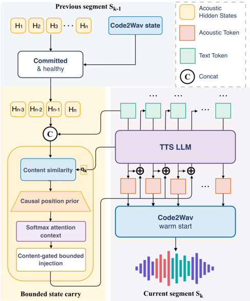

> [!abstract] arXiv · 2026 · Preprint
> **Rime Wen et al.** (X Square Robot) · [→ Paper](https://arxiv.org/abs/2608.18661) · Demo: ? · Code: ✓
>
> Wraps a pretrained Qwen3-TTS model, with its weights unchanged, in a strictly causal inference procedure that speaks text as it arrives token by token from an upstream LLM, with no lookahead. A frontend holds back ambiguous spans and closes segments against the acoustic budget, and acoustic state is carried across segment boundaries so that consecutive segments sound continuous.

## Problem

Most "streaming" TTS systems stream audio out but wait for a full sentence (or a fixed chunk) of text before starting, so their latency stays tied to how fast the upstream language model writes. The authors call these systems pseudo-streaming. Methods that accept streaming text (LiveSpeech, SyncSpeech, SpeakStream, prosodic-boundary-aware streaming, MagpieTTS-LF) still rely on some future tokens. True zero-lookahead synthesis must solve three problems at once. The first is pronunciation under partial input: "He finished 3" may continue as "3 laps" (three) or "3rd" (third), and audio already played cannot be revised. The second is segmentation: cutting only at punctuation creates many tiny segments, while a fixed window cuts at linguistically arbitrary points once the KV-cache budget fills. The third is continuity: a segment synthesized from a fresh state must re-establish pitch and timbre, so the seam between segments is audible.

## Method

The system runs on Qwen3-TTS (Qwen3-TTS-12Hz-1.7B). Its Talker is an autoregressive LM that emits discrete 12 Hz acoustic tokens, and its Code2Wav module decodes them into a waveform. The paper chooses this backbone because acoustic output is countable, decoding state can be transferred, and remaining KV-cache capacity can be observed. The main comparison describes the offline reference and X2Streaming-TTS as using "identical model weights" (§4.2), and the paper reports no training stage. All contributions are inference-time mechanisms around the unchanged backbone. The paper does not say whether the projection used to map states into a shared space (§3.2.2) has learned parameters.

**Causal commitment (frontend).** It has two parts.
- *Uncertainty-aware semantic readiness* (§3.1.1): the incoming buffer is split into a releasable prefix and an unresolved suffix using deterministic closure rules for numbers, units, symbols, abbreviations and punctuation. A span is released only when no admissible continuation could change how it is pronounced. It is then normalized and released atomically and never revised.
- *Capacity-adaptive punctuation-aware segmentation (CAPS)* (§3.1.2): the authors first write segmentation as an offline constrained optimization, with a penalty per segment plus a tiered boundary cost (sentence-final, clause-level, weaker punctuation, hard break), subject to each segment fitting the cache capacity B. This offline problem can be solved exactly by dynamic programming. Online, CAPS keeps an exponential moving average of the realized acoustic-to-text expansion ratio (acoustic decoding steps per text token, clipped to [2, 10]) and uses it to predict a token capacity per segment. A segment closes at a punctuation boundary of tier l once its length reaches a fraction α_l of the predicted capacity, (α1, α2, α3) = (0.7, 0.8, 0.9), or at a hard cut when capacity is reached. A short proof bounds the number of segments at 1/α1 times the minimum plus one (about 1.43x). The authors argue that zero lookahead is affordable because speech takes many more decoding steps than text tokens, so voicing the current text leaves time for new tokens to arrive.

**Causal speech-state inheritance (§3.2).** When a segment ends, a health check is run. The predecessor must have received complete input, consumed all admitted text, terminated normally, had an expansion ratio within [1, 12], and left an intact snapshot. If it passes, two states are carried forward along independent paths:
1. The complete Code2Wav state bundle (KV cache, convolution and transposed-convolution states, frame index) warm-starts waveform decoding of the next segment.
2. The trailing H = 4 Talker hidden states are concatenated with the new segment's token-aligned representations to form a bounded memory. Attention over this memory uses a fixed prior: zero weight on future positions, a quadratic decay over the nearest four positions, and a constant log 0.1 bias beyond that. The attended context is added to the Talker hidden state through a gate whose gain is bounded between 0.0075 and 0.015 and scales with attention concentration. This bounds the perturbation explicitly.

At most two text segments can be queued. Acoustic decoding stays sequential, so each segment starts only after the inherited state from the previous one is available.

## Key Results

All evaluations feed text tokens at a fixed rate. A deployed upstream LLM may emit tokens at a variable rate.

**Intelligibility and long-text robustness (Table 1, % error, lower is better).** The cleanest comparison is with the offline Qwen3-TTS-12Hz-1.7B reference, which uses the same weights. X2Streaming-TTS has lower error on 3 of 8 conditions: SEED ZH CER 0.78 vs 1.10, MiniMax ZH CER 0.78 vs 0.87, and long-text 1x 2.55 vs 3.95. Its largest regression is 0.62 points (long-text 2x, 3.67 vs 3.05). The other regressions are SEED EN WER 1.93 vs 1.43, MiniMax EN 1.86 vs 1.85, 5x 4.08 vs 4.01, and 10x 4.36 vs 3.93. Among the chunk-streaming baselines (FireRedTTS-2, CosyVoice 2-S, CosyVoice 3-S), it has the lowest error on 6 of 8 conditions. CosyVoice 3-S is better on SEED EN (1.68 vs 1.93) and long-text 2x (3.36 vs 3.67). At 10x, error is 4.36 against 5.12 to 5.48 for the streaming baselines, though the offline Qwen3-TTS reference is lower (3.93).

**Causal commitment (Table 2).** In online replay on 59 passages, CAPS uses 430 segments with a 0.54% hard-cap share and 76.93% budget utilization. Punctuation-only segmentation produces 3,151 segments at 11.77% utilization. A fixed window produces 401 segments at 92.48% utilization, but 87.13% of them are hard cuts. A fixed-ratio policy produces 470 segments with a 1.70% hard-cap share and 78.90% utilization, so it has slightly higher utilization than CAPS. On boundary quality against human annotations at a matched budget, CAPS reaches F1 0.952 (miss 0.057, false split 0.036). SaT-3L, a text segmenter allowed up to 48 future subwords and used only as a reference, reaches F1 0.940.

**Boundary continuity and long-passage stability (Table 3).** Compared with the three chunk-streaming systems, X2Streaming-TTS has the lowest pitch jump (22.61 Hz) and energy jump (1.66 dB) at the 954 boundaries. Its PBD is 0.1092, with a bootstrap CI that does not overlap FireRedTTS-2's 0.1915. It also has the highest ECAPA centroid similarity (0.9511) and UTMOS (3.92) over fixed 10 s windows. FireRedTTS-2 has the best boundary metrics among the baselines but only 0.5205 speaker similarity over long passages. The offline Qwen3-TTS reference is not included in this table.

**Symbols and prefix ambiguity (Table 4).** On identical symbol-heavy inputs, X2Streaming-TTS scores CER 2.00%, 73.3% fully correct readings, 93.33% listener-judged meaning preservation, UTMOS 4.025 and MOS 3.802. The best baseline on CER, Read and Sem. is CosyVoice 3-S (6.65%, 40%, 60%). The best baseline on MOS is FireRedTTS-2 (3.629). Numeric and streaming-ambiguity items reach 0% CER and 100% correct readings. Subjective ratings come from 120 listeners. The number of test items is not reported.

**Latency (Figure 3).** On one RTX 5090 with a BF16 engine, median client-side time to first audio token is 15.8 ms for a single request. It rises to 38.5, 50.2, 76.3 and 118.6 ms at 8, 16, 32 and 64 concurrent requests, and to 260.8 ms at 128. Baseline latencies are not measured.

## Novelty Assessment

The backbone is unchanged. The contribution is an inference procedure: a strictly causal release-and-segment controller, plus a recipe for carrying decoder and LM state across segment boundaries. Parts of the frontend are classical engineering, such as deterministic text-normalization closure rules and tiered punctuation thresholds. The new pieces are treating segmentation as a capacity-constrained problem with online feedback on the expansion ratio, with a simple fragmentation bound, and the bounded, causally masked injection of previous Talker states alongside a full Code2Wav warm start. The idea of holding back ambiguous spans until their pronunciation is resolved is simple and well motivated. Table 4 gives direct evidence that it helps.

The evaluation has gaps. The paper claims that removing either mechanism causes a measurable deficiency, but the tables contain no ablation that removes speech-state inheritance or causal commitment from the same system. The continuity results compare against other systems only. Latency is measured for the proposed system only, and the continuity and long-passage tables omit the offline Qwen3-TTS reference.

## Field Significance

Moderate — The paper shows that a pretrained codec-LM TTS model can be driven with zero text lookahead at near-offline intelligibility. It does this purely through inference-time commitment and state-carrying mechanisms, so a streaming-text frontend can be separated from model training. The evidence comes from one backbone, with fixed-rate token arrival and mostly Mandarin continuity data. That limits how far the results generalize.

## Claims

- **supports:** Strict zero-lookahead streaming-text TTS can match offline intelligibility closely when the acoustic decoder takes many more steps per text token than text takes to arrive, so speaking the observed prefix leaves time for new text.
  > *Evidence:* With weights identical to offline Qwen3-TTS-12Hz-1.7B, token-level input yields lower error in 3 of 8 conditions (e.g. SEED ZH CER 0.78 vs 1.10). The largest regression is 0.62 points (long-text 2x). *(§3, §4.2, Table 1)*
- **supports:** Withholding text spans whose pronunciation is still ambiguous until later tokens resolve them reduces normalization errors in incremental TTS.
  > *Evidence:* On symbol-heavy inputs, the uncertainty-aware frontend reaches CER 2.00% and 73.3% fully correct readings, against 6.65% and 40% for the strongest chunk-streaming baseline. Numeric and prefix-ambiguity items reach 0% CER. *(§3.1.1, §4.5, Table 4)*
- **refines:** Segmentation for streaming synthesis works best when it weighs linguistic boundary strength against the remaining acoustic generation budget, rather than using either punctuation or a fixed window alone.
  > *Evidence:* Capacity-adaptive punctuation-aware segmentation reaches 76.93% budget use with a 0.54% hard-cut share and boundary F1 0.952. Punctuation-only segmentation uses 11.77% of the budget (F1 0.199), and a fixed window has 87.13% hard cuts (F1 0.017). *(§3.1.2, §4.3, Table 2)*
- **supports:** Carrying waveform-decoder state and a short window of acoustic LM hidden states across segment boundaries reduces audible pitch and energy discontinuities in segmented streaming synthesis.
  > *Evidence:* With a Code2Wav warm start and H = 4 inherited Talker states, boundary pitch and energy jumps are 22.61 Hz and 1.66 dB (PBD 0.1092), against PBD 0.1915 to 0.3479 for chunk-streaming baselines. No within-system ablation is reported. *(§3.2, §4.4, Table 3)*
- **complicates:** Good continuity at segment boundaries does not imply consistent speaker identity over long streamed passages, so the two need to be measured separately.
  > *Evidence:* FireRedTTS-2 has the best boundary metrics among the baselines (PBD 0.1915) but only 0.5205 ECAPA centroid similarity over 10 s windows, against 0.9304 and 0.9264 for CosyVoice 2-S and CosyVoice 3-S. *(§4.4, Table 3)*

## Limitations and Open Questions

> [!warning] No within-system ablation
> The paper credits speech-state inheritance with removing boundary pitch discontinuities and causal commitment with preventing capacity-forced cuts. However, Table 3 compares only against other chunk-streaming systems, and Table 2 compares segmentation policies without measuring their effect on synthesized audio. The individual contribution of each mechanism to final speech quality is therefore not isolated.

- Text arrives at a fixed rate in all experiments. Behaviour under bursty or stalled upstream LLM output is not evaluated.
- Segmentation and continuity data are 59 Mandarin passages from an unnamed Chinese TTS corpus. The symbol test set is in-house, and its size and language mix are not reported.
- Latency is reported only for X2Streaming-TTS. No end-to-end latency comparison with the chunk-streaming baselines is made under the same serving setup.
- The method depends on backbone properties (countable tokens, transferable decoder state, observable cache capacity). Applying it to other TTS architectures, such as flow-matching or non-autoregressive decoders, is not tested.
- The closure rules for readiness are hand-written. Their coverage beyond numbers, units, symbols and abbreviations, and across languages, is not characterised.
- The fragmentation bound concerns segment count only and, as the authors note, does not guarantee physical KV-cache safety. The EMA predictor can under-estimate, which is handled by a larger update after overflow.

## Wiki Connections

- [[streaming-tts|Streaming TTS]] — Shows strict token-level, zero-lookahead streaming-text synthesis with measured time to first audio token from 15.8 ms (single request) to 260.8 ms (128 concurrent).
- [[autoregressive-codec-tts|Autoregressive Codec TTS]] — Steers an unchanged Qwen3-TTS Talker, an AR LM over 12 Hz codec tokens, by injecting inherited hidden states and warm-starting its Code2Wav decoder across segments.
- [[subjective-evaluation|Subjective Evaluation]] — Collects MOS and meaning-preservation judgments from 120 listeners on symbol and prefix-ambiguity inputs.
- [[2601.15621|Qwen3-TTS]] — The backbone. Its Talker and Code2Wav states are inherited across segments, and its offline 1.7B model with identical weights is the main reference.
- [[2505.17589|CosyVoice 3]] — Chunk-streaming baseline (CosyVoice 3-S). It is the strongest comparator on SEED EN WER and long-text 2x, but has larger boundary discontinuities.
- [[2412.10117|CosyVoice 2]] — Chunk-streaming baseline (CosyVoice 2-S) on intelligibility, continuity and symbol tests.
- [[2509.02020|FireRedTTS-2]] — Chunk-streaming baseline with good boundary continuity but weak long-passage speaker similarity.
- [[2025.acl-long.313|F5-TTS]] — Offline baseline in the intelligibility and long-text comparison.
- [[2406.02430|Seed-TTS]] — Source of the SEED-TTS-Eval intelligibility test set.
- [[2603.06444|Prosodic Boundary-Aware Streaming TTS]] — Related streaming-text TTS that still uses limited future words. The paper contrasts it with its own strict zero-lookahead setting.
