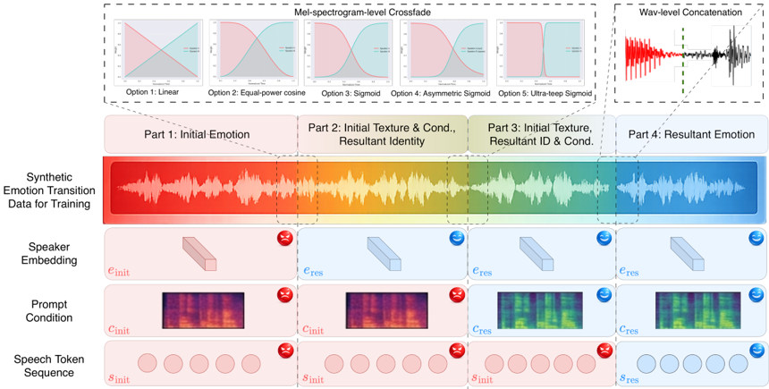
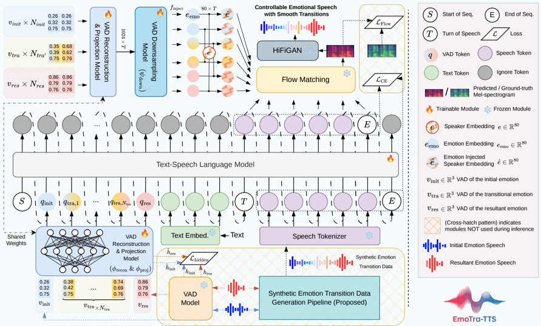

> [!abstract] arXiv · 2026 · Preprint
> **Tianchi Liu et al.** (LIGHTSPEED / National University of Singapore / Nanyang Technological University) · [→ Paper](https://arxiv.org/abs/2608.23791) · Demo: ✓ · Code: ✓
>
> EmoTra-TTS adapts CosyVoice2 to render a user-specified emotion transition inside one utterance, driven by an interpolated Valence-Arousal-Dominance (VAD) trajectory that conditions both the speech-token LLM and the flow decoder, and trained on synthetic transition audio made by blending flow-decoder passes.

## Problem

Emotional TTS systems usually condition an utterance on one categorical label or one static embedding. Finer-grained systems exist (spherical VAD vectors, word-level emotion prompts, activation steering), but none lets a user specify a continuous emotion trajectory that rises, shifts and settles within a single utterance. LLM-based TTS may vary prosody from the text, but that variation is not controllable. The authors name three obstacles: natural recordings of intra-utterance transitions are scarce and hard to elicit from actors; a two-stage LLM plus flow-decoder system needs time-aligned emotion signals at both stages; and injecting a new conditioning signal into a pretrained decoder can push it outside its operating range and destroy content.

## Method

EmoTra-TTS is built on CosyVoice2-0.5B, an autoregressive LLM over supervised semantic speech tokens followed by a conditional flow matching (CFM) decoder and a HiFi-GAN vocoder. Emotion is represented as a point in a continuous VAD space in [0,1]^3, and the task is to move from an initial emotion to a resultant emotion over the utterance.

**Synthetic transition data (§3.2).** The base CosyVoice2 generates one speech-token sequence under the initial emotion. That shared sequence is decoded three times by the flow decoder with different speaker embeddings and prompt conditions taken from emotional reference speech: initial, a "bridge" pass (initial prompt context with the resultant speaker embedding), and resultant. Because the token sequence is shared, the three mel spectrograms are frame-aligned and can be blended with sigmoid crossfades (steepness 12, chosen by informal author listening over five curves, Appendix F). A fourth, purely resultant-emotion segment is appended after vocoding. Whisper large-v3 filters samples with CER above 0.10, and pairs must differ by at least 0.35 in VAD (Chebyshev distance). VAD labels come from a pretrained wav2vec2 speech emotion recognition model. The source corpus is EmoVoice-DB (five speakers, seven emotions), first filtered so that each sample's predicted VAD falls inside a per-category range; the result is about 100K transition utterances.

**Stage 1: LLM with temporal VAD tokens (§3.3).** A small projection network (LayerNorm inside a two-layer MLP) maps a VAD vector to the LLM embedding space. The initial and resultant VADs plus three linearly interpolated intermediate points become five VAD tokens prepended to the text tokens. The authors report that using only the two endpoints produced perceptibly abrupt transitions in preliminary experiments. Training uses the speech-token cross-entropy plus an auxiliary L1 loss (weight 0.1) that reconstructs the wav2vec2 SER features of the initial and resultant reference speech from the VAD tokens, which anchors the VAD embeddings to affective acoustic features. Figure 2 marks the text-speech LM as trainable in this stage.

**Stage 2: frame-level emotion injection in the frozen flow decoder (§3.4).** Emotion enters through the decoder's existing speaker-embedding channel: a frame-level VAD trajectory (piecewise linear interpolation) passes through the frozen Stage 1 projection and reconstruction modules and a trainable downsampling MLP (1024 to 256 to 80, zero-initialized output), and is added to the speaker embedding, which becomes time-varying. The key design is "direction-magnitude decoupled injection" (Dir-Mag): a LayerNorm re-normalizes the MLP output and a fixed, non-trainable scale (0.07) sets the injection norm close to the speaker-embedding norm (about 0.62). The MLP learns the emotion direction, while the magnitude cannot grow. All decoder weights stay frozen; only about 280K MLP parameters and 160 LayerNorm affine parameters are trained, with the standard CFM objective and 0.2 classifier-free-guidance dropout. A separate model is trained per voice. At inference the system is single-pass: 642M parameters versus 639M for CosyVoice2.

## Key Results

Evaluation uses a 200-sentence English test set whose transition narratives and target VADs were generated by ChatGPT-5.2. A blind MOS test (10 raters, about 250 ratings per system) splits MOS into MOS-Qua (naturalness and quality), MOS-Emo (emotion adequacy) and MOS-Tra (transition smoothness); speaker similarity and Whisper WER are automatic (Table 2).

- **Transition smoothness.** EmoTra-TTS has the highest MOS-Tra in Table 2 (3.63 ± 0.17). All open-source baselines score 2.80 or lower; the strongest is Qwen3-TTS with prompt-based segment concatenation (2.80), and MOSS-TTS with concatenation is lowest (1.94). This gives the reported 30% to 87% relative gain (3.63 against 2.80 and 1.94). The paper's own synthetic training data (multi-pass blending) scores 3.55.
- **Where EmoTra-TTS is not best.** MOS-Qua: neutral Qwen3-TTS (4.02), MOSS-TTS (3.98) and CosyVoice2 (3.87) are higher, as are the synthetic data (3.58) and the LLM-only ablation (3.62); EmoTra-TTS (3.54) is the highest only among systems with explicit emotion rendering (categories d and e). MOS-Emo: the synthetic data (4.05), prompt-concatenation MOSS-TTS (3.89), CosyVoice2 (3.82), Qwen3-TTS (3.70) and WeSCon (3.53) are all at or above EmoTra-TTS (3.52). SIM: neutral MOSS-TTS is highest (0.754). WER: concatenated Qwen3-TTS is lowest (0.92%).
- **Concatenation trade-off.** Segment concatenation gives strong per-segment emotion but abrupt joins: MOSS-TTS reaches MOS-Emo 3.89 with MOS-Tra 1.94 and its MOS-Qua drops from 3.98 (neutral) to 2.85.
- **Dual-stage ablation.** Relative to the neutral CosyVoice2 baseline, LLM-only training raises MOS-Emo from 2.53 to 2.70 and MOS-Tra from 2.32 to 2.58; adding flow-stage training raises them to 3.52 and 3.63 (§5.3).
- **Injection variants (Table 8).** Among seven designs, a linear additive projection keeps the best quality (MOS-Qua 3.60, WER 1.65%) but has lower MOS-Tra (3.33) than Dir-Mag (3.63). An unconstrained MLP (MOS-Qua 2.10, WER 20.09%), FiLM (1.96, 53.35%) and MLP+LoRA on the decoder (1.03, 107.15%) collapse content; hard norm clamping recovers content partly (3.29, 3.89%) with weaker emotion. The authors trace the MLP and FiLM failures to injection norms about 2x and 3 to 5x the speaker norm.
- **Fixed scale (Table 3).** A scale of 0.04 keeps quality (MOS-Qua 3.60) with lower MOS-Tra (3.31); 0.10 collapses (MOS-Qua 2.59, WER 5.30%, MOS-Tra 1.85).
- **Preference tests.** Against the four concatenation and word-level baselines, EmoTra-TTS wins 67.5% to 79.5% of pairs (11 raters, 160 pairs; Figure 3). Against commercial systems (12 raters, 80 pairs, a separate pool added during revision), it wins 72.0% overall against GPT-4o mini TTS and 64.4% against ElevenLabs v3, with every 95% CI lower bound above 50% (Table 4). No MOS is reported for the commercial systems.
- **Objective smoothness and cost.** EmoTra-TTS has the lowest Prosodic Jerk Ratio (JR-F0 0.025, a new F0 second-difference metric) among the compared systems (Table 7). Latency matches CosyVoice2 (1.74 s vs. 1.75 s), while the multi-pass data pipeline needs 2.92 s and 5.09 GB (Table 5).

The baselines receive the transition specification through each system's own interface (instructions, concatenated prompts, word-level prompts), so the comparison measures controllability under different input formats rather than a matched-conditioning contest.

## Novelty Assessment

The method combines three ideas that are each recognizable from adjacent work: synthesizing training data with the model's own decoder, VAD conditioning of an LLM-based TTS, and bounded additive conditioning of a frozen generative model (the paper cites ControlNet zero-init and DoRA's direction-magnitude split). The genuinely new parts are the multi-pass flow blending trick, which exploits the content-invariance of the flow decoder to get frame-aligned emotion transitions without recordings, and the Dir-Mag injection, whose value is supported by a seven-variant ablation with norm measurements rather than asserted. The appendix failure analysis (decoder drift, LoRA content collapse, magnitude mismatch, FiLM compensation, gradient suppression under clamping) is a useful empirical record for anyone conditioning a frozen flow decoder. The authors state that the paper is accepted to EMNLP 2026 (Main Conference); this page summarizes the arXiv preprint.

The evidence is narrower than the framing. Training data come entirely from one AI-generated corpus with five speakers, one model is trained per voice, and the system is never tested on unseen speakers. Transitions are linear between two emotion points. The gain is concentrated in MOS-Tra; on per-segment emotion adequacy the model is below simple prompt concatenation and slightly below its own synthetic training data.

## Field Significance

Moderate — EmoTra-TTS demonstrates explicit, user-specified intra-utterance VAD trajectory control in an LLM-plus-flow TTS, evaluated against both open-source and commercial systems, and shows that self-generated blended transition data can train such control. Its documented failure modes for conditioning frozen flow decoders, and the norm-parity explanation for them, are reusable beyond emotion.

## Claims

- **supports:** Emotion transitions within an utterance can be learned from synthetic training data built by decoding one shared speech-token sequence under different emotional conditions and crossfading the frame-aligned outputs.
  > *Evidence:* Multi-pass flow blending on EmoVoice-DB yields about 100K transition utterances; the blended data alone score MOS-Tra 3.55 and the model trained on them scores 3.63, against at most 2.80 for open-source baselines. *(§3.2, §5.2, Table 2)*
- **refines:** Adding a conditioning signal to a frozen flow-matching decoder preserves content only when the injection norm stays near the norm of the existing conditioning signal; learnable modulation and soft constraints let the injection magnitude grow until content collapses.
  > *Evidence:* An unconstrained MLP reaches about 2x the speaker-embedding norm (WER 20.09%), FiLM inflates it 3 to 5x (WER 53.35%), while LayerNorm with a fixed scale holds about 1.07x (WER 1.77%); raising the fixed scale to give about 1.44x the norm drops MOS-Qua to 2.59. *(§5.4, Table 3; Appendix E, Table 8)*
- **complicates:** Generating emotional segments separately and concatenating them trades per-segment emotion strength against transition smoothness and overall naturalness.
  > *Evidence:* Prompt-based concatenation gives the highest baseline MOS-Emo (MOSS-TTS 3.89) but the lowest MOS-Tra (1.94), and MOS-Qua falls from 3.98 (neutral) to 2.85; EmoTra-TTS reaches MOS-Tra 3.63 with a lower MOS-Emo of 3.52. *(§5.2, Table 2)*
- **supports:** In a two-stage LLM plus flow-decoder TTS, emotion conditioning at the acoustic decoder contributes more to rendered emotion than conditioning the token-level LLM alone.
  > *Evidence:* LLM-only training moves MOS-Emo from 2.53 to 2.70 and MOS-Tra from 2.32 to 2.58; adding frame-level injection in the flow decoder raises them to 3.52 and 3.63. *(§5.3, Table 2)*
- **complicates:** Parameter-efficient adapters applied to all decoder layers can be more destructive than adding a single conditioning signal when adapting a frozen flow decoder to a new control axis.
  > *Evidence:* MLP plus rank-8 LoRA on all 336 decoder layers gives MOS-Qua 1.03 and WER 107.15%, while the same MLP added through the speaker channel with Dir-Mag keeps WER at 1.77%. *(Appendix E.3, Table 8)*

## Limitations and Open Questions

> [!warning]
> All training data derive from EmoVoice-DB, an entirely AI-generated corpus with five speakers; a separate model is trained per voice and generalization to unseen speakers or other languages is not tested.

- The test sentences and their target VADs are generated by an LLM, and the MOS panel is 10 raters; the commercial comparison uses a different rater pool and is reported only as preference rates.
- Transitions are modeled as one linear move between two VAD points; the authors note this is a first-order approximation of emotion dynamics and that control is unstable for small VAD differences.
- The synthetic training data come from the same CosyVoice2 backbone, so the learned transitions inherit its blending behavior; the crossfade curve was chosen by informal author listening only.
- Per-segment emotion adequacy (MOS-Emo) is below prompt-concatenation baselines and WeSCon, so the gain is in smoothness rather than emotion strength.
- JR-F0 is introduced as an objective smoothness metric but is not validated against listener ratings.
- The code (data synthesis and training pipelines) is linked from the first page, but the ethics statement restricts it to non-commercial academic research.

## Wiki Connections

- [[emotion-synthesis|Emotion Synthesis]] — Introduces continuous VAD trajectory control for emotion transitions inside a single utterance.
- [[autoregressive-codec-tts|Autoregressive Codec TTS]] — Trains the CosyVoice2 speech-token LLM with prepended interpolated VAD tokens and an SER feature reconstruction loss.
- [[flow-matching|Flow Matching]] — Keeps the CFM decoder frozen and trains only a bounded frame-level emotion injection through its speaker channel, with a detailed failure analysis of alternatives.
- [[subjective-evaluation|Subjective Evaluation]] — Splits MOS into quality, emotion adequacy and transition smoothness and adds paired preference tests against open-source and commercial systems.
- [[2412.10117|CosyVoice 2]] — Backbone model; also a neutral, instruction and concatenation baseline.
- [[2504.12867|EmoVoice]] — Instruction baseline whose EmoVoice-DB corpus is the sole source of training data.
- [[2601.15621|Qwen3-TTS]] — Strongest open-source transition baseline (prompt-based concatenation, MOS-Tra 2.80).
- [[2603.18090|MOSS-TTS]] — Baseline whose concatenated output shows the highest baseline emotion adequacy but the lowest transition smoothness.
- [[neurips-2025-SYcggdxX6W|WeSCon]] — Word-level emotion control baseline that varies emotion within an utterance but with discrete boundaries.
- [[2601.03170|TED-TTS]] — Related segment-level approach to intra-utterance emotion variation, discussed but not evaluated.
- [[2601.22873|EmoShift]] — Activation-steering emotion control cited as a contrasting route to fine-grained emotion.
- [[2602.03420|CoCoEmo]] — Composable activation-steering emotion control cited as related work.
