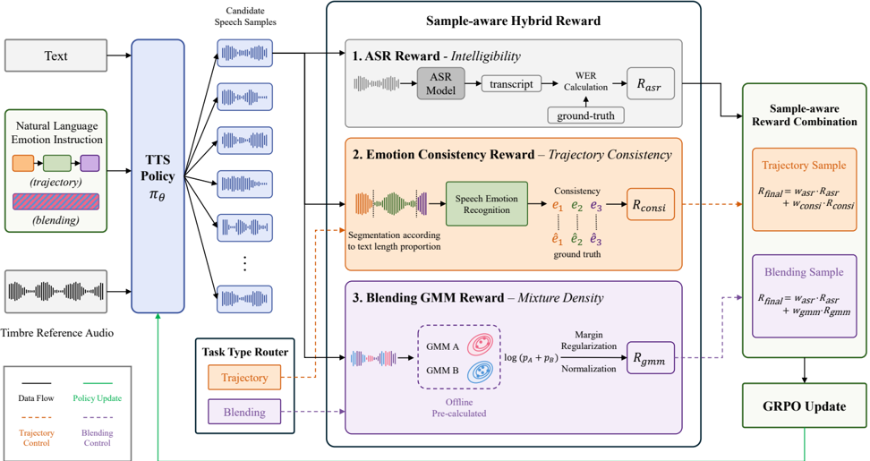

> [!abstract] arXiv · 2026 · Preprint
> **Yan Zhou et al.** (Institute of Computing Technology, Chinese Academy of Sciences / University of Chinese Academy of Sciences) · [→ Paper](https://arxiv.org/abs/2608.30325) · Demo: ✓ · Code: ✓
>
> HybridEmo post-trains the CosyVoice 3 speech-token LLM with SFT and then GRPO under a sample-aware hybrid reward, so that one instruction-following TTS policy can render ordered emotion trajectories and concurrent emotion blends within a single utterance.

## Problem

Instruction-following emotional TTS systems mostly treat emotion as one utterance-level label. Real speech can change emotion across an utterance (a trajectory, such as sad then happy) or mix two emotions at once (a blend). The authors argue that both forms face a supervision mismatch. Token-level cross-entropy fits target speech tokens but never scores whether the requested emotion pattern was realized. Existing speech RL rewards score global properties (intelligibility, speaker similarity) or a single utterance-level emotion posterior. Such rewards cannot locate a missing or misordered stage in a trajectory, and cannot tell whether two target emotions coexist in a blend.

## Method

HybridEmo starts from the 0.5B CosyVoice 3 checkpoint ([[2505.17589|CosyVoice 3]]): an autoregressive speech-token LLM followed by a flow-matching acoustic generator. Only the LLM is trained. The speech tokenizer and the flow-matching generator stay frozen. The LLM sees the text and a natural-language emotion instruction. The timbre reference enters only through the acoustic generator at decoding time.

Training has two stages. Stage one is SFT with token-level cross-entropy on real multi-emotion speech. Stage two treats the SFT model as a GRPO policy. For each condition it samples 8 speech-token rollouts at temperature 0.6. The frozen generator decodes them, and the policy is updated with group-relative advantages under a KL constraint to the SFT reference. RL conditions carry text, instruction, and emotion structure, but no target waveform.

The reward is routed by sample type. Both types share an ASR reward, `clip(1 - tanh(3·WER))`, computed with SenseVoice (following the ASR-reward recipe of [[2412.10117|CosyVoice 2]]). Trajectory samples then add a segment-aligned consistency reward. The generated waveform is split into stages in proportion to the text length of each span. emotion2vec+ large scores the target-emotion posterior for each segment. The reward is `β·mean + (1-β)·min` over stages (β = 0.7), so a high average cannot hide a failed stage. Blending samples instead add a GMM mixture-density reward. Offline, the base CosyVoice 3 synthesizes single-emotion speech. Clips with emotion2vec+ confidence of at least 0.8 are kept, and their frame-level emotion features are projected to 6 dimensions with LDA. Isolation Forest removes outliers, and a 3-component full-covariance GMM is fit per emotion. Online, each frame of a candidate is scored by the log-sum-exp of the two target densities (a union score). A weaker-target margin penalizes utterances in which one target's average pair-normalized share falls below ρ = 0.05. The score is standardized with running statistics and passed through a sigmoid. Reward weights are 0.5 (ASR), 0.5 (trajectory consistency) and 0.3 (GMM).

The data are built with LLM annotation. The SFT corpus is the English portion of Emilia: 119,981 trajectory and 4,115 blending utterances, 383.6 h in total. Qwen3-Omni-30B-A3B-Captioner describes each clip. MiniMax-M2.5 then screens for emotional speech, assigns a 7-class emotion label, identifies trajectory or blending structure, and writes the instruction. Trajectories have 1 to 3 spans, and blends pair 2 distinct non-neutral emotions (12 pairs). MiniMax-M2.5 also generates MultiEmo-RL (12,000 trajectory and 2,400 blending text-instruction conditions). MultiEmo-Test has 720 conditions: 200 each for 1-, 2- and 3-stage trajectories, plus 120 blends. Each test condition is paired with a reference voice from the English Seed-TTS eval set. SFT runs 5 epochs and GRPO 1 epoch (via verl), on 4 H800 GPUs.

## Key Results

Emotion control is scored on 1 to 5 rubrics by an LLM judge (Qwen3-Omni-30B-A3B-Instruct). WER uses whisper-large-v3, quality uses UTMOSv2, and speaker similarity uses ERes2Net. The judge and the ASR model differ from the models used in the reward (emotion2vec+ and SenseVoice). Baselines are CosyVoice 3 0.5B, EmoVoice 0.5B and 1.5B, and Qwen3-TTS-12Hz-1.7B-VoiceDesign. Qwen3-TTS gets a designated voice rather than the speech prompt, so the authors treat it as an external reference, not a matched comparison.

- **Trajectory (Table 2).** Macro correctness rises from 3.24 (CosyVoice 3) to 3.33, with gains at 1, 2 and 3 stages. Macro naturalness rises from 2.40 to 2.50. WER is 1.87% (CosyVoice 3: 1.91%) and UTMOS is 3.21 (3.20). Speaker similarity drops from 0.69 to 0.66. Qwen3-TTS scores higher on macro correctness (3.44) and naturalness (2.57).
- **Blending (Table 3).** Intensity rises from 3.47 to 3.71 and naturalness from 3.06 to 3.24. HybridEmo ties Qwen3-TTS on intensity (3.71) and trails it on naturalness (3.29). WER rises slightly, from 0.30% to 0.37%. UTMOS is 3.17 against 3.18, and speaker similarity drops from 0.70 to 0.64.
- **Human preference (Figure 3).** Four trained listeners judged 20 conditions per pair (80 judgments per pair). Win/tie/loss was 46/40/14 against CosyVoice 3 and 49/34/17 against EmoVoice-0.5B. Against Qwen3-TTS it was 35/29/36, which is essentially balanced.
- **Ablation (Table 4).** SFT alone gives small gains (trajectory correctness 3.28, blending intensity 3.50). Hybrid GRPO applied directly to CosyVoice 3 without SFT raises WER (2.08% trajectory, 0.71% blending). A trajectory-only GRPO variant beats joint HybridEmo on trajectory correctness (3.35 vs 3.33) and naturalness (2.53 vs 2.50). Removing the weaker-target margin lowers blending naturalness from 3.24 to 3.05.
- **Tokenizer analysis.** The CosyVoice 3 tokenizer was used to reconstruct RAVDESS. emotion2vec+ embeddings of original and reconstructed audio have a mean cosine similarity of 0.9441, which suggests the discrete tokens keep most emotion information.

The paper describes the gains as "significant", but reports no statistical test. The trajectory gains over CosyVoice 3 are small on a 5-point scale (0.06 to 0.12 per setting).

## Novelty Assessment

The new element is the reward design, not the model. The architecture is CosyVoice 3 unchanged, and GRPO with an ASR reward is an existing recipe. Two pieces are new. First, a stage-segmented consistency reward combines the mean with the weakest stage, aligning stages by text-length proportion with no timestamps. Second, a frame-level GMM mixture-density reward with a weaker-target margin scores concurrent emotion blends. Routing both through one policy by sample type is also new. The explicit split of multi-emotion control into ordered trajectories and concurrent blends, with a matching test set, is a useful framing.

The evidence is weaker than the method. Emotion scores come from a single LLM judge whose agreement with human ratings is not measured. The human study is small. The test conditions and the training annotations come from the same LLM pipeline (MiniMax-M2.5). Against the strongest external baseline (Qwen3-TTS), HybridEmo is at parity at best, although that comparison is not matched.

## Field Significance

Moderate — The paper shows that RL rewards shaped to the structure of the target (per-stage minimum for sequences, density union with a balance margin for mixtures) can improve emotion control beyond utterance-level emotion rewards in an instruction-following AR speech-token TTS. It also defines trajectory and blending as two evaluable multi-emotion tasks. The size of the measured gains is modest and depends on an unvalidated automatic judge.

## Claims

- **supports:** Combining a supervised fine-tuning stage with subsequent RL post-training is more effective for new expressive-control tasks than applying RL directly to the base TTS model.
  > *Evidence:* Hybrid-reward GRPO applied straight to CosyVoice 3 reaches trajectory correctness 3.30 and blending intensity 3.50, and raises WER to 2.08% and 0.71%. The same GRPO after SFT reaches 3.33 and 3.71, with WER of 1.87% and 0.37%. *(§Ablation Study, Table 4)*
- **supports:** RL rewards that score emotion per segment and penalize the weakest segment improve multi-stage emotion trajectory rendering in instruction-following TTS more than SFT alone.
  > *Evidence:* Trajectory-GRPO and joint HybridEmo raise macro trajectory correctness to 3.35 and 3.33, against 3.28 for SFT and 3.24 for CosyVoice 3. The judge-scored gains appear at 1, 2 and 3 stages. *(§Automatic Evaluation Results, Table 2; §Ablation Study, Table 4)*
- **supports:** For concurrent emotion blending, a reward that keeps any single target emotion from dominating improves the perceived coexistence of emotions.
  > *Evidence:* Removing the weaker-target margin from the GMM mixture-density reward lowers blending naturalness from 3.24 to 3.05 and intensity from 3.71 to 3.66. *(§Ablation Study, Table 4)*
- **complicates:** Emotion-focused RL post-training of a speech-token LM can reduce speaker similarity even when the acoustic decoder that carries timbre stays frozen.
  > *Evidence:* ERes2Net speaker similarity falls from 0.69 to 0.66 on trajectories and from 0.70 to 0.64 on blends, relative to CosyVoice 3. The authors describe this as no noticeable degradation. *(§Automatic Evaluation Results, Tables 2 and 3)*
- **complicates:** Training one policy on several structurally different expressive-control tasks can trade a little per-task performance for coverage.
  > *Evidence:* The trajectory-only GRPO variant beats joint HybridEmo on trajectory correctness (3.35 vs 3.33) and naturalness (2.53 vs 2.50). Joint HybridEmo gives the best blending scores. *(§Ablation Study, Table 4)*

## Limitations and Open Questions

> [!warning]
> All emotion scores (correctness, naturalness, intensity) come from one LLM judge, Qwen3-Omni, with no reported agreement with human ratings. The paper reports no significance test for gains it calls "significant". The human preference study is small: 4 listeners, 20 conditions per pair.

- The trajectory reward places stage boundaries by text-length proportion. The authors state the assumption that text length roughly tracks speaking duration. Its error is not measured.
- Test conditions, RL conditions and SFT annotations all come from the same MiniMax-M2.5 / Qwen3-Omni pipeline. This may favor a model fine-tuned on that distribution. The judge (Qwen3-Omni-Instruct) is from the same model family as the SFT captioner.
- The Qwen3-TTS comparison uses a designated voice instead of a speech prompt, so neither the automatic nor the human comparison is matched.
- The work is English-only, with a 7-class emotion taxonomy, at most 3 trajectory stages, and blends of exactly 2 emotions.
- GMM anchors are fit on emotion speech synthesized by the base CosyVoice 3. The paper does not test whether anchors from real human emotional speech would score blends differently.
- The paper links a code repository. It does not state whether MultiEmo-Test, MultiEmo-RL or the annotated SFT corpus are released.

## Wiki Connections

- [[emotion-synthesis|Emotion Synthesis]] — Extends emotion control from one utterance-level label to ordered emotion trajectories and concurrent two-emotion blends.
- [[instruction-conditioned-tts|Instruction-Conditioned TTS]] — The policy is conditioned on natural-language emotion instructions that specify the multi-emotion pattern.
- [[rlhf-speech|RLHF Speech]] — GRPO post-training with routed, structure-aware emotion rewards and a shared ASR reward is the core contribution.
- [[autoregressive-codec-tts|Autoregressive Codec TTS]] — Only the autoregressive speech-token LLM of CosyVoice 3 is fine-tuned and RL-aligned; the tokenizer and flow-matching decoder stay frozen.
- [[subjective-evaluation|Subjective Evaluation]] — Includes a small pairwise win/tie/loss listening study with four trained listeners against three baselines.
- [[2505.17589|CosyVoice 3]] — Base model and main baseline; HybridEmo post-trains its 0.5B speech-token LLM.
- [[2504.12867|EmoVoice]] — Emotional TTS baseline at 0.5B and 1.5B, outperformed on judge-scored emotion metrics and in human preference.
- [[2601.15621|Qwen3-TTS]] — External VoiceDesign baseline without a speech prompt; HybridEmo trails it on trajectory correctness and reaches parity in human preference.
- [[2412.10117|CosyVoice 2]] — Source of the ASR-based content reward recipe that HybridEmo shares across both task types.
- [[2407.04051|FunAudioLLM]] — Provides SenseVoice, the ASR model used to compute the content reward.
- [[2312.15185|emotion2vec]] — emotion2vec+ large supplies the segment posteriors for the trajectory reward and the frame features for the GMM anchors.
- [[2509.17765|Qwen3-Omni]] — Its Captioner model annotates the SFT corpus, and its Instruct model serves as the emotion judge for evaluation.
- [[2407.05361|Emilia]] — Its English portion is the source of the multi-emotion SFT corpus.
