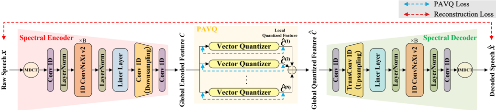

> [!abstract] arXiv · 2026 · Preprint
> **Fei Liu et al.** (University of Science and Technology of China) · [→ Paper](https://arxiv.org/abs/2609.03363) · Demo: ✓ · Code: ✗
>
> Replaces residual vector quantization in an MDCT-domain speech codec with several independent vector quantizers that all read the same encoder features and whose outputs are summed, which lets each codebook shrink to 128 entries and cuts bitrate by about 30% at comparable quality.

## Problem

Most neural speech codecs discretize encoder features with residual vector quantization (RVQ), where each quantizer codes the residual left by the previous one. The authors argue that this sequential dependence makes further bitrate reduction hard and gives individual quantizers no clear role, which limits use in tasks that need disentangled representations. Grouped RVQ (GRVQ, as in HiFi-Codec) adds parallelism by splitting channels, but each group still runs RVQ and the channel split is hard to interpret. Finite scalar quantization with a single quantizer (SQCodec) needs a very large codebook to be competitive, which works against low bitrate.

## Method

PACodec keeps the spectral codec design of the same group's MDCTCodec and changes the quantizer. The spectral encoder computes an MDCT spectrum (frame length 80, frame shift and frequency bins 40), applies a 1D convolution and layer normalization, then 8 cascaded 1D ConvNeXt v2 blocks, and finally downsamples with two 1D convolutions to 32-channel features. The total downsampling factor is 320, so the token rate is 50 Hz at 16 kHz and 150 Hz at 48 kHz. The decoder mirrors the encoder with transposed convolutions and reconstructs the waveform by inverse MDCT. The full model has 6.7M parameters.

The quantizer, parallel additive vector quantization (PAVQ), follows what the authors call a "global-local-global" design. Each of N independent VQs receives the same global encoded feature and picks its nearest codeword by Euclidean distance. The N local quantized features are then summed to form the global quantized feature passed to the decoder. Unlike RVQ, no quantizer depends on another; unlike GRVQ, there is no channel split, so every branch sees the full feature vector. The bitrate is the token rate times the summed log2 codebook sizes. The reported configuration uses N = 4 VQs of 128 entries each (28 bits per frame), giving 1.4 kbps at 16 kHz and 4.2 kbps at 48 kHz.

Training combines a PAVQ loss with a reconstruction loss. The PAVQ loss is the sum over branches of the squared Frobenius distance between each branch's quantized output and the shared encoder feature, so every branch is pulled toward the full feature rather than toward a residual. The reconstruction loss follows MDCTCodec: an adversarial term from a multi-resolution MDCT-based discriminator plus spectral terms (MSE on MDCT spectra, MSE plus MAE on mel-spectrograms). Training uses AdamW for 500 epochs.

## Key Results

Baselines (EnCodec, AudioDec, DAC, HiFi-Codec, APCodec, MDCTCodec, SQCodec) were all retrained with their official implementations. PACodec runs at 1.4 kbps on LibriTTS (16 kHz) and 4.2 kbps on VCTK (48 kHz). Baselines run at a "low" setting (1.5 / 4.5 kbps) and a "high" setting (2 / 6 kbps). SQCodec appears only at 1.5 kbps on LibriTTS, and HiFi-Codec only at the high setting (Table I).

- **LibriTTS, 16 kHz (Table I):** PACodec scores LSD 0.89 dB, STOI 0.93, UTMOS 3.80 and DNSMOS 3.26. It does not lead on any of these four metrics. MDCTCodec at 1.5 kbps is better on LSD (0.88), UTMOS (3.87) and DNSMOS (3.28) and ties on STOI (0.93). MDCTCodec at 2 kbps (LSD 0.86, STOI 0.94, UTMOS 3.88) and SQCodec at 1.5 kbps (UTMOS 3.88) also score higher on some metrics. PACodec is ahead of EnCodec, AudioDec, APCodec and HiFi-Codec at both settings on these metrics. Against DAC it is level or slightly ahead: LSD 0.89 vs 0.90, STOI equal to DAC at 2 kbps (0.93), DNSMOS equal (3.26), and UTMOS 3.80 vs 3.65/3.64.
- **LibriTTS ABX listening test (Fig. 2):** 40 native English listeners on Amazon Mechanical Turk compared 10 utterance pairs per method, with PACodec at 1.4 kbps against each baseline at 2 kbps. Preferences were statistically indistinguishable (p between 0.22 and 0.53) for EnCodec (42.5% vs 38.89%), AudioDec (41.43% vs 38%), DAC (37.27% vs 43.33%), MDCTCodec (41.71% vs 38.57%) and HiFi-Codec (36.67% vs 39.69%). PACodec was strongly preferred over APCodec (85.79% vs 13.68%, p < 0.01). The authors read this as parity with 2 kbps codecs at 600 bps less, a 30% saving.
- **VCTK, 48 kHz (Table I):** PACodec at 4.2 kbps scores LSD 0.78 dB, STOI 0.89, UTMOS 3.93 and DNSMOS 3.17. Against all 4.5 kbps baselines it is best on every one of the four metrics. Against the 6 kbps baselines it is best on LSD (next best 0.82, APCodec) and DNSMOS (next best 3.15, APCodec). It is not best on STOI, where DAC at 6 kbps is higher (0.91) and MDCTCodec at 6 kbps ties (0.89). Nor is it best on UTMOS, where APCodec (3.95) and DAC (3.94) at 6 kbps are higher. The authors frame this as a 1.8 kbps (30%) saving at "equal or better quality". That holds on LSD and DNSMOS, but on STOI and UTMOS the best 6 kbps baselines are slightly ahead.
- **Model size (Table I):** at 6.7M parameters, PACodec is the smallest codec in the table, just below MDCTCodec (6.8M). DAC has 76.5M and HiFi-Codec 63.6M.
- **Branch ablation, VCTK (Table II):** dropping one VQ from the sum at inference shows different roles. Without VQ1, WER rises from 0.03 to 0.75, CER from 0.01 to 0.59, STOI falls to 0.46 and speaker similarity to 0.22. Without VQ4, F0-RMSE jumps from 30.9 to 1114 cents and speaker similarity drops to 0.39, while WER rises less (0.19). Removing VQ2 or VQ3 causes moderate degradation: MCD reaches 2.44 and 2.20 dB, against 1.53 for the full model. The paper does not say which ASR or speaker-verification models were used for WER, CER and speaker similarity.
- **Fewer branches, VCTK (Table III):** dropping from 4 to 3 VQs (3.15 kbps) changes the metrics only slightly: LSD 0.79 vs 0.78, STOI 0.87 vs 0.89, UTMOS 3.89 vs 3.93, DNSMOS 3.16 vs 3.17. The paper does not state whether the 3-branch variant was retrained. Its numbers do not match any leave-one-out row in Table II, so it is unlikely to be the 4-branch model with a branch dropped.

## Novelty Assessment

The new element is the quantizer. Summing the outputs of independent quantizers that all read the same input is a form of additive quantization. Here it replaces RVQ and GRVQ inside a neural speech codec, trained with a per-branch commitment-style loss toward the shared feature. Everything else (MDCT front end, ConvNeXt v2 encoder/decoder, MDCT discriminator, loss recipe) comes from MDCTCodec. Because the paper does not run a controlled ablation that swaps PAVQ for RVQ inside the same backbone at matched bitrate, some of the gain over MDCTCodec could come from training differences. The MDCTCodec rows in Table I serve as the nearest proxy for that ablation. On LibriTTS they do not show a clear win: MDCTCodec at 1.5 kbps matches or beats PACodec at 1.4 kbps on all four objective metrics. On VCTK they do show one: PACodec at 4.2 kbps beats MDCTCodec at 4.5 kbps on all four. The disentanglement analysis is post hoc: no training term encourages branches to specialize, and the roles are inferred from leave-one-out reconstructions on one dataset.

## Field Significance

Moderate — The paper shows that a parallel, summed set of small codebooks can stand in for RVQ in a lightweight spectral codec. It reports about 30% bitrate savings at 48 kHz on objective metrics and listener parity at 16 kHz. Its leave-one-branch-out analysis suggests that independent additive quantizers may separate content-, pitch/timbre- and detail-related information without an explicit disentanglement objective. The paper does not test that suggestion on any downstream task.

## Claims

- **supports:** Replacing sequentially dependent residual quantizers with independent parallel quantizers whose outputs are summed lets each codebook be small, lowering codec bitrate at similar reconstruction quality.
  > *Evidence:* With 4 parallel VQs of 128 entries each, PACodec at 4.2 kbps on 48 kHz VCTK beats all 4.5 kbps RVQ baselines on LSD, STOI, UTMOS and DNSMOS, and beats the 6 kbps baselines on LSD and DNSMOS. On 16 kHz LibriTTS, ABX tests at 1.4 kbps show no significant preference against five of six 2 kbps baselines (p = 0.22 to 0.53). *(§III-C, Table I, Fig. 2)*
- **complicates:** Bitrate savings from a new quantizer can depend on sampling rate and dataset, and may not show up against a strong codec that shares the same backbone.
  > *Evidence:* On 16 kHz LibriTTS, PACodec at 1.4 kbps does not lead on any objective metric. MDCTCodec at 1.5 kbps, which uses the same MDCT/ConvNeXt v2 backbone with RVQ, scores better LSD, UTMOS and DNSMOS and ties on STOI. The authors describe the LibriTTS objective metrics as less discriminative than those on VCTK. *(§III-C, Table I)*
- **supports:** Additive multi-branch quantization supports partial reconstruction, which shows how different codebooks specialize in content, pitch/timbre and acoustic detail even without an explicit disentanglement loss.
  > *Evidence:* On VCTK, removing VQ1 raises WER from 0.03 to 0.75 and drops STOI to 0.46. Removing VQ4 raises F0-RMSE from 30.9 to 1114 cents and drops speaker similarity from 0.81 to 0.39. Removing VQ2 or VQ3 causes only moderate degradation. *(§III-D, Table II)*
- **refines:** In a codec built on parallel additive quantizers, a configuration with fewer branches can lower bitrate at a small quality cost, but each branch of a given trained model remains essential to its output.
  > *Evidence:* A 3-branch PACodec (3.15 kbps) on VCTK reaches LSD 0.79, STOI 0.87 and UTMOS 3.89, against 0.78, 0.89 and 3.93 for the 4-branch model at 4.2 kbps. In contrast, dropping any single branch from the trained 4-branch model at inference raises MCD from 1.53 to between 2.20 and 10.09 dB. The paper includes no matching RVQ reduction. *(§III-E, Table III; §III-D, Table II)*

## Limitations and Open Questions

- The paper attributes the bitrate saving to PAVQ, but it never compares PAVQ with RVQ inside the same backbone at matched bitrate and training. MDCTCodec, retrained from its official implementation, is the closest proxy. On LibriTTS it matches or beats PACodec at a near-identical bitrate.
- The subjective test covers only LibriTTS at 16 kHz, uses 10 pairs per method, and compares only against 2 kbps baselines. Parity is inferred from non-significant p-values, which shows no detected difference rather than demonstrated equivalence. There is no listening test at 48 kHz.
- The main comparison reports no intelligibility (WER) or speaker-similarity numbers. Perceived quality there rests on predicted MOS (UTMOS, DNSMOS), LSD and STOI. APCodec's LibriTTS results (UTMOS 1.71 at 1.5 kbps) are far below its VCTK results, which may reflect retraining conditions; the paper does not discuss this.
- The disentanglement analysis is leave-one-out reconstruction on one dataset with one trained model. Branch roles are not guaranteed to be stable across training runs or configurations, and the paper runs no voice conversion or other downstream experiment.
- The paper does not report codebook utilization, latency, streaming behaviour, or use of PACodec tokens by a downstream generative model. Code is not released; only a speech-sample page is linked.
- The authors state that the paper is accepted to APSIPA ASC 2026. This page summarizes the arXiv version.

## Wiki Connections

- [[neural-codec|Neural Audio Codec]] — Proposes parallel additive vector quantization as an alternative to RVQ and GRVQ for low-bitrate speech coding, with a 6.7M-parameter MDCT-domain codec.
- [[subjective-evaluation|Subjective Evaluation]] — Uses ABX paired preference tests with 40 native English listeners to support bitrate-parity claims against 2 kbps codecs.
- [[2210.13438|EnCodec]] — RVQ baseline retrained at 1.5/2 kbps and 4.5/6 kbps; PACodec at lower bitrate scores higher on all objective metrics and shows listener parity at 16 kHz.
- [[2305.02765|HiFi-Codec]] — Its group-residual VQ is the parallel-quantization design PACodec argues against; evaluated as a high-bitrate baseline, where PACodec reaches listener parity at 1.4 vs 2 kbps.
- [[1904.02882|LibriTTS]] — Source of the 16 kHz training and test data (2,311 training and 39 unseen test speakers).
- [[2204.02152|UTMOS]] — Predicted-MOS metric used for all objective quality comparisons.
