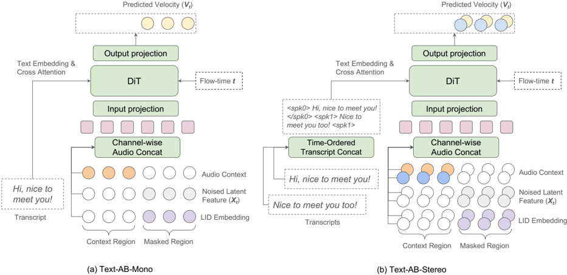

> [!abstract] arXiv · 2026 · Preprint
> **Sanyuan Chen et al.** (Meta) · [→ Paper](https://arxiv.org/abs/2609.03992) · Demo: ? · Code: ?
>
> Scales the Audiobox flow-matching recipe to a 3B-parameter, alignment-free latent DiT that reads raw text through cross-attention, and fine-tunes it into one system for cross-lingual voice dubbing, two-channel full-duplex dialogue synthesis, and turn-level emotion-controlled dialogue synthesis.

## Problem

Two production speech-generation settings remain hard for zero-shot TTS. Voice dubbing is cast as cross-lingual zero-shot TTS: the source speech is the audio prompt and the target-language transcript is the text, but large training corpora are monolingual, so the model must transfer speaker attributes across languages despite a training-inference mismatch. Full-duplex dialogue synthesis, wanted as training data for full-duplex speech LMs, has mostly been built by synthesizing monologue turns and stitching them together, which lacks joint modeling of turn dynamics. The authors note that integrated dialogue generators either lack zero-shot voice prompting or are trained on limited data at modest scale. On the modeling side, Audiobox depended on forced-aligned text tokens and an explicit duration predictor, which the authors argue underfit expressive speech, break on noisy conversational audio, and complicate scaling.

## Method

Text-AB (Alignment-Free Text-Audiobox) keeps the Audiobox design of a Diffusion Transformer trained with an optimal-transport flow-matching loss (logit-normal time sampling, σ_min = 1e-5) on a speech-infilling task, with loss only on the masked region and a first-order Euler ODE solver at inference (32 steps in all evaluations). The DiT uses adaLN-style modulation from a flow-time MLP shared across layers with per-layer biases, following Movie Gen. Three changes separate it from Audiobox *(§1, §2)*:

- **Latent space.** Audio is represented by DAC-VAE features from Movie Gen: 128-dimensional continuous latents at 25 Hz for 48 kHz audio, a 1920× compression ratio against the 160×-320× of the EnCodec features used in Audiobox. The DAC-VAE is taken as given; the paper does not train or evaluate it as a codec.
- **Alignment-free text interface.** Raw text is encoded by an off-the-shelf mT5 encoder and injected via cross-attention, so no forced aligner or duration predictor is needed. Frame-level language-ID embeddings are concatenated channel-wise with the audio context and noised latent.
- **Context zero-out.** Because the velocity is optimized only in the masked region, the noised latent's context region and the language-ID embeddings in that region are zeroed during both training and inference. This removes a training-inference mismatch (and lets an Es context prompt an En target) while the clean audio context still carries the prompt.

Two variants share this backbone. Text-AB-Mono generates single-channel speech. Text-AB-Stereo concatenates audio context, noised latents and language-ID embeddings from both channels along the channel dimension and predicts both channels' velocities jointly; its text input is a single time-ordered transcript of both speakers with speaker-ID tokens. Text-AB-Stereo is initialized from Text-AB-Mono by duplicating the input and output projection matrices, with input weights halved.

Training is multi-stage *(§3, §5.1)*. Pretraining runs Text-AB-Mono on 480k hours of English (380k) and Spanish (100k) monolingual speech for 800k steps on 256 A100 GPUs. Dubbing SFT adds sentence-level masking on 2k hours of multi-sentence En/Es data (left part as context, only the right part masked), mixed with 50 hours of voice- and style-aligned En↔Es pairs synthesized with Unit-Voicebox from the Seamless project acting as a cross-lingual voice converter. Dialogue SFT trains Text-AB-Stereo on 28k hours of English two-channel recordings for 1M steps. Emotional dialogue SFT follows the same recipe but labels each turn with a valence-arousal-dominance (VAD) vector from a pretrained wav2vec2-based emotion recognizer, projects it linearly, and appends it to the text-encoder output in the cross-attention memory, decoupling turn emotion from the prompt's speaking style. At inference, users give a categorical emotion per turn, mapped to VAD through a predefined table.

Inference supports one-shot generation up to about one minute (quality degrades beyond that, per the authors) with empty, mono or stereo prompts; a mono prompt fixes one speaker and samples a random voice for the other channel. Longer output uses multi-diffusion from Movie Gen Audio, extended to variable-length overlapping chunks whose predicted flows are averaged in overlaps at every ODE step (default 30 s chunks, 20 s overlap). Multi-diffusion keeps identities consistent only with a stereo prompt, so mono or empty prompts first generate an initial two-speaker chunk to serve as the stereo prompt. A multi-stage reranker samples several seeds, keeps candidates whose WavLM speaker similarity is at least 75% of the best, and picks the lowest Whisper-Large-V3 WER (32 candidates for dubbing, 4 for dialogue, 64 for emotional dialogue, where turn-alignment and emotion-accuracy scores are also weighed) *(§4, §5.1)*.

## Key Results

**Voice dubbing** *(§5.2, Table 1)*. In side-by-side human ratings on a [-3, 3] scale against the latest internal dubbing model (positive favors Text-AB), on an internal benchmark of 100 Es→En and 100 En→Es samples, Text-AB is preferred on all six aspects in both directions: shareability +0.40 / +0.38 (Es→En / En→Es), voice naturalness +0.39 / +0.45, prosody similarity +0.33 / +0.34, voice similarity +0.29 / +0.36, audio degeneration +0.16 / +0.06, and translation accuracy +0.02 / +0.03. The translation-accuracy margins are close to zero. No public dubbing system is compared.

**Dubbing ablations** *(§5.2, Tables 2-3, Figure 4)*. Scaling from 300M to 1B to 3B parameters lowers WER from 44.45% to 22.97% to 13.98% and raises SpkSim from 0.64 to 0.72 to 0.76 and Aes from 6.03 to 6.26 to 6.29 (Table 2). In the SFT ablation (Table 3), pretraining alone gives 5.93% WER / 0.69 SpkSim / 6.72 Aes; monolingual SFT gives 3.16% / 0.73 / 6.75; adding the cross-lingual data gives the lowest WER (2.72%) and highest Aes (6.82) but drops SpkSim to 0.60, the lowest of the three rows. The absolute WER levels of Tables 2 and 3 differ substantially, and the paper does not state the inference configuration behind each table, so the two tables should not be compared directly. Reranking over 32 candidates moves WER from 4.05% to 2.20% and SpkSim from 0.66 to 0.74 relative to no reranking (Figure 4).

**Full-duplex dialogue** *(§5.3, Table 4)*. On the ~30 s short-form set, Text-AB-Stereo trails ground-truth recordings on every one of the six 1-5 MOS dimensions, by 0.04 to 0.10; human-likeness is 4.53 vs 4.62 (Text-AB minus ground truth = -0.09). On the 1-2 min long-form set against the latest internal dialogue model, Text-AB scores higher on human-likeness (3.86 vs 3.00), intonation (3.98 vs 3.28), pacing (3.73 vs 3.39), expressive intensity (3.93 vs 3.32) and expressive correctness (3.96 vs 3.62), but lower on NSVs and fillers (4.12 vs 4.57), which the authors attribute tentatively to a domain mismatch between training conversations and evaluation scripts. Figure 5 ablations report that 3B beats 300M, initialization from pretrained Text-AB-Mono beats training from scratch, and more updates help; the authors state the 3B model at 500k updates is comparable to ground truth on WER, SpkSim and Aes. Figure 6 shows more ODE steps and reranking candidates improve WER and Aes at higher real-time factor, with SpkSim largely insensitive.

**Emotional dialogue** *(§5.4, Tables 5-7)*. Turn-level VAD conditioning raises Qwen2-Audio emotion accuracy over plain dialogue SFT for angry (0.814 vs 0.650), happy (0.428 vs 0.396) and sad (0.479 vs 0.455), and raises human emotion-alignment MOS (3.576 vs 2.397, 3.333 vs 1.966, 3.421 vs 2.943); the neutral category is evaluated but not reported in Table 5. In dialog naturalness (Table 6), with ground-truth text dialogues, emotional dialogue SFT has the highest LLM-judge (Gemini 2.5 Pro) score among generated systems (4.643; the ground-truth recordings score 4.844), but MoonCast has the highest human MOS (3.990 vs 3.906, with overlapping ± ranges, and ground truth at 3.851). With synthetic emotional text dialogues, dialogue SFT has the highest LLM-judge score (3.680 vs 3.653 for emotional SFT), and emotional dialogue SFT has the highest human MOS (3.866, against 3.090 for dialogue SFT, 3.009 for the CosyVoice 2 concatenation baseline and 2.930 for MoonCast). Emotional interaction MOS is 3.675 vs 3.317 for dialogue SFT, the only two systems rated (Table 7).

## Novelty Assessment

Most individual components come from earlier Meta work or the wider flow-matching literature: the flow-matching DiT and infilling objective from Audiobox, the DAC-VAE latents, shared-MLP modulation and multi-diffusion from Movie Gen, and text cross-attention without duration modeling as in other alignment-free non-autoregressive TTS. The contribution is their integration and scaling into one 3B model that covers cross-lingual dubbing, stereo full-duplex dialogue with zero-shot prompting, and turn-level emotion control. Smaller engineering ideas are new to this paper: zeroing the context region of the noised latent and language-ID stream to close a train-inference gap, the mono-to-stereo initialization by duplicated projections, variable-length multi-diffusion chunking with a bootstrap chunk for unprompted speakers, and VAD embeddings in the cross-attention memory for turn-level emotion in two-channel dialogue. ZipVoice-Dialog had already shown stereo flow-matching dialogue generation, so the dialogue novelty here is mainly scale, data volume and zero-shot prompting. The evidence for the gains over internal systems is strong in magnitude but rests on unnamed baselines and internal test sets.

## Field Significance

Moderate — The paper provides an industrial-scale data point that a single alignment-free flow-matching DiT, pretrained on monolingual speech and fine-tuned per task, can serve cross-lingual dubbing and two-channel full-duplex dialogue synthesis, with short-form dialogue rated within 0.1 MOS of real recordings. Its ablations (scale, SFT data mix, reranking, multi-diffusion settings) are useful for practitioners, but most headline comparisons are against unnamed internal systems on internal benchmarks.

## Claims

- **supports:** Alignment-free non-autoregressive TTS that learns text-speech alignment through cross-attention, without forced alignment or a duration model, scales to multi-billion-parameter models and long conversational speech.
  > *Evidence:* Text-AB reads mT5 text embeddings through cross-attention, and WER falls from 44.45% (300M) to 22.97% (1B) to 13.98% (3B) on dubbing, while the stereo variant generates up to one minute of two-speaker dialogue in one pass. *(§2.2, Table 2, §4)*
- **complicates:** Adding synthetic cross-lingual pairs to fine-tuning improves content accuracy and audio quality for cross-lingual TTS but can reduce speaker similarity to the prompt.
  > *Evidence:* Mono + cross-lingual SFT gives the lowest WER (2.72% vs 3.16%) and highest Aes (6.82 vs 6.75) of the SFT configurations but lowers SpkSim from 0.73 to 0.60, below even the pretraining-only model (0.69). *(§5.2, Table 3)*
- **supports:** Jointly generating both channels of a dialogue with one flow-matching model, conditioned on a time-ordered two-speaker transcript, can approach the perceived naturalness of real full-duplex recordings on short conversations.
  > *Evidence:* On ~30 s held-out conversations, Text-AB-Stereo scores 4.53 human-likeness MOS vs 4.62 for ground truth, and is within 0.10 of ground truth on all six rated dimensions. *(§5.3, Table 4)*
- **supports:** Best-of-N reranking on automatic speaker-similarity and WER scores substantially improves flow-matching TTS output, with gains growing with the number of candidates.
  > *Evidence:* For dubbing, reranking over 32 seeds lowers WER from 4.05% to 2.20% and raises SpkSim from 0.66 to 0.74 compared with a single sample. *(§5.2, Figure 4)*
- **complicates:** Explicit turn-level emotion conditioning in dialogue synthesis improves emotion alignment but does not uniformly improve every naturalness measure, and LLM-judge and human naturalness rankings can disagree.
  > *Evidence:* VAD conditioning raises emotion accuracy and emotion-alignment MOS in all three reported categories, yet with emotional scripts the unconditioned model scores slightly higher on the Gemini judge (3.680 vs 3.653) while human MOS favors the conditioned model (3.866 vs 3.090); with ground-truth scripts MoonCast has the highest human MOS. *(§5.4, Tables 5-6)*

## Limitations and Open Questions

> [!warning] Unnamed internal baselines and test sets
> The dubbing benchmark, both dialogue test sets and the two main baselines ("latest internal dubbing model", "latest internal model") are internal and undescribed, and the paper mentions no code, weights or demo release. The headline dubbing and long-form dialogue gains cannot be reproduced or compared with public systems; only the emotional-dialogue study includes public baselines (MoonCast, CosyVoice 2).

- Dubbing is evaluated only for English↔Spanish, and only the TTS stage of a cascade; ASR and translation errors are outside the evaluation, and dubbing-specific constraints such as lip-sync or timing to the source are not measured.
- The dubbing objective results (Tables 2-3) do not state the test set or inference configuration, and their WER levels differ widely, so the size and SFT ablations are hard to relate to each other or to Table 1.
- Dialogue SFT is English-only; the dialogue model is not shown to inherit the Spanish capability.
- Long-form generation scores lower than the internal model on NSVs and fillers, and multi-diffusion needs a stereo prompt (or a bootstrap chunk) to keep speaker identities consistent.
- Emotional dialogue uses only four emotion categories mapped to fixed VAD points, so the continuous VAD interface is not tested with intermediate values; emotion labels come from automatic recognizers (wav2vec2 VAD for training, Qwen2-Audio for scoring) rather than human annotation.
- The 3B model required 256 A100 GPUs per stage and reranking with up to 64 candidates; inference cost is reported only as relative real-time factor trends in Figure 6.

## Wiki Connections

- [[flow-matching|Flow Matching]] — Text-AB is a 3B flow-matching DiT on DAC-VAE latents, extended with context zero-out and variable-length multi-diffusion for long-form generation.
- [[zero-shot-tts|Zero-Shot TTS]] — dubbing is framed as cross-lingual zero-shot TTS with the source speech as prompt, and dialogue synthesis supports zero-shot mono or stereo voice prompts.
- [[multilingual-tts|Multilingual TTS]] — the model is pretrained and fine-tuned on English and Spanish with frame-level language IDs and evaluated on En→Es and Es→En dubbing.
- [[emotion-synthesis|Emotion Synthesis]] — turn-level VAD embeddings control emotion in two-channel dialogue, evaluated with a speech emotion recognizer and human emotion-alignment MOS.
- [[subjective-evaluation|Subjective Evaluation]] — results rest on side-by-side [-3, 3] dubbing ratings and 1-5 MOS studies of dialogue human-likeness, naturalness and emotional interaction.
- [[2312.15821|Audiobox]] — the direct predecessor; Text-AB replaces its EnCodec features, forced-aligned text and duration predictor with DAC-VAE latents and cross-attention, at roughly 10× the parameters and 3× the pretraining data.
- [[2312.05187|Seamless]] — source of the Unit-Voicebox model used as a cross-lingual voice converter to synthesize the 50 hours of En↔Es fine-tuning pairs.
- [[2507.09318|ZipVoice-Dialog]] — prior non-autoregressive flow-matching stereo dialogue generator that Text-AB positions itself against on prompting ability and scale.
- [[2503.14345|MoonCast]] — public baseline in the emotional dialogue study, where it has the highest human naturalness MOS with ground-truth scripts but trails Text-AB with emotional scripts.
- [[2412.10117|CosyVoice 2]] — backbone of the utterance-level concatenation baseline in the emotional dialogue comparison.
- [[2502.05139|Audiobox Aesthetics]] — supplies the Aes production-quality metric used in all objective evaluations.
- [[2407.10759|Qwen2-Audio]] — used as the speech emotion recognizer for emotion accuracy.
- [[2507.06261|Gemini 2.5]] — Gemini 2.5 Pro serves as the LLM judge for dialog naturalness scores.
