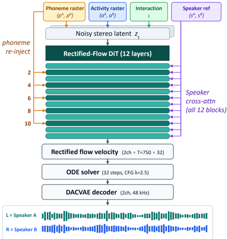

> [!abstract] arXiv · 2026 · Preprint
> **Higashinaka et al.** (Nagoya University / National Institute of Informatics / Keio University / Waseda University) · [→ Paper](https://arxiv.org/abs/2609.07200) · Demo: ? · Code: ✓
>
> KABURI-TTS generates two-party dialogue speech with one speaker per channel from explicit per-frame phoneme and voice-activity rasters, so overlaps, backchannels and turn switches are set by the input timing rather than learned implicitly from text.

## Problem

Full-duplex spoken dialogue models need large amounts of two-channel, one-speaker-per-channel conversational speech, and synthesis is a common way to produce it. The authors group existing conversational TTS into three lines: placing utterances from a single-speaker TTS, serialized speaker-tagged generation into one mixed signal (SoundStorm, MOSS-TTSD, CoVoMix), and text-to-two-channel generation (CHATS, Moshi-based multistream TTS, ZipVoice-Dialog stereo, DialoSpeech). In all of these, whether and how speech overlaps is learned implicitly from data. The authors argue that the output therefore tends to alternate, shows too little simultaneous speech (backchannels, interruptions, overlaps), and gives the designer no direct control over it.

## Method

KABURI-TTS (Kaburi is Japanese for simultaneous speech) discretizes a 30-second dialogue window into T = 750 frames at 25 fps. Its inputs are frame-synchronous "rasters": a per-channel phoneme raster (a phoneme or a silence token per frame for speakers A and B), an activity raster derived from it (speaking or not, per channel and frame), a 10-class interaction state computed deterministically from the activity raster (silence, A only, B only, overlap, plus six boundary states for each speaker's onset and offset and the A→B and B→A switches), and a reference latent per speaker. The output is one DACVAE continuous latent sequence per channel (32 dimensions per frame), decoded to 2-channel 48 kHz audio, left channel for speaker A and right for speaker B.

The acoustic model is a pretrained single-speaker zero-shot TTS, a 12-layer rectified-flow DiT (Irodori TTS, the 500M v2 checkpoint), whose text input is disabled by zeroing its weights. The phoneme, activity and interaction conditions are projected and added as biases after the latent input projection, and the phoneme condition is re-injected into layers 2, 4, 6, 8 and 10. Speaker reference latents enter through speaker cross-attention in all 12 blocks. The two channels are stacked along the batch dimension and processed in one forward pass with shared weights; they are never mixed directly, and their interplay is carried only through the conditions. Inference uses 32-step ODE integration with classifier-free guidance on the phoneme condition (scale 2.5).

Training adapts the backbone with LoRA (r = 256) in the attention and MLP layers, unfreezes the later blocks, LayerNorms and input/output layers, and zero-initializes the new condition-injection layers so the untrained model matches the backbone. The loss has three terms: rectified-flow velocity regression with a per-frame weight that down-weights silent frames to 0.05; five binary auxiliary timing heads on intermediate DiT features (activity, onset and offset per channel, overlap and turn switch; weight 0.1 each); and L2-SP regularization toward the pretrained weights (10^-4). The phoneme condition is dropped with probability 0.15 for guidance.

Because the acoustic model needs a phoneme raster, two front ends turn text into one. Statistical placement samples inter-utterance gaps from direction-dependent empirical gap distributions of the training data (a piecewise-linear inverse CDF over the 5th to 95th percentiles, overlap capped at 0.3 s) and spreads utterance length over phonemes from training-average durations. The duration predictor is a 2-layer Transformer encoder (hidden size 192, about 0.8M parameters) that classifies phoneme duration, silence duration and gap into bins from phoneme, speaker, channel and dialogue-context tokens, with a +9-frame gap correction calibrated on validation data because expectation decoding makes turns too tight.

Training data is LLM-jp-Zoom1, a 1,085-hour Japanese casual-conversation corpus of 2,000 Zoom dialogues with 60 speakers, chunked into 30-second windows and annotated with phoneme rasters via Silero VAD, Whisper-v3 transcription, g2p and Montreal Forced Aligner alignment. The acoustic model was trained for 30k steps on 7 Quadro RTX 6000 GPUs.

## Key Results

Evaluation is a crowdsourced 5-point Likert test on three items: utterance-level naturalness, interaction-level naturalness and intelligibility. 140 workers took part, each sample was rated by two workers, and differences were tested with paired Wilcoxon signed-rank tests under Benjamini-Hochberg FDR control.

**Test chunk Eval (Table I, 100 chunks from seen and unseen speakers).** Human recordings score 4.42 / 4.43 / 4.31 and every synthetic system stays well below them. Among synthetic systems, KABURI with the ground-truth phoneme raster has the highest utterance (3.49) and interaction naturalness (3.64). With text-derived rasters, KABURI (pred) reaches 3.20 utterance naturalness, significantly above KABURI (stat, 2.96) and both Irodori baselines (2.90, 2.89; p < .05). On interaction naturalness, KABURI (stat, 3.46) and KABURI (pred, 3.37) are statistically tied with each other and both are significantly above Irodori (GT placement, 2.61) and Irodori (stat, 2.79) at p < .01. KABURI (stat) has the highest intelligibility among synthetic systems (3.82), significantly above KABURI (pred) and the Irodori systems, and numerically above KABURI (GT, 3.65) without a significant difference. Seen and unseen speaker subsets showed no significant differences.

**Text-in Eval (Table II, 60 LLM-written dialogues).** KABURI (stat) has the highest value in all three columns (3.38 / 3.83 / 3.86). Only its interaction naturalness is significantly better than other systems: KABURI (pred, 3.30) and Irodori (stat, 3.11), at p < .01. Against MOSS-TTSD (3.53), the difference is not significant (corrected p = 0.071). No utterance-naturalness or intelligibility difference is significant. MOSS-TTSD produces single-channel mixed speech, so the authors note that its task differs from the two-channel systems.

**Voice activity (Table III).** An energy-based voice activity analysis shows that KABURI produces far more overlap and turn switching than independently synthesized and placed utterances. In Text-in Eval, overlap is 0.120 (stat) and 0.161 (pred) against 0.020 for Irodori (stat), and switches per minute are 40.4 and 43.8 against 17.4. In Test chunk Eval, KABURI (GT) tracks the human recordings closely (overlap 0.074 vs 0.076, 33.8 vs 35.4 switches/min). The text-driven variants overshoot human overlap (0.105 and 0.096 vs 0.076) and have less silence (0.199 and 0.267 vs 0.314). The authors also state the paper was accepted at APSIPA ASC 2026.

## Novelty Assessment

The new element is the conditioning interface: two-channel dialogue speech is generated from explicit, frame-synchronous phoneme and activity rasters plus a derived interaction-state signal, with auxiliary timing heads that supervise onset, offset, overlap and turn switch. This separates "when each speaker talks" from "how it sounds", so overlap is set upstream instead of emerging from a text-to-speech model. The building blocks are existing ones: a pretrained rectified-flow DiT, LoRA, L2-SP, a pretrained DACVAE codec, and statistical or small learned timing front ends. The contribution is therefore a new conditioning and training scheme on an adapted backbone rather than a new generator. The comparison set is narrow: the main two-channel competitors named in the related work (CHATS, ZipVoice-Dialog, DialoSpeech, the Moshi-based multistream TTS) are not evaluated, and the only external dialogue baseline (MOSS-TTSD) outputs mixed audio.

## Field Significance

Moderate — The paper shows that a pretrained single-speaker flow-matching TTS can be turned into a two-channel dialogue renderer whose overlap and turn-taking are driven by an explicit timing raster, with clear gains in interaction naturalness and overlap over placing independently synthesized utterances. It provides a controllable data-generation route for full-duplex dialogue models in Japanese. However, its advantage over a strong text-to-dialogue baseline is not statistically established, and the control fidelity it is designed for is not yet measured.

## Claims

- **supports:** Conditioning dialogue speech synthesis on explicit per-speaker voice-activity timing yields substantially more overlap and turn switching than synthesizing each utterance independently and placing it on a timeline.
  > *Evidence:* With the same statistical placement, KABURI (stat) reaches 0.120 overlap and 40.4 switches/min in Text-in Eval against 0.020 and 17.4 for the Irodori single-speaker placement baseline; in Test chunk Eval the Irodori systems lose backchannels into the interlocutor's speech. *(§V, Table III)*
- **supports:** A pretrained single-speaker flow-matching TTS backbone can be adapted into a two-channel dialogue generator with low-rank adaptation, zero-initialized condition layers and shared weights across channels, improving perceived interaction naturalness over utterance-wise synthesis.
  > *Evidence:* LoRA (r = 256) plus partial unfreezing of a 12-layer rectified-flow DiT, with the two channels batched and coupled only through rasters, gives interaction naturalness of 3.46 (stat) and 3.37 (pred) against 2.61 and 2.79 for the Irodori baselines (p < .01). *(§III-B, §III-C, Table I)*
- **complicates:** In dialogue synthesis, a learned duration predictor does not consistently outperform simple statistical timing placement drawn from corpus gap distributions; which one wins depends on the input setting and the rated dimension.
  > *Evidence:* The predictor gives better utterance naturalness on held-out chunks (3.20 vs 2.96, p < .05), but statistical placement gives better interaction naturalness on LLM-written scripts (3.83 vs 3.30, p < .01). *(§IV-E, Tables I and II)*
- **complicates:** More overlap and faster turn switching in synthesized dialogue are not by themselves evidence of human-like or controllable timing, because aggregate activity statistics can overshoot human references and do not measure adherence to the conditioning signal.
  > *Evidence:* Text-driven KABURI variants exceed the human reference overlap (0.105 and 0.096 vs 0.076) with less silence (0.199 and 0.267 vs 0.314), and the authors state that frame-level adherence to the input raster remains unevaluated. *(§V, Table III)*
- **complicates:** Gains of two-channel, timing-conditioned dialogue synthesis over strong single-channel text-to-dialogue models are small in listener ratings at current evaluation sizes.
  > *Evidence:* On 60 Text-in dialogues rated by two crowd workers each, KABURI (stat) is not significantly better than MOSS-TTSD on any item (interaction naturalness 3.83 vs 3.53, corrected p = 0.071), and no system differs significantly on utterance naturalness. *(§IV-E, Table II)*

## Limitations and Open Questions

> [!warning] Control fidelity is not measured
> The method is motivated by controllable overlap, but the paper measures only aggregate overlap, silence and switch rates from energy-based voice activity. The authors state that frame-level adherence of the output to the input phoneme and activity rasters remains to be evaluated.

- The system is Japanese-only and trained on a single corpus with 60 speakers. The unseen-speaker subset has 10 new speakers mixed with 7 seen ones, and Text-in Eval uses training speakers.
- Generation is fixed to 30-second windows; supporting arbitrary durations is listed as future work.
- No objective intelligibility (WER/CER) or speaker-similarity metrics are reported; quality evidence rests on a Likert test with two raters per sample.
- The two-channel competitors discussed in the related work are not compared, and the one dialogue baseline (MOSS-TTSD) produces mixed single-channel audio, so its overlap and switch statistics are not available.
- The text-driven systems still fall well short of human recordings on every rated item. The duration predictor needs an ad hoc +9-frame gap correction.
- Use of the generated data to train full-duplex dialogue models, the stated goal, is left to future work.

## Wiki Connections

- [[flow-matching|Flow Matching]] — The acoustic model is a LoRA-adapted 12-layer rectified-flow DiT that predicts per-channel velocity fields under raster conditioning.
- [[zero-shot-tts|Zero-Shot TTS]] — Speaker identity comes from reference latents via cross-attention, and Test chunk Eval includes a subset with 10 unseen speakers that shows no significant gap to seen speakers.
- [[subjective-evaluation|Subjective Evaluation]] — Rates utterance-level and interaction-level naturalness separately for dialogue speech, collected from 140 crowd workers with FDR-controlled paired tests.
- [[2507.09318|ZipVoice-Dialog]] — A flow-matching two-channel dialogue generator from text, cited as an example of implicit overlap learning that KABURI-TTS replaces with explicit timing rasters (not evaluated as a baseline).
- [[2510.08373|DialoSpeech]] — Another text-to-two-channel dialogue system cited as learning overlap implicitly; not compared experimentally.
- [[2305.09636|SoundStorm]] — Cited as the origin of serialized speaker-tagged dialogue generation into a single mixed signal, the line the authors say tends toward alternating output.
- [[2410.00037|Moshi]] — The full-duplex dialogue model behind the multistream TTS line, cited both as the downstream consumer of two-channel data and as an implicit-overlap generation approach.
- [[2025.naacl-long.484|Behavior-SD]] — Cited for utterance placement of single-speaker TTS output; the statistical placement front end is inspired by it.
- [[2602.06053|PersonaPlex]] — A full-duplex conversational model cited as a system trained with synthesized dialogue data, the use case KABURI-TTS targets.
