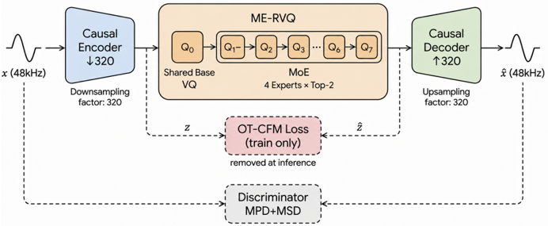

> [!abstract] arXiv · 2026 · Preprint
> **Mingyu Zhao et al.** (Tsinghua University) · [→ Paper](https://arxiv.org/abs/2609.09866) · Demo: ? · Code: ?
>
> A fully causal 48 kHz codec for speech, music and environmental sound that gives each residual quantization layer four expert codebooks, chosen by a router the decoder can rerun from already-decoded codes, so no expert IDs are transmitted.

## Problem

Most residual vector quantization (RVQ) codecs use one shared codebook per layer. That single space must cover speech formants, musical harmonics and environmental textures at once. Mixture-of-experts (MoE) quantizers add capacity, but prior designs either place the experts outside the quantization bottleneck or send routing information in the bitstream, which adds overhead and complicates streaming. Flow-based codecs such as FlowDec improve perceptual quality but need iterative sampling at inference, which is costly for real-time use. The authors also argue that 16 kHz speech metrics (PESQ, STOI) do not characterize full-band 48 kHz reconstruction.

## Method

UniStream is a SEANet-style causal convolutional encoder-decoder operating on 48 kHz mono audio. Four strided blocks (strides 2, 4, 5, 8) downsample by 320, giving a 150 Hz latent frame rate with a 256-dimensional latent. All inference-time modules are causal with no look-ahead. The deployed codec has 47.9M parameters.

The quantizer is Multi-Expert RVQ (ME-RVQ) with 8 layers. Layer 0 is a shared 1024-entry codebook. Layers 1 to 7 each hold four 1024-entry expert codebooks and a small two-layer MLP router (hidden size 128). The router reads the running reconstruction, which is the sum of the codes decoded so far, and predicts softmax weights over experts per frame. The Top-K experts each quantize the residual, and their outputs are combined with renormalized weights. Because the router input depends only on code indices already in the bitstream, the decoder recomputes the same expert choice and weights. The authors verify bit-exact encoder-decoder agreement in float32 on an A100 GPU and a Xeon 8358 CPU. Codebooks use EMA updates with Laplace smoothing; a Switch-style load-balancing loss and a router z-loss guard against expert collapse. ME-RVQ adds 5.5M parameters, and average codebook-entry utilization is 87.3%.

Each code index costs 10 bits per frame. Top-1 mode sends one index per layer, giving 12 kbps. Top-2 mode sends two indices for each of the seven MoE layers, giving 22.5 kbps.

Training adds an auxiliary Optimal Transport Conditional Flow Matching (OT-CFM) objective. A 6-layer causal Transformer velocity network learns to transport Gaussian noise to the continuous encoder latent while conditioned on the quantized latent. The intent is to push the quantized latent to keep information about the continuous one. The module is discarded at inference, so it costs nothing at run time. The generator loss combines multi-scale mel, single-resolution STFT and waveform L1 losses, MPD and MSD adversarial and feature-matching losses, the commitment and routing losses, and the flow-matching loss. The flow loss starts after 5k steps and the adversarial losses after 10k steps. The model trains for 200k steps on 8 A100 GPUs, sampling LibriSpeech, MTG-Jamendo and FSD50K with probabilities 0.5, 0.3 and 0.2. All audio is resampled to 48 kHz; LibriSpeech is natively 16 kHz.

## Key Results

Evaluation uses small fixed subsets: 200 LibriSpeech test-clean utterances, 100 MTG-Jamendo clips and 94 FSD50K clips. Baselines are Opus and EnCodec (each at 12 and 24 kbps) and DAC (8 kbps), SNAC (2.6 kbps) and Mimi (1.1 kbps) from their official checkpoints, not retrained on the paper's data. EnCodec, DAC and SNAC are non-causal; Opus, Mimi and UniStream are causal. No subjective listening test is reported.

**Matched rate, 12 kbps (Table 1).** UniStream-Top1 reaches PESQ 2.81, UTMOS 3.34 and STOI 0.826, against EnCodec's 2.88, 3.35 and 0.878. Its clearest gain over EnCodec is spectral: speech Mel-D falls from 13.07 to 8.21 and environmental Mel-D from 13.18 to 10.16, but music Mel-D is worse (10.72 against 9.20). The causal Opus at 12 kbps scores much higher on speech (PESQ 3.99, UTMOS 3.81, STOI 0.936), though its music and environmental Mel-D (22.51, 28.52) are far worse. The paper's discussion of Table 1 does not address Opus's speech advantage.

**Full-band ViSQOL (Table 2).** UniStream-Top1 scores 4.35 in speech audio mode (tied with SNAC) and 4.43 in speech mode, above EnCodec at 12 kbps (4.03, 4.15) but below Opus at 12 kbps in speech mode (4.63). On music and environmental audio, Top1 (3.82, 3.70) trails EnCodec at 12 kbps (4.13, 3.91). UniStream-Top2 reaches 4.67 in speech mode, the highest among the neural codecs in the table (DAC 4.63 is next); Opus at 24 kbps scores 4.77. Top2's environmental audio-mode score of 3.96 is above every system at 12 kbps or below (DAC 3.94 is closest), but those systems run at roughly half its bitrate or less, and Opus and EnCodec at 24 kbps score higher (4.07, 4.02). Top2 is 0.03 below Opus at 24 kbps on speech in audio mode (4.42 against 4.45).

**VGGish-FAD and DNSMOS (Tables 3 and 4).** Top2's speech FAD (0.27) is behind DAC (0.18) and Mimi (0.24), and its music FAD (0.68) is worse than EnCodec, DAC and SNAC (0.37, 0.32, 0.40). Top1's speech FAD (0.72) is worse than Opus at 12 kbps (0.60). On DNSMOS P.835 OVR, Top2 (3.20) is close to EnCodec at 24 kbps (3.21) but below DAC (3.33), Mimi (3.29), SNAC (3.25) and Opus at 12 kbps (3.24). Top1 (3.07) is close to EnCodec at 12 kbps (3.06).

**Ablation at 22.5 kbps (Table 5).** Removing ME-RVQ lowers PESQ from 3.41 to 3.20 and UTMOS from 3.87 to 3.80, and raises Mel-D in all three domains (speech 7.25 to 7.72). Removing OT-CFM lowers PESQ to 3.37 and UTMOS to 3.86 but slightly improves Mel-D in all three domains (speech 7.25 to 7.07) and leaves STOI marginally higher (0.865 against 0.864).

**Efficiency (§4.7).** End-to-end GPU real-time factor (RTF) is 0.144 on an A100; CPU RTF is 1.05 on a Xeon 8358, slightly slower than real time. The 6.7 ms latent-frame interval is a lower bound on streaming latency, not a measured end-to-end figure.

## Novelty Assessment

The architectural contribution is the decoder-reproducible router. Expert codebooks inside RVQ already exist (SwitchCodec), as do domain-adaptive codebooks (UniCodec). Driving the router from the cumulative quantized reconstruction removes the need to transmit expert IDs, and the paper verifies bit-exact routing across GPU and CPU. That is a clean and practical design point. The OT-CFM regularizer reuses a standard objective as a training-only auxiliary loss. Its measured effect is small (0.04 PESQ, 0.01 UTMOS) and comes with worse Mel-D, so it is a minor addition.

The evidence is weaker than the design. At matched 12 kbps, UniStream-Top1 is roughly on par with EnCodec on speech quality metrics, worse on music and environmental ViSQOL, and clearly behind Opus on speech metrics. The stronger Top2 results compare a 22.5 kbps system against lower-rate baselines. Baselines are off-the-shelf checkpoints at different bitrates, and the ablation does not say how the bitrate of the "w/o ME-RVQ" variant is matched. The multi-metric full-band evaluation is useful, but it is applied to small subsets without listening tests.

## Field Significance

Low — The paper shows that MoE routing inside RVQ can be made signaling-free by conditioning the router on already-decoded codes, and that this added capacity improves a causal 48 kHz codec in a within-model ablation. Against external codecs, the gains are mixed, so the result is mainly a design proof of concept rather than a new quality operating point. The authors state that the paper is accepted to NCMMSC 2026; this page summarizes the arXiv preprint.

## Claims

- **supports:** Routing residual quantization layers among several expert codebooks increases codec quantization capacity and improves reconstruction across speech, music and environmental audio.
  > *Evidence:* At 22.5 kbps, removing ME-RVQ lowers PESQ from 3.41 to 3.20 and UTMOS from 3.87 to 3.80, and raises Mel-D in all three domains (speech 7.25 to 7.72, music 9.54 to 10.19, environmental 7.91 to 8.36); the paper does not state how the ablated variant's bitrate is matched. *(§4.6, Table 5)*
- **supports:** Expert routing in a residual quantizer can be driven only by already-decoded codes, so the decoder reproduces the expert selection without any side information in the bitstream.
  > *Evidence:* The router input at each layer is the sum of previously decoded quantized codes; with float32 router evaluation, encoder-decoder routing is verified bit-exact on an A100 GPU and a Xeon 8358 CPU, and the 12 and 22.5 kbps bitrates count only code indices. *(§3.2)*
- **complicates:** A training-only flow-matching objective on a codec's quantized latent yields small perceptual speech gains while slightly worsening spectral distortion.
  > *Evidence:* Removing OT-CFM lowers PESQ from 3.41 to 3.37 and UTMOS from 3.87 to 3.86, but lowers Mel-D in all three domains (speech 7.25 to 7.07) and leaves STOI marginally higher (0.865 against 0.864). *(§4.6, Table 5)*
- **complicates:** Narrow-band speech metrics, full-band perceptual metrics and spectral distortion rank audio codecs differently, so a single metric family can misrepresent general-audio codec quality.
  > *Evidence:* At 12 kbps, Opus leads UniStream-Top1 and EnCodec on PESQ, UTMOS and STOI but has by far the worst music and environmental Mel-D (22.51, 28.52); UniStream-Top1 matches EnCodec on PESQ and UTMOS, trails it on STOI and music/environmental ViSQOL, yet cuts speech Mel-D from 13.07 to 8.21. *(§4.2, §4.3, Tables 1 and 2)*

## Limitations and Open Questions

> [!warning] Speech results rest on upsampled 16 kHz data and no listening test
> Speech training and evaluation both use LibriSpeech, which is resampled from 16 kHz to 48 kHz, so the codec's full-band speech claims are never tested on speech with real content above 8 kHz. The paper reports no subjective listening test (named as future work); all quality claims rest on objective metrics.

- **Baseline comparability.** Neural baselines are official checkpoints at different bitrates (1.1 to 24 kbps), some non-causal, and none retrained on the paper's mixed-domain data. The 48 kHz EnCodec checkpoint is stereo; mono input is duplicated across channels and its 24 kbps setting is the total stereo rate (12 kbps per channel).
- **Matched-rate standing.** At 12 kbps, UniStream-Top1 does not clearly beat EnCodec and trails Opus on PESQ, UTMOS and STOI in Table 1.
- **Ablation design.** The "w/o ME-RVQ" configuration is not specified (codebook count, bitrate), so the size of the ME-RVQ gain at equal rate is uncertain.
- **Small evaluation sets.** Results come from 200, 100 and 94 clips per domain, with no confidence intervals.
- **Deployment.** CPU RTF is 1.05, slightly slower than real time; end-to-end algorithmic latency is not measured; no entropy coding is applied.
- **Music.** Music FAD and music ViSQOL remain behind several baselines, which the authors acknowledge.

## Wiki Connections

- [[neural-codec|Neural Audio Codec]] — Contributes a causal 48 kHz RVQ codec whose per-layer expert codebooks are selected by a decoder-reproducible router, with a multi-metric full-band evaluation across speech, music and environmental audio.
- [[2210.13438|EnCodec]] — Main rate-matched neural baseline at 12 kbps and higher-rate reference at 24 kbps; UniStream-Top1 roughly matches its PESQ and UTMOS while lowering speech Mel-D.
- [[2410.00037|Moshi]] — Its Mimi codec is evaluated as a causal 1.1 kbps reference baseline.
- [[2107.03312|SoundStream]] — Provides the RVQ encoder-quantizer-decoder paradigm that ME-RVQ modifies.
- [[iclr-2025-uxDFlPGRLX|FlowDec]] — A full-band flow-based codec that uses flow sampling at inference; UniStream instead confines flow matching to training to avoid runtime cost.
- [[2025.acl-long.937|UniCodec]] — Prior domain-adaptive codebook design for unified audio coding that UniStream positions against.
- [[2608.08432|BAMU]] — Same group's post-hoc bitrate allocation on frozen codecs; UniStream instead builds adaptive routing into the quantizer during training.
- [[2010.05646|HiFi-GAN]] — Source of the MPD and MSD discriminators and the STFT loss used in UniStream's training objective.
