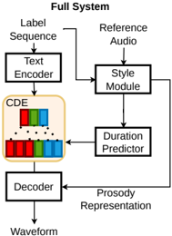
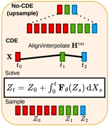

> [!abstract] arXiv · 2026 · Preprint
> **Mattias Cross et al.** (University of Sheffield) · [→ Paper](https://arxiv.org/abs/2609.11725) · Demo: ? · Code: ✓
>
> Replaces the length-regulation step of a duration-based encoder-decoder TTS model with a neural controlled differential equation (CDE), so that phone durations shape the values of the decoder input rather than only how often each phone state is repeated.

## Problem

Duration-based non-autoregressive TTS models (Glow-TTS, VITS, StyleTTS, Grad-TTS, Matcha-TTS) resolve text-to-speech alignment by upsampling phone-level encoder states: each phone embedding is copied for its predicted number of frames. The authors argue this makes duration change only *where and how often* a latent state appears, never its *value*. A lengthened vowel becomes a short vowel repeated, and the decoder must recover duration-dependent behaviour (local speaking rate, position within a phone, proximity to a boundary) from frame context and positional cues alone. The paper asks whether treating TTS as a mapping from phone labels observed at irregular times to regularly sampled acoustic frames, the setting neural CDEs were designed for, gives duration a more direct role. Neural CDEs had been used for speech classification but not for synthesis.

## Method

The phone-level encoder output $H^{txt}$ is augmented with a time channel holding the cumulative-duration timestamp of each phone, giving a control sequence $X_i = [H^{txt}_i; t_i]$. The time channel is normalised by the utterance's total duration. Linear interpolation turns this sequence into a continuous control path $X$. A hidden state then evolves as the solution of a CDE, $Z_t = Z_0 + \int_0^t F_\theta(Z_s)\, dX_s$, rewritten as an ODE in the control derivative so that standard solvers apply. Because CDEs respond to changes in the control rather than to absolute time, the interpolation knots can sit at regular computational steps while the time channel carries the irregular phone timing. The solver step size $h$ is exposed as a modelling choice: $h = 1$ evaluates one phone per step, and $h = 0.5$ adds an intermediate evaluation inside each phone interval (half-phone steps). The sampled trajectory is either read out at frame level or sampled per phone and upsampled with the alignment matrix as usual. Two CDE layers can be stacked in a single augmented solve, using the chain rule for CDEs, so that the first layer's hidden path drives the second without re-interpolation.

Implementation details: $Z_0$ comes from an LSTM run over the reversed control sequence. The usual MLP vector field would need a 128-to-65,536 output projection for 512 control channels and 128 hidden dimensions, so the authors parameterise $F_\theta$ with a U-Net that strides along the hidden dimension (their own design choice). Integration uses fixed-step fourth-order Runge-Kutta, a second U-Net upsamples $Z$ back to 512 channels, and a gated residual $H^{cde} = H^{txt} + \gamma Z$ with trainable $\gamma$ inserts the module into a pretrained model.

The paper uses two setups. (1) **Matcha-TTS bridge (LJSpeech):** a CDE is inserted between a pretrained Matcha-TTS encoder (control path) and its flow-matching ODE decoder (readout), with only the CDE trainable. This tests whether a CDE can be added without breaking a pretrained mapping. (2) **Reference-style emotional TTS (ESD):** StyleTTS 2 is first trained on LibriTTS. The CDE is then inserted after the text encoder and the whole model is fine-tuned for 5 epochs on about 5 h of English ESD (all modules trainable). Fine-tuning includes StyleTTS 2's style diffusion from epoch 2 and its WavLM-based adversarial ("SLM") training from epoch 4. The style module predicts duration and prosody from a reference utterance of the same speaker and emotion. An LSTM fed the same duration-augmented control path serves as a discrete recurrent control. Model size is not reported, and the system predicts waveforms through the StyleTTS 2 decoder, with no codec.

## Key Results

- **LJSpeech bridge (Table I):** inserting the CDE leaves objective scores essentially unchanged: MCD 5.35 vs. 5.36 at 10 ODE steps and 5.29 vs. 5.30 at 5 steps, with log-F0 RMSE 0.30 vs. 0.30 and 0.29 vs. 0.30. The authors read this as the CDE not disrupting the pretrained encoder-decoder mapping. The differences are far smaller than the reported standard deviations (about ±0.5 MCD).
- **ESD objective (Table II):** with long context (800 frames), the single-layer $h = 1.0$ CDE has the lowest MCD of any row (5.04, vs. 5.18 for the fine-tuned StyleTTS 2 baseline, 5.57 for the LibriTTS-only baseline and 6.24 for F5-TTS). Its log-F0 RMSE is 0.41 against the baseline's 0.40. All configurations sit at 0.39 to 0.42 log-F0 RMSE, within overlapping ±0.13 to ±0.16 standard deviations. Adding layers does not help monotonically: the 4-layer $h = 1.0$ model reaches 5.24 MCD long-context and 5.50 short-context. The LSTM given the same inputs (short context only) scores 5.28 MCD vs. 5.17 for the matching single-layer $h = 1.0$ CDE. The authors take this as evidence that the CDE does not behave as a drop-in replacement for a discrete recurrent model. F5-TTS is reported to suffer pacing inaccuracies.
- **Reference emotion-intensity tracking (Table III, MUSHRA-style, 25 crowdworkers, about 10 ratings per sample):** the single-layer $h = 1.0$ CDE has the highest macro Spearman correlation with the reference's intensity ratings among all synthetic systems and ground truth (0.53, vs. 0.08 for the ESD fine-tuned baseline, 0.26 for F5-TTS and 0.18 for ground truth; the style reference is 1.00 by construction). The per-emotion picture is mixed. This model correlates poorly on neutral (0.13 vs. 0.35 for the baseline) and surprise (0.19 vs. 0.39), and well on anger (0.64 vs. −0.20), happiness (0.77 vs. 0.15) and sadness (0.70 vs. −0.30). The half-phone single-layer CDE has the lowest macro mean absolute intensity error (0.316, below ground truth at 0.347 and the baseline at 0.373) but a lower macro correlation (0.30). This is the trade-off between tracking and absolute calibration that the authors attribute to temporal resolution. Every system under-expresses emotion relative to the reference, with macro MOS-EI between 3.20 and 3.25 against 3.53 for the reference.
- **Emotion-expression quality (Table IV, CMOS-EQ, positive values favour the CDE):** the single-layer $h = 1.0$ CDE scores +0.12 overall against the ESD fine-tuned baseline. Per emotion, listeners favoured the CDE for anger (+0.37) and sadness (+0.37), showed little preference for neutral (+0.03) and happiness (+0.11), and favoured the baseline for surprise (−0.28). Per-sample averages were statistically indistinguishable under a Wilcoxon signed-rank test. Per-listener averages showed a significant (p < 0.05) preference for the CDE. Against ground truth the CDE scores −1.14, a clear deficit.
- **Human emotion classification (Table V):** the CDE systems do not improve on the baseline in macro accuracy (0.372 for $h = 1.0$/1 layer and 0.369 for $h = 0.5$/2 layers, vs. 0.386 for the ESD fine-tuned baseline). All synthetic systems sit far below real speech (0.691 for ground truth).

## Novelty Assessment

The authors say this is the first formulation of TTS as a neural vector field driven by a continuous-time phonetic control path; the claim holds within what the paper surveys. The ingredients come from the neural-CDE literature: the CDE itself, linear-interpolation control paths, RK4 solvers and stacking via the CDE chain rule. The new parts are applying them to text-speech alignment, adding a duration-derived time channel, and using a U-Net vector field to avoid the large MLP output projection. The module is fine-tuned into an existing system (StyleTTS 2) rather than used to build a new TTS model, and the authors distinguish it from continuous-depth models such as Grad-TTS and Matcha-TTS, where the ODE runs over generation depth rather than over the phonetic timeline. The evidence is small in scale: one 5-hour fine-tuning set, a 50-utterance listening test, and objective differences within one standard deviation. The paper therefore shows that the design space exists and gives preliminary signals rather than a clear quality gain.

## Field Significance

Moderate. The paper introduces continuous-time modelling of the phone sequence as an alternative to repeat-based length regulation in duration-based TTS, and shows that solver step size becomes a tunable property of the model. The strongest signal is improved rank agreement with reference emotion intensity in a small crowdsourced test. Objective quality, absolute emotion calibration and emotion recognisability are at or near the baseline, so the work opens a direction for duration-aware, style-sensitive acoustic modelling without yet showing a consistent quality advantage. The authors state that the paper is accepted to IEEE SLT 2026; this page summarizes the arXiv preprint.

## Claims

- **supports:** Making phone duration change the values of decoder inputs, rather than only how often each phone state is repeated, can improve how closely synthesized speech tracks the emotion intensity of a style reference.
  > *Evidence:* Fine-tuning StyleTTS 2 on ESD with a single-layer neural CDE driven by a duration-augmented phone path raises the macro Spearman correlation between synthesized and reference emotion-intensity ratings from 0.08 to 0.53, while overall CMOS-EQ against the baseline is +0.12 and per-sample preference is not significant. *(§IV, Table III, Table IV)*
- **complicates:** Gains in reference-style rank tracking do not necessarily carry over to how recognisable the synthesized emotion is to listeners.
  > *Evidence:* The CDE variants with the highest style-tracking scores reach macro human emotion-classification accuracy of 0.372 and 0.369, slightly below the fine-tuned baseline's 0.386 and far below ground truth at 0.691. *(§IV, Table V)*
- **refines:** In continuous-time acoustic models, the temporal resolution at which the phone sequence is integrated trades off relative style tracking against absolute calibration.
  > *Evidence:* Half-phone steps (h = 0.5, one layer) give the lowest macro intensity MAE (0.316) but a macro correlation of 0.30, whereas whole-phone steps (h = 1.0, one layer) give a correlation of 0.53 with an MAE of 0.341. Stacking layers changes these numbers non-monotonically. *(§II-C, §IV, Table III)*
- **complicates:** On prosodically neutral single-speaker read speech, adding duration-aware continuous dynamics to a pretrained encoder-decoder mapping yields objective changes too small to separate from noise.
  > *Evidence:* A CDE bridge inserted into a pretrained Matcha-TTS on LJSpeech changes MCD by 0.01 (5.36 to 5.35 at 10 ODE steps) and log-F0 RMSE by at most 0.01, against standard deviations of about ±0.5 MCD. *(§IV, Table I)*
- **complicates:** Adding depth to a continuous-time conditioning module does not reliably improve acoustic accuracy in low-resource emotional fine-tuning.
  > *Evidence:* On ESD, MCD rises from 5.17 (one layer) to 5.35 (two layers) and 5.50 (four layers) at h = 1.0 with short context, and from 5.04 to 5.24 between one and four layers with long context. *(§IV, Table II)*

## Limitations and Open Questions

> [!warning] Small, mixed evidence base
> The subjective findings rest on 50 test utterances rated by 25 crowdworkers (about 10 ratings per sample), with per-emotion results that reverse between configurations. The per-sample CMOS-EQ difference against the baseline is not significant, and objective differences fall within one standard deviation.

- The deployment advice the authors draw, training several CDE configurations and picking one per intended style, reflects the lack of a single configuration that is consistently strong across emotions.
- Only one target dataset (about 5 hours of English ESD) and one host architecture (StyleTTS 2) are tested for the main claim. Autoregressive TTS is explicitly left to future work.
- The LSTM control appears only in the short-context condition and is evaluated only objectively, so the paper does not show subjectively that continuous dynamics, rather than added sequential capacity, cause the style-tracking gain.
- Naturalness and intelligibility are not measured. The listening tests ask only about emotion, and no WER or naturalness MOS is reported.
- Open questions the authors list: cubic or other interpolation schemes, adaptive solvers, frame-level rather than phone-level control paths, and larger and more diverse evaluation. Training cost and memory of the CDE module relative to the baseline are argued from theory (adjoint method) but not measured.

## Wiki Connections

- [[transformer-enc-dec-tts|Transformer Encoder-Decoder TTS]] — Targets the length-regulation step of duration-based non-autoregressive encoder-decoder TTS, replacing repeat-based upsampling of phone states with a duration-driven continuous trajectory.
- [[emotion-synthesis|Emotion Synthesis]] — Evaluates the CDE on reference-guided emotional TTS on ESD, reporting per-emotion intensity tracking, calibration, expression quality and recognisability.
- [[subjective-evaluation|Subjective Evaluation]] — Uses a MUSHRA-style emotion-intensity test with rank correlation and MAE against reference ratings, an emotion-quality CMOS with consistency checks, and a human emotion-classification task.
- [[2025.acl-long.313|F5-TTS]] — Used as an external zero-shot baseline on ESD, where it has the highest MCD (6.24) of all systems and, per the authors, pacing inaccuracies.
- [[2105.06337|Grad-TTS]] — Cited as a continuous-depth model whose dynamics run over generation depth; the paper distinguishes its continuous-time phonetic trajectory from this kind of model.
- [[2110.13900|WavLM]] — Provides the features for the StyleTTS 2 adversarial (SLM) objective that the paper keeps during CDE fine-tuning.
- [[1712.05884|Tacotron 2]] — Source of the LJSpeech data split used for the Matcha-TTS bridge experiment.
