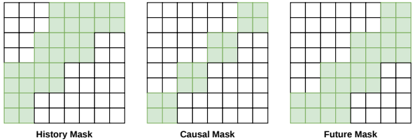

> [!abstract] arXiv · 2026 · Preprint
> **Hanke Xie et al.** (Northwestern Polytechnical University / Shenzhen Pimei Technology Co., Ltd.) · [→ Paper](https://arxiv.org/abs/2609.12728) · Demo: ✓ · Code: ✗
>
> A streaming token-to-mel decoder that trains MeanFlow with a mel-space output (the network predicts a mel field and the average velocity is derived from it) and bounds its context with layer-selective block masks, improving 2-3 step decoding quality over a velocity-predicting MeanFlow decoder.

## Problem

Semantic-token TTS pipelines in the CosyVoice style leave speaker detail, prosody and fine spectral structure to a flow-matching acoustic decoder. That decoder needs several neural function evaluations (NFEs) per output, which is costly in streaming, where each packet must finish within its playback interval. MeanFlow cuts the step count by learning the average velocity over an interval, but quality still drops at 2-3 steps. A streaming decoder also needs a bounded receptive field: global attention grows with utterance length, while decoding chunks independently breaks continuity at chunk boundaries. The paper argues that prior work treats the sampling budget (few-step generation) and the context budget (bounded attention) separately.

## Method

The decoder maps discrete speech tokens to an 80-bin mel-spectrogram (16 kHz, 160-sample hop). The tokens are S3Tokenizer v2 tokens with the CosyVoice 2 BPE vocabulary (6,563 entries, 25 Hz). A frozen text-to-token LLM supplies the tokens and a frozen HiFi-GAN vocoder renders the waveform. Only the decoder is trained. The backbone is a Diffusion Transformer (DiT) in two sizes: Small (16 layers, hidden size 768, 159M parameters) and Base (22 layers, hidden size 1,024, 341M parameters).

![Figure 1: Overall framework and few-step inference process of the proposed X-Pred MeanFlow acoustic decoder. A frozen text-to-token LLM generates discrete speech tokens c, which condition the trainable token-to-mel decoder. At each sampling step, the decoder directly predicts the clean mel-spectrogram x̂θ and analytically recovers the mean velocity as ûθ = (zt − x̂θ)/t. The resulting mel-spectrogram x̂ is converted into waveform ŷ by a frozen HiFi-GAN vocoder. The snowflake symbol denotes frozen components.](assets/2609.12728/figure-1.png)

**X-Pred MeanFlow.** A standard ("Direct-u") MeanFlow decoder outputs the average velocity u(z_t, r, t, c) directly. X-Pred instead outputs a "generalized mel field" x = z_t − t·u, and recovers the velocity as û = (z_t − x̂)/t. When r = 0 this field is the clean mel endpoint; when r = t it reduces to standard endpoint (x-) prediction. The training loss is unchanged: the derived û is still regressed onto the stop-gradient MeanFlow target v_t − (t − r)·D_t û, with the total derivative computed by a Jacobian-vector product. So the change is an output reparameterization: the loss stays in velocity space and the network predicts in mel space. With one step, the output is exactly the predicted clean mel. Training uses a CFG-aware target with guidance scale 2.0; all reported inference uses CFG = 0.

**Layer-selective block-masked attention.** Token and mel sequences are split into aligned blocks (B = ρC mel frames per block of C tokens). Each DiT layer ℓ has a past-block budget P_ℓ and a future-block budget F_ℓ, applied as an additive attention mask. Most layers see only the current block, and a selected subset sees history or bounded look-ahead. Masked layers can stack, so the receptive field could still grow. Inference therefore runs on a fixed sliding window of H past and F future blocks, which bounds context, memory and per-packet compute regardless of utterance length. "LS-Strict" uses no look-ahead; "LS-Bounded" adds bounded future context.

Training uses Emilia, AdamW (peak learning rate 7.5 × 10⁻⁵, 20k warmup updates) and 2.0M updates. Within each model size, Direct-u and X-Pred share the backbone, data, block-mask configuration, optimizer and update budget.

## Key Results

Evaluation uses 100 randomly selected sentences from unseen speakers. Metrics are UTMOS, WER and speaker similarity (SIM), with WER and SIM from the Seed-TTS evaluation toolkit.

**Few-step quality (Table 1).** X-Pred is better than Direct-u on all three metrics at every matched NFE and model size:

| Model, NFE | Direct-u UTMOS / SIM / WER | X-Pred UTMOS / SIM / WER |
|---|---|---|
| Small, 2 | 2.910 / 0.638 / 8.19% | 3.189 / 0.661 / 6.89% |
| Small, 3 | 3.051 / 0.649 / 7.79% | 3.310 / 0.670 / 6.28% |
| Base, 2 | 2.867 / 0.669 / 6.58% | 3.247 / 0.678 / 6.23% |
| Base, 3 | 3.076 / 0.671 / 6.30% | 3.382 / 0.684 / 5.89% |

Small X-Pred at 10 NFE (UTMOS 3.464, SIM 0.697, WER 5.54%) is a quality reference, not a matched comparison. Small X-Pred beats Base Direct-u on UTMOS at both 2 and 3 NFE. On SIM it is slightly lower (0.661 vs 0.669 at 2 NFE; 0.670 vs 0.671 at 3 NFE). On WER it is worse at 2 NFE (6.89% vs 6.58%) and slightly better at 3 NFE (6.28% vs 6.30%). The parameter-efficiency claim therefore holds for UTMOS only; SIM and WER are roughly tied.

**Streaming (Table 2).** B-CMOS is a boundary comparison score relative to the non-streaming Full reference, which is fixed at 0. Higher is better, so a negative value means worse than Full. The paper does not say how B-CMOS is collected or who rated it.

| Config | NFE | UTMOS | B-CMOS | RTF | First / startup (ms) |
|---|---|---|---|---|---|
| Full (non-streaming) | 3 | 3.356 | 0 | not reported | not reported |
| Local | 3 | 3.084 | −0.42 | 0.352 | 98.0 / 338.0 |
| Uniform | 3 | 3.273 | −0.15 | 0.618 | 160.0 / 640.0 |
| LS-Strict | 3 | 3.238 | −0.23 | 0.446 | 118.0 / 358.0 |
| LS-Bounded | 2 | 3.189 | −0.10 | 0.401 | 106.9 / 586.9 |
| LS-Bounded | 3 | 3.310 | −0.07 | 0.543 | 141.0 / 621.0 |

At 3 NFE, LS-Bounded has the highest UTMOS and B-CMOS of the streaming schedules. It also beats Uniform (the same bounded mask on every layer) on RTF and startup latency. Local is the cheapest (RTF 0.352, 338 ms startup) but loses the most quality (UTMOS 3.084, B-CMOS −0.42). LS-Strict avoids look-ahead and starts much sooner than LS-Bounded (358 ms vs 621 ms), but scores lower on both quality measures. The paper reports zero deadline misses at 2 and 3 NFE for LS-Bounded over "hundreds of seconds" of audio, with no table for this. Table 2 does not state the model size. Its LS-Bounded UTMOS values (3.189 and 3.310) match the Small X-Pred rows in Table 1.

The comparison is internal only. No external decoder (for example the CosyVoice 2 flow-matching decoder or another few-step method) is evaluated, so the absolute quality of the system relative to published decoders is unknown.

## Novelty Assessment

The paper has two parts. The first is the mel-space (x-prediction) reparameterization of MeanFlow for a token-to-mel decoder. It is a clean change: the target and sampler stay the same and the network output becomes a data-space quantity. Its reference list includes image-domain work on predicting the clean signal ("Back to basics: let denoising generative models denoise") and on pixel-space mean flows. The paper does not spell out how its formulation differs from those works, so the clearly new part is the transfer to speech-token decoding with a matched Direct-u ablation. The second part, layer-selective block-masked attention, extends block-wise and chunk-aware masking (CosyVoice 2's chunk-aware flow matching, StreamFlow's block-wise masks) by giving each layer its own past/future budget. Both parts are small, well-isolated design changes. The evaluation is equally small: one 100-sentence test set, automatic metrics, and internal baselines only.

## Field Significance

Moderate — The paper gives matched-ablation evidence that the output parameterization matters for few-step MeanFlow speech decoding: predicting mel rather than velocity helps at 2-3 steps at two model sizes. It also shows that bounded context is best spent unevenly across layers in a streaming DiT decoder. The authors state that the paper is accepted to ISCSLP 2026; this page summarizes the arXiv preprint.

## Claims

- **supports:** Parameterizing a few-step average-velocity flow decoder to predict the clean acoustic target, rather than the velocity, improves quality at very low step counts without changing the training target or sampler.
  > *Evidence:* With the same backbone, data, masks and 2.0M updates, X-Pred beats Direct-u MeanFlow on UTMOS, SIM and WER at 2 and 3 NFE for both the 159M and 341M decoders (e.g. Small, 2 NFE: UTMOS 2.910 → 3.189, WER 8.19% → 6.89%). *(§4.2, Table 1)*
- **refines:** Improvements to the few-step generative objective can substitute for decoder scale on naturalness, but not necessarily on speaker similarity or intelligibility.
  > *Evidence:* Small X-Pred beats Base Direct-u on UTMOS at 2 and 3 NFE (3.189 vs 2.867; 3.310 vs 3.076). SIM stays slightly lower (0.661 vs 0.669; 0.670 vs 0.671), and WER is worse at 2 NFE (6.89% vs 6.58%). *(§4.2, Table 1)*
- **supports:** In streaming acoustic decoders, giving cross-chunk context to a subset of layers gives a better quality-latency trade-off than independent chunk decoding or the same bounded context in every layer.
  > *Evidence:* At 3 NFE, LS-Bounded reaches UTMOS 3.310 and B-CMOS −0.07 at RTF 0.543, compared with Uniform (3.273, −0.15, RTF 0.618) and Local (3.084, −0.42, RTF 0.352). *(§4.3, Table 2)*
- **complicates:** Bounded look-ahead improves chunk-boundary quality in streaming synthesis but costs startup latency.
  > *Evidence:* LS-Bounded (with look-ahead) beats LS-Strict on UTMOS (3.310 vs 3.238) and B-CMOS (−0.07 vs −0.23), but estimated startup latency rises from 358 ms to 621 ms. *(§3.3; §4.3, Table 2)*

## Limitations and Open Questions

- The evaluation uses only 100 sentences, automatic metrics (UTMOS, WER, SIM) and the undefined B-CMOS score. The paper does not report a MOS listening test, confidence intervals or significance tests.
- There is no comparison with an external decoder (the CosyVoice 2 flow-matching decoder, IntMeanFlow, or a many-step CFM decoder). All gains are relative to the authors' own Direct-u MeanFlow.
- The paper does not identify the frozen text-to-token LLM. It also does not say whether evaluation tokens come from that LLM or from ground-truth speech, or how speaker identity is supplied to the decoder for the unseen-speaker SIM evaluation.
- The evaluation language is not stated, though Emilia is multilingual.
- Block size, the per-layer (P_ℓ, F_ℓ) assignment and the window sizes H and F are not reported, so the streaming configurations cannot be reproduced from the paper. Hardware for the RTF and latency figures is not stated.
- The zero-deadline-miss runtime result is described in prose only. Table 2 does not state the model size.
- No code release is mentioned.

## Wiki Connections

- [[flow-matching|Flow Matching]] — Trains a MeanFlow (average-velocity flow-matching) token-to-mel decoder and shows that a mel-space output parameterization improves 2-3 step generation.
- [[streaming-tts|Streaming TTS]] — Proposes layer-selective block-masked attention with a fixed sliding window for chunk-wise streaming decoding, and reports RTF, first-packet and startup latency for several context schedules.
- [[2412.10117|CosyVoice 2]] — Supplies the token vocabulary and the chunk-aware causal flow-matching approach that this decoder's block-masked streaming design builds on.
- [[2407.05407|CosyVoice]] — Cited as the source of the semantic-token LM plus conditional flow-matching decoder pipeline that this work targets.
- [[2505.17589|CosyVoice 3]] — Cited alongside CosyVoice as a semantic-token pipeline with a flow-matching acoustic decoder.
- [[2510.07979|IntMeanFlow]] — Cited as prior average-velocity few-step speech generation; it is not evaluated as a baseline.
- [[2407.05361|Emilia]] — Training corpus for all decoders.
- [[2204.02152|UTMOS]] — Primary automatic naturalness metric in both the few-step and streaming evaluations.
- [[2406.02430|Seed-TTS]] — Its evaluation toolkit computes the WER and speaker-similarity scores.
- [[2025.acl-long.313|F5-TTS]] — Cited as a conditional flow-matching speech generator in the background on multi-step flow decoders.
