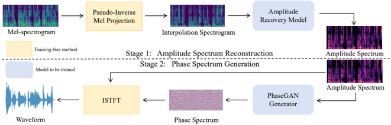

> [!abstract] arXiv · 2026 · Preprint
> **Wenzheng Zhang et al.** (Inner Mongolia University) · [→ Paper](https://arxiv.org/abs/2609.12918) · Demo: ✓ · Code: ✗
>
> PhaseGAN splits mel-to-waveform vocoding into two stages. A regression network first recovers the amplitude spectrum. A second network then generates the phase spectrum through adversarial training alone, with no phase target. The result is a 1.6M-parameter time-frequency vocoder, and a 0.54M-parameter compact variant.

## Problem

Mel-spectrograms carry amplitude information but no phase. Recovering the amplitude spectrum from a mel input is close to interpolation, while recovering phase is a one-to-many generation problem: many phase spectra are perceptually equivalent for one amplitude spectrum. The authors argue that time-domain GAN vocoders (HiFi-GAN, BigVGAN) spend many parameters and operations on both problems at once. Time-frequency vocoders with explicit phase prediction (APNet, APNet2, FreeV) supervise phase with strong losses against the target phase, which fits the one-to-many mapping poorly.

## Method

Inference has four steps (§2.1, Figure 1):

1. The 80-band mel-spectrogram is projected back to the 513-bin linear-frequency scale with the pseudo-inverse of the mel filterbank (the FreeV idea).
2. An amplitude recovery network refines this interpolated spectrum into an amplitude spectrum.
3. A generator predicts the phase spectrum conditioned on the estimated amplitude.
4. The inverse STFT combines amplitude and phase into a waveform.

Both networks use ICCRN (Inplace Cepstral Convolutional Recurrent Neural Network), a speech-enhancement architecture from the authors' earlier work (§2.2). ICCRN does no down- or up-sampling along frequency, so all layers keep 513 frequency bins and the same channel count. It adds cepstral analysis and dual-path LSTMs over frequency and time; the time-axis LSTM is unidirectional, so the model is causal. The amplitude network uses 10 channels, a Softplus output and an MSE loss on amplitude (§2.3). The phase generator uses 20 channels and borrows the APNet output head: two parallel convolutions produce pseudo-real and pseudo-imaginary components, and a two-argument arctangent maps them to wrapped phase in (−π, π] (§2.4).

The phase stage is trained with the R3GAN recipe from image generation (§2.4). The generator loss combines a multi-resolution STFT loss (magnitude and spectral-convergence terms over three resolutions, weight 0.8) with a relativistic paired adversarial loss (weight 0.2). The discriminator is a MelGAN-style multi-scale waveform discriminator. Its loss adds zero-centred R1 and R2 gradient penalties with a cosine-scheduled coefficient. No loss term compares predicted phase to target phase, so phase is learned only through waveform-level adversarial and magnitude feedback. The two stages are trained separately: 1M steps for amplitude and 1.5M steps for phase, batch 16, on LJSpeech at 22.05 kHz with a 1024-point FFT and hop 256 (§3.4). PhaseGAN-s shrinks the two ICCRNs to 3 and 8 channels (§3.4).

## Key Results

All baselines (HiFi-GAN, iSTFTNet, BigVGAN, APNet, Vocos, APNet2, FreeV) were retrained on the VITS LJSpeech split, with the same training steps and batch size as PhaseGAN (§3.2, §3.4). MOS comes from a crowd-sourced Amazon Mechanical Turk test with 20 listeners (§3.3).

**LJSpeech, single speaker (Table 1).** Among the retrained systems, PhaseGAN (1.63M params, 6.42G MACs) has the best value on every quality metric:

- WB-PESQ 3.926 (next best: PhaseGAN-s 3.672, then FreeV 3.593)
- STOI 0.988 (next best: PhaseGAN-s 0.981)
- MCD 2.108 (next best: PhaseGAN-s 2.483)
- V/UV F1 0.969 (next best: 0.962 for APNet2 and FreeV)
- periodicity error 0.088 (next best: FreeV 0.106)
- pitch RMSE 17.926 (next best: PhaseGAN-s 20.522)
- F0-RMSE 35.216 (next best: HiFi-GAN 36.232)
- UTMOS 4.238 (next best: iSTFTNet 4.236)
- MOS 4.256 ±0.05 (next best: HiFi-GAN 4.233 ±0.03)

The UTMOS lead is 0.002, and the MOS confidence intervals of PhaseGAN and HiFi-GAN overlap. On those two metrics PhaseGAN effectively ties the best time-domain baselines. Its advantage on PESQ, MCD and pitch error is larger.

Some values the authors copied from the original baseline papers (in parentheses in Table 1) beat PhaseGAN's numbers. APNet2 reports MCD 2.078, and APNet and FreeV report F0-RMSE of 19.83 and 26.40. So PhaseGAN's lead holds only under the authors' retraining protocol.

PhaseGAN-s has the fewest parameters (0.54M) and the lowest compute (1.05G MACs) in the table. Vocos needs 1.11G MACs and 13.35M parameters. On objective metrics PhaseGAN-s beats every baseline on WB-PESQ, STOI and MCD. Its MOS (3.986 ±0.05) is lower than HiFi-GAN (4.233), iSTFTNet (4.143), Vocos (4.112) and FreeV (4.017). The authors' "near-SOTA quality" description of the compact model rests on objective metrics, not on listener ratings.

**Ablations (Table 1).** Every ablation hurts MOS and UTMOS. Removing the zero-centred gradient penalty does the most damage (MOS 3.014, WB-PESQ 3.091, F0-RMSE 49.523), which supports the authors' point that stable adversarial training is central. Without the MR-STFT loss, MOS falls to 3.586. Without the adversarial loss, MOS falls to 3.743 and UTMOS to 3.483, and the authors report audible mechanical artifacts. Removing the ICCRN frequency or cepstral modules costs about 0.6 MOS.

**Unseen speakers, VCTK (Table 2).** Only HiFi-GAN and FreeV are compared, all trained on LJSpeech only. PhaseGAN has the best value on every metric: WB-PESQ 3.199 vs. 2.578 (HiFi-GAN) and 2.414 (FreeV), and MOS 4.142 vs. 3.886 and 3.764. Its pitch RMSE (16.026) is less than half that of HiFi-GAN (37.109).

**Singing, Opencpop (Table 3).** Again, all models are trained on LJSpeech only. PhaseGAN has the best value on every metric. Its WB-PESQ is 3.865, against 2.301 for HiFi-GAN and 2.952 for FreeV. MCD is 1.512, against 3.532 and 3.011. MOS is 4.356, against 4.012 and 3.956. The F0-RMSE lead is small (39.112 vs. HiFi-GAN 39.251). The authors say the singing MOS test used 5 native Mandarin listeners, which leaves the rater count for this test unclear (§3.3).

**End-to-end TTS with FastSpeech 2 mels (Table 4).** PhaseGAN gives the highest UTMOS (4.245) and MOS (4.189 ±0.06). HiFi-GAN is close (4.132 and 4.145 ±0.02), and the MOS confidence intervals overlap. PhaseGAN-s gives the lowest MOS (3.985).

## Novelty Assessment

The main new element is the training objective: phase is learned by adversarial training (R3GAN's relativistic loss with zero-centred penalties) on a dedicated phase generator, after a separately trained amplitude network. The two-stage design, the pseudo-inverse mel projection (from FreeV) and the parallel phase head (from APNet) are reused components. ICCRN comes from the authors' own speech-enhancement work.

The "first systematic application of adversarial training to phase reconstruction" claim (§1, §5) needs care. Vocos, a baseline in Table 1, also predicts phase without a direct phase loss, relying on adversarial and magnitude-domain losses. PhaseGAN's distinctive choices are the explicit decoupling and the R3GAN recipe, not phase learning without phase targets in itself.

The evidence is mixed. The retrained comparison is broad and the ablations are informative, but listener tests use crowd-sourced raters, and generalization tests use only two baselines. The standard model is not cheap in compute: it has the fewest parameters of the full-size models, but its 6.42G MACs are four to six times those of Vocos and FreeV, and more than twice those of APNet2. Its efficiency advantage is mainly in parameter count.

## Field Significance

Moderate. The paper gives evidence that treating amplitude as regression and phase as adversarial generation can yield a very small time-frequency vocoder. It is competitive with retrained GAN and phase-prediction vocoders on LJSpeech, and it generalizes better than HiFi-GAN and FreeV to unseen speakers and to singing. The strongest results come from a single training speaker and the authors' own retraining of baselines, so it is an incremental data point on vocoder parameter efficiency, not a settled advance.

## Claims

- **supports:** Decoupling amplitude regression from adversarially generated phase allows a time-frequency vocoder with very few parameters to match or exceed much larger GAN vocoders on objective quality metrics.
  > *Evidence:* PhaseGAN (1.63M params) reaches WB-PESQ 3.926 and MCD 2.108 on LJSpeech, against 3.574 and 3.641 for retrained HiFi-GAN (13.94M) and 3.522 and 2.672 for Vocos (13.35M). The 0.54M-parameter PhaseGAN-s still reaches WB-PESQ 3.672. *(§4.1, Table 1)*
- **supports:** Phase spectra can be learned without any phase supervision when adversarial training is stabilized, and the stabilization terms are essential.
  > *Evidence:* The phase generator gets only multi-resolution STFT magnitude losses and an R3GAN relativistic adversarial loss. Removing the zero-centred gradient penalty drops MOS from 4.256 to 3.014 and raises F0-RMSE from 35.216 to 49.523. Removing the adversarial loss drops UTMOS to 3.483. *(§2.4, §4.2, Table 1)*
- **complicates:** Gains in objective metrics for compact vocoders do not necessarily carry over to listener ratings.
  > *Evidence:* PhaseGAN-s beats every baseline on WB-PESQ, STOI and MCD on LJSpeech, yet its MOS (3.986) is below HiFi-GAN (4.233), iSTFTNet (4.143), Vocos (4.112) and FreeV (4.017). In FastSpeech 2 end-to-end synthesis it has the lowest MOS of the four vocoders (3.985). *(§4.1, §4.5, Tables 1 and 4)*
- **supports:** A vocoder whose phase generation depends mainly on the amplitude spectrum can generalize to unseen speakers and to singing when trained on a single speaker.
  > *Evidence:* Trained only on LJSpeech, PhaseGAN reaches MOS 4.142 on unseen VCTK speakers (HiFi-GAN 3.886, FreeV 3.764) and MOS 4.356 on Mandarin singing from Opencpop (HiFi-GAN 4.012, FreeV 3.956). Its pitch RMSE is roughly half that of HiFi-GAN on both sets. *(§4.3, §4.4, Tables 2 and 3)*
- **complicates:** Vocoder rankings depend on the retraining protocol, so numbers reported in original baseline papers and in reproductions can disagree.
  > *Evidence:* Under the authors' retraining on the VITS LJSpeech split, APNet's F0-RMSE is 39.739 against 19.83 in the original paper, and FreeV's is 39.087 against 26.40. APNet2's original MCD (2.078) is lower than PhaseGAN's 2.108. *(§3.2, Table 1)*

## Limitations and Open Questions

Training uses only LJSpeech, one female English speaker at 22.05 kHz (§3.4). The model's behaviour after multi-speaker or high-sample-rate training is untested, and the authors list broader datasets as future work (§6). BigVGAN is designed for large-scale universal training, but here it is retrained on LJSpeech alone. This likely understates that baseline.

The unseen-speaker, singing and end-to-end comparisons include only HiFi-GAN and FreeV (Tables 2 to 4). The listening tests are crowd-sourced on Amazon Mechanical Turk with 20 listeners. For the singing test the paper names 5 native Mandarin listeners without making clear whether these are part of, or instead of, the 20 (§3.3). No significance testing is reported, and several MOS gaps fall within overlapping confidence intervals.

The paper does not say whether the phase generator is trained on ground-truth or on stage-1 estimated amplitude spectra. This matters for the mismatch between the two stages at inference. The paper reports MACs but not real-time factor or on-device latency, although it argues the model suits edge devices. The paper links a demo repository, but no code release is stated.

## Wiki Connections

- [[gan-vocoder|GAN Vocoder]] — PhaseGAN is a GAN-trained time-frequency vocoder that applies adversarial training only to phase generation, after a separate amplitude regression stage.
- [[subjective-evaluation|Subjective Evaluation]] — Crowd-sourced MOS tests on English speech and Mandarin singing show that a compact variant leading on objective metrics can still trail baselines with listeners.
- [[2010.05646|HiFi-GAN]] — The main time-domain baseline, retrained on the same LJSpeech split. PhaseGAN beats it on objective metrics and roughly ties it on single-speaker MOS.
- [[2206.04658|BigVGAN]] — Retrained on LJSpeech alone as a time-domain baseline; PhaseGAN outperforms it on all Table 1 metrics with about a tenth of the parameters.
- [[2306.00814|Vocos]] — An iSTFT-based baseline that also learns phase without a direct phase loss; PhaseGAN-s undercuts its compute and parameter count.
- [[2006.04558|FastSpeech 2]] — Provides the pretrained acoustic model whose mel outputs feed the vocoders in the end-to-end TTS evaluation.
- [[2204.02152|UTMOS]] — Used as the automatic naturalness predictor alongside crowd-sourced MOS in all speech evaluations.
