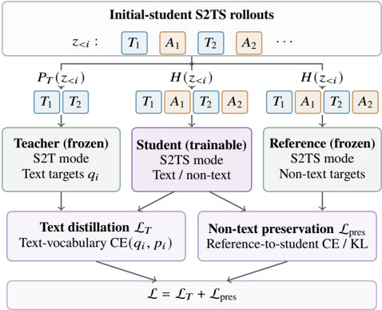

> [!abstract] arXiv · 2026 · Preprint
> **Daxin Tan et al.** (Huawei / The Chinese University of Hong Kong / City University of Hong Kong) · [→ Paper](https://arxiv.org/abs/2609.15313) · Demo: ? · Code: ?
>
> Shows that speech LMs which interleave text and acoustic tokens answer markedly less accurately when they also speak than when they answer in text only (the "output-mode gap"), and narrows that gap by distilling the model's own text-only policy into its joint text-and-speech generation on its own sampled trajectories.

## Problem

Many speech LMs that answer in speech keep an explicit text stream to guide acoustic generation. In fully discrete designs such as Step-Audio 2 and Baichuan-Audio, text and acoustic tokens are generated autoregressively in an interleaved pattern, so every acoustic token the model emits becomes context for its next text token. Prior work on modality gaps looked at the input side: how speech input degrades reasoning compared with text input. Nobody had isolated the output side, holding the speech input and the model fixed and asking whether the text answer stays as accurate once speech output is switched on.

The authors measure this directly. They define the output-mode gap (OMG) as speech-to-text (S2T) answer accuracy minus the accuracy of the internal text produced in speech-to-text-and-speech (S2TS) mode, under the same answer extractor. A positive gap means the model answers worse while speaking. Before any training, Step-Audio-2-mini shows gaps of 42.87 pp on Spoken-MQA and 29.72 pp on speech-rendered GSM8K. Baichuan-Audio-Instruct shows 12.41 and 10.39 pp.

## Method

Joint-Output On-Policy Distillation (JO-OPD) uses the model's own stronger S2T mode as the teacher for its S2TS mode. The student starts from the base model and samples joint S2TS trajectories for each spoken prompt. At every text position, two contexts are built from the same speech input. The student sees its full native interleaved history (text, acoustic and control tokens). The frozen teacher, in S2T mode, sees only the text-only projection of that history, with acoustic and control tokens removed. The student therefore learns to predict the text token that the text-only policy would choose after the same text prefix, despite the acoustic tokens in its own context.

The text distillation loss is a cross-entropy restricted to the text vocabulary, so it shapes preferences among text tokens without directly pushing the probability of text versus non-text outputs. JO-OPD-Soft uses the teacher's top-32 text tokens, renormalised, as the target. JO-OPD-Hard uses a one-hot target at the teacher's top text token. A second, preservation loss keeps acoustic and control-token predictions close to a frozen S2TS reference copy of the base model, conditioned on the same joint history. For Step-Audio 2 this is a top-32 cross-entropy on non-text positions of the shared output head (weight 0.05). For Baichuan-Audio it is an exact KL on the controller and codec distributions (weights 1 and 10), with codec-loss gradients flowing through the frozen speech head into the shared language model. The total objective is the sum of the two losses.

Training uses 27,847 prompts from Tulu 3 and NaturalReasoning, with overlap against the evaluation sets removed. Training speech is synthesised with the single SLT voice in flite. The main runs train for one epoch on fixed trajectories sampled once from the initial student, using AdamW, batch size 32 and learning rate 2 × 10⁻⁶. For Step-Audio 2 the full language model is updated with the audio encoder and adapter frozen. For Baichuan-Audio the language model and text head are updated and everything else is frozen. Model sizes and the native acoustic tokenizers are not described in the paper beyond the model names.

## Key Results

Answer accuracy is scored with the same extractor across modes. Spoken answers are transcribed with Whisper-large-v3-turbo and scored with the same rule, so the generated speech is evaluated for answer content. Matched baselines use the same prompts and number of updates: Self-SFT trains on the same S2TS trajectories, and Response-SFT trains on independently generated S2T responses.

- **Step-Audio 2, internal text (Table 1).** JO-OPD-Soft raises S2TS internal-text accuracy from 32.45% to 58.92% on Spoken-MQA and from 39.50% to 56.86% on GSM8K. S2T accuracy barely moves (75.32 to 75.18, 69.22 to 69.90), so the gap falls from 42.87 to 16.26 pp and from 29.72 to 13.04 pp. JO-OPD-Soft has the highest internal-text accuracy and the lowest gap of all five rows on both benchmarks. Self-SFT makes things worse (gaps of 52.57 and 34.80 pp). Response-SFT changes little (44.37 and 28.51 pp).
- **Baichuan-Audio, internal text (Table 2).** The gains are much smaller. The gap falls by 2.92 pp on Spoken-MQA (12.41 to 9.49) and by 0.61 pp on GSM8K (10.39 to 9.78). JO-OPD has the lowest gap of the three rows on both benchmarks. Part of the Spoken-MQA S2TS improvement is matched by a rise in S2T accuracy (66.26 to 69.54).
- **Reasoning instructions (Table 3).** On 1,000 human-recorded VoiceBench-BBH questions, asking Step-Audio 2 for explicit reasoning widens its base gap from 8.2 to 19.0 pp. JO-OPD-Soft cuts the chain-of-thought gap to 5.8 pp (S2TS internal text +14.7 points) and the short-answer gap to 5.0 pp (+2.9 points).
- **Spoken answers (Table 4).** Improvements in the generated speech are smaller than in the internal text. On Spoken-MQA, Step-Audio 2 spoken-answer accuracy rises from 28.67% to 36.16% (+7.49) and Baichuan-Audio from 50.14% to 53.07% (+2.92 as reported). On GSM8K, Baichuan-Audio rises by 2.35 points, but Step-Audio 2 with JO-OPD-Soft scores 35.25%, below the base (36.16%) and below Response-SFT (39.80%). For Step-Audio 2 on Spoken-MQA, the distance between internal-text and spoken-answer accuracy grows from 3.78 points in the base model to 22.76 points after JO-OPD-Soft.
- **Ablations (Tables 1 and 5).** Soft targets beat hard targets on internal-text accuracy by 17.97 points on Spoken-MQA and 4.32 on GSM8K. Supervising over the full vocabulary instead of the text vocabulary keeps internal-text accuracy within 1.8 points but collapses spoken-answer accuracy to 11.20% (Spoken-MQA) and 13.04% (GSM8K). Removing the preservation loss lowers spoken-answer accuracy to 29.74% and 30.02%.
- **Scale and refresh (Table 6, §5.4).** On Spoken-MQA, internal-text accuracy rises with training set size (36.95% at 2,000 prompts, 49.71% at 8,000, 58.92% at 27,847). Size and update count are confounded under one-epoch training. Regenerating trajectories from the updated student in a four-stage run adds 2.57 and 2.73 points over static trajectories.

Each configuration is evaluated with one response per input and no variance or significance testing.

## Novelty Assessment

There are two contributions. The first is diagnostic: the paper names and measures an output-side modality gap under fixed inputs and models, and shows it in two different interleaved architectures. The second is the training objective. On-policy distillation from a text-conditioned teacher already exists for input-side gaps (X-OPD, CORD). JO-OPD is new in using the same model's S2T mode as teacher on a text-only projection of the student's own interleaved history, with the loss restricted to the text vocabulary and a separate non-text preservation term. The ablations show that both of these design choices matter for the spoken output. The model architectures are unchanged.

The evidence is strongest for Step-Audio 2 internal text. Gains on Baichuan-Audio are small, and the gains in what the model actually says are much smaller than the internal-text gains, with no gain on GSM8K for Step-Audio 2. Matched baselines are fair in prompt count and update count. Self-SFT is reported for Step-Audio 2 only.

## Field Significance

Moderate — The paper identifies a concrete failure mode of interleaved text-speech generation: generated acoustic tokens in the context reduce the accuracy of the model's own text stream. It also gives a simple self-distillation fix that works without changing the architecture. Its spoken-answer results show that better internal text does not automatically yield better spoken answers. That makes the paper a useful cautionary data point for evaluating speech LMs by their text channel alone.

## Claims

- **supports:** In speech LMs that generate interleaved text and acoustic tokens, enabling speech output can substantially lower the accuracy of the model's own text stream compared with text-only responses to the same speech input.
  > *Evidence:* Under the same extractor and inputs, Step-Audio-2-mini's S2TS internal-text accuracy is 42.87 pp below its S2T accuracy on Spoken-MQA and 29.72 pp below on GSM8K; Baichuan-Audio-Instruct shows 12.41 and 10.39 pp gaps. *(§3.1, Table 1, Table 2)*
- **supports:** Distilling a speech LM's own text-only policy along its self-generated interleaved trajectories narrows the output-mode accuracy gap more than supervised fine-tuning on matched data.
  > *Evidence:* JO-OPD-Soft cuts Step-Audio 2's gap from 42.87 to 16.26 pp on Spoken-MQA, while Self-SFT widens it to 52.57 pp and Response-SFT leaves it at 44.37 pp; on Baichuan-Audio the reduction is smaller (2.92 and 0.61 pp). *(§5.1, Table 1, Table 2)*
- **complicates:** Gains in a speech LM's internal text accuracy only partly transfer to the content of its generated speech.
  > *Evidence:* For Step-Audio 2, JO-OPD-Soft adds 26.47 points of internal-text accuracy on Spoken-MQA but only 7.49 points of ASR-scored spoken-answer accuracy, and on GSM8K spoken-answer accuracy falls slightly below the base (35.25% vs. 36.16%). *(§5.2, Table 4)*
- **refines:** Fine-tuning the text predictions of a joint text-speech model needs explicit protection of its acoustic-token predictions, or speech output degrades even when text accuracy holds.
  > *Evidence:* Supervising over the full vocabulary keeps internal-text accuracy within 1.8 points of JO-OPD-Soft but drops ASR-scored spoken-answer accuracy from 36.16% to 11.20% on Spoken-MQA; removing the non-text preservation loss drops it to 29.74%. *(§5.3, Table 5)*
- **supports:** Explicit reasoning instructions widen the accuracy penalty of joint text-speech output in interleaved speech LMs.
  > *Evidence:* On human-recorded VoiceBench-BBH questions, Step-Audio 2's base gap rises from 8.2 pp (short answer) to 19.0 pp (chain of thought), because S2T accuracy rises slightly while S2TS internal-text accuracy falls. *(§5.1, Table 3)*

## Limitations and Open Questions

> [!warning] Speech output is evaluated only for answer content
> The generated speech is scored only by Whisper-large-v3-turbo transcription and answer extraction. The paper reports no WER of the speech against the internal text, no naturalness or quality score (MOS, UTMOS) and no listening test. Spoken-answer gains are far smaller than internal-text gains, and Step-Audio 2 shows no gain on GSM8K.

- The paper does not explain why the speech diverges increasingly from the internal text after JO-OPD-Soft (a 22.76-point difference on Spoken-MQA, against 3.78 in the base model). Text-speech misalignment, truncation within the 4,096 joint-token budget and ASR errors are not separated.
- Training speech comes from a single synthetic flite voice. Evaluation inputs are mostly synthetic (Spoken-MQA, speech-rendered GSM8K). Only the VoiceBench-BBH subset is human-recorded, and it is evaluated on Step-Audio 2 only.
- The method is tested on two fully discrete interleaved models only. Thinker-Talker designs, where speech does not feed back into text prediction, are outside its scope.
- Each configuration uses one generated response per input, with no confidence intervals or significance testing. Self-SFT is not run on Baichuan-Audio.
- Model sizes, compute, and code or demo availability are not reported.

## Wiki Connections

- [[spoken-language-model|Spoken Language Model]] — Trains two speech LMs that take spoken questions as input and shows that their text accuracy drops when they also produce speech.
- [[speech-to-speech|Speech-to-Speech]] — Targets spoken question answering with spoken responses and scores the generated speech by ASR-based answer accuracy.
- [[2507.16632|Step-Audio 2]] — The main base model; JO-OPD is applied to Step-Audio-2-mini, which shows the largest output-mode gap.
- [[2502.17239|Baichuan-Audio]] — Second base model, with a separate controller and codec head; JO-OPD gives smaller gains here.
- [[2606.30944|PRIME-Speech]] — A related approach that preserves S2T capability in speech generation by adding an audio post-decoder to a frozen backbone, rather than distilling within an interleaved model.
- [[2605.05927|TextPro-SLM]] — Shares an author and studies the input-side modality gap that this paper contrasts with its output-side gap.
- [[2410.17196|VoiceBench]] — Supplies the 1,000 human-recorded BBH questions used for the reasoning-instruction analysis.
- [[2402.05755|Spirit LM]] — An earlier interleaved text-speech LM cited as an example of the coupled generation design this paper analyses.
- [[2509.17765|Qwen3-Omni]] — Cited as the Thinker-Talker alternative with separate text and speech generation; the paper does not test JO-OPD on it.
