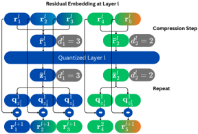

> [!abstract] arXiv · 2026 · Preprint
> **Trachu et al.** (Carnegie Mellon University) · [→ Paper](https://arxiv.org/abs/2609.17509) · Demo: ? · Code: ✓
>
> LACE gives each residual quantization layer of a dynamic-frame-rate codec its own segmentation boundaries, removing the error floor that shared boundaries impose, and adds union alignment and boundary anchoring so the variable-duration tokens can drive an autoregressive TTS model.

## Problem

Dynamic-frame-rate codecs shorten token sequences by merging adjacent frames into variable-length segments, each carrying one code and a duration. Prior methods either compress a single-codebook codec or apply one compression step before multi-layer residual vector quantization (RVQ). Both force every quantization layer to share the same segment boundaries. In RVQ, however, deeper layers encode finer residual detail that changes faster over time, so a single boundary set fits the first layer but not the deeper ones. The compression error left by shared boundaries passes through every layer untouched and becomes an error that more codebooks cannot remove.

## Method

LACE (Layer-Adaptive Codec Encoding) moves the compression step inside the RVQ stack. At each layer, the frame-level residual is segmented by a compression model, averaged per segment, quantized, and repeated back to frame level by its duration. The next residual is computed from the frame-level residual (not the segment mean), so it carries both the compression error and the quantization error of the current layer. LACE is agnostic to the compression model: the paper plugs in dynamic-programming segmentation (CodecSlime-style, minimizing within-segment reconstruction error at a target rate γ), cosine-similarity thresholding (FlexiCodec-style), and density-peak clustering (VARSTok-style).

Per-layer boundaries are a problem for TTS, because codes covering the same time span can have different durations in different layers. Union alignment takes the union of all layers' boundaries and re-segments every layer on that shared set, keeping each code and splitting its duration. This raises the effective frame rate. Boundary anchoring limits the increase: only layers up to an anchor layer l* may introduce new boundaries, and deeper layers must place boundaries at positions already in the anchor set (implemented for DP as an infinite cost on non-anchor boundaries). l* trades quality against frame rate.

A theoretical analysis models compression as a block-diagonal averaging matrix. Under three assumptions (strict compression, near-centroid quantizers, and a positive fraction of energy captured per layer), the bound on expected residual error after C layers converges to a constant floor (the first layer's compression error) for single compression, shrinks by a product of per-layer factors with boundary anchoring, and goes to zero for full layer-wise compression. The full derivation is in the supplementary material.

Codecs are DAC, EnCodec and SoundStream pretrained on LibriTTS with ESPnet-Codec recipes, then fine-tuned end to end for 80k iterations with the original codec (GAN) objective and LACE inserted into the quantizer. The TTS model is an autoregressive decoder-only Transformer (24 layers, dimension 1024, 16 heads; parameter count not reported) that predicts segment-level codes in a delay pattern. A duration head predicts a duration class for each first-layer code, applied to all layers after union alignment; training uses cross-entropy for codes and focal loss for durations (weights 1 and 3). Phonemes come from espeak-ng, and a 3-second reference utterance from the same speaker is prepended as a speaker prompt. Inference uses nucleus sampling (top-p 0.8).

## Key Results

**Reconstruction (Table I).** All systems are matched at about 8.6 kbps. Because LACE spends duration bits per layer, it reaches that bitrate at a lower average effective frame rate (22.5 Hz) than single compression (27 Hz). LACE beats single compression on every metric (WER, UTMOS, PESQ, STOI, SpkSim) in all five backbone and compression-model combinations. On fine-tuned DAC with DP compression, WER falls from 4.92% to 2.22%, UTMOS rises from 2.49 to 3.81, and PESQ from 1.61 to 3.08, close to uncompressed 75 Hz DAC at 24 kbps (WER 2.16%, UTMOS 3.95, PESQ 3.59). Gains are largest where single compression is weakest: fine-tuned SoundStream WER falls from 7.37% to 2.78%, and DAC with cosine compression from 6.9% to 2.57%. Figure 3 shows LACE ahead across the rate-distortion curve, including on the pretrained DAC without fine-tuning. Baselines are re-implementations on the same backbones, not the original systems.

**TTS (Table II, DAC with DP compression).** At equal γ, LACE improves on single compression on WER, UTMOS, SpkSim, MOS and SMOS. At γ = 0.5, single compression fails on intelligibility (WER 30.73%) while LACE with l* = 2 reaches 4.93%. At γ = 0.7, LACE (l* = 2) gets WER 5.11% vs 6.77%, UTMOS 3.45 vs 2.59, and MOS 3.96 ± 0.05 vs 3.85 ± 0.06. Union alignment raises LACE's effective rate (52.5 to 61.8 Hz vs 37.5 to 52.5 Hz for single compression), so LACE is slower than single compression at the same γ (RTF 1.73 vs 1.45 at γ = 0.7). At a matched 52.5 Hz, LACE (γ 0.5, l* 2) still edges single compression (γ 0.7) on WER (4.93% vs 6.77%), UTMOS (2.69 vs 2.59) and SMOS (3.86 vs 3.82), with overlapping MOS intervals.

Against the uncompressed 75 Hz model, LACE at γ = 0.7 reduces RTF from 1.95 to 1.73 (about 11%). Its MOS (3.96 ± 0.05) is within the confidence interval of the uncompressed model (3.94 ± 0.05), but objective quality drops (UTMOS 3.45 vs 4.18, WER 5.11% vs 2.31%). Raising the anchor layer from 2 to 3 does not improve quality and worsens WER (8.52% vs 4.93% at γ = 0.5). The authors attribute this to repeated code IDs after union alignment. TTS WER uses best-of-10 selection with Whisper-Small. Without reranking, the mean WER over 10 candidates keeps the same ranking (14% vs 61% at γ = 0.5; 14% vs 21% at γ = 0.7). Human ratings come from 35 raters on 25 utterances.

**Analysis.** Cosine similarity between consecutive residual frames is concentrated near 1 in early RVQ layers and shifts toward 0 in deeper layers (Figure 4). Measured quantization error on pretrained DAC follows the theory (Figure 5): single compression plateaus as layers are added while LACE keeps decreasing, and the gap narrows as γ approaches 1.

## Novelty Assessment

The core idea, per-layer segmentation inside RVQ with a residual update that propagates compression error, is a genuine structural change to dynamic-frame-rate codecs, which previously compressed once before quantization. SNAC already used different frame rates per layer, but fixed ones. The theoretical error-floor argument is a useful addition that explains why gains grow with codebook depth. Union alignment and boundary anchoring are simple and needed to make the tokens usable for TTS. The TTS model itself is a conventional delay-pattern AR codec LM with an added duration head. The evaluation is careful about fairness: bitrates are matched, baselines are re-implemented on the same backbones, and the paper checks that reranking does not drive the WER result. It is limited to LibriTTS and to one TTS configuration.

## Field Significance

Moderate — LACE shows that sharing segment boundaries across RVQ layers puts a floor on the error of dynamic-frame-rate codecs, and that per-layer boundaries remove it, with consistent reconstruction gains across three backbones and three compression models. For TTS, union alignment gives back much of the frame-rate saving, so LACE is a better rate-quality point than single compression rather than a large efficiency gain over uncompressed tokens. The authors state that the paper is accepted to SLT 2026; this page summarizes the arXiv preprint.

## Claims

- **supports:** Applying a separate temporal compression step at each residual quantization layer gives better reconstruction at matched bitrate than one compression step shared by all layers.
  > *Evidence:* At about 8.6 kbps, layer-wise compression beats single compression on WER, UTMOS, PESQ, STOI and SpkSim for DAC, EnCodec and SoundStream backbones and for DP, cosine and density-clustering segmenters (e.g. fine-tuned DAC + DP: WER 4.92% to 2.22%, PESQ 1.61 to 3.08), and Figure 3 shows the advantage at every bitrate. *(§V-A, Table I, Figure 3)*
- **supports:** In residual vector quantization, deeper layers encode faster-changing residuals, so a single set of segment boundaries suits early layers better than deep ones.
  > *Evidence:* Cosine similarity between consecutive frame-level residuals is concentrated near 1 in early layers and shifts toward 0 in deeper layers of the pretrained codecs. *(§V-C1, Figure 4)*
- **refines:** Shared segmentation boundaries leave a compression error that adding more quantization layers cannot remove, whereas recomputing boundaries per layer lets the error keep falling with depth.
  > *Evidence:* The derived bound converges to the first layer's compression error for single compression and to zero for full layer-wise compression; measured quantization error on pretrained DAC plateaus for single compression but keeps decreasing for LACE as layers are added, with the gap shrinking as the compression rate approaches 1. *(§III-D, §V-C2, Figure 5)*
- **complicates:** Variable-frame-rate codec tokens give smaller sequence-length savings in autoregressive TTS than in reconstruction, because the TTS model needs boundaries shared across codebook layers.
  > *Evidence:* LACE reaches its reconstruction bitrate at 22.5 Hz, but union alignment for TTS raises its effective rate to 52.5 to 61.8 Hz; the γ = 0.7 LACE TTS system (l* = 2) cuts RTF only from 1.95 to 1.73 relative to 75 Hz uncompressed tokens, and UTMOS falls from 4.18 to 3.45. *(§IV-D, §V-B, Table II)*
- **complicates:** Splitting long segments into repeated identical codes can bias autoregressive codec TTS toward repetition and hurt intelligibility.
  > *Evidence:* Raising the anchor layer from 2 to 3 increases the TTS effective rate (52.5 to 58.0 Hz) without improving quality and raises WER from 4.93% to 8.52%; the authors attribute this to repeated code IDs introduced by union alignment. *(§V-B, Table II)*

## Limitations and Open Questions

> [!warning]
> The TTS efficiency gain is modest. After union alignment, LACE TTS runs at 52.5 to 61.8 Hz, and the γ = 0.7 configuration (highest MOS and UTMOS among LACE systems) reduces RTF only by about 11% relative to uncompressed 75 Hz tokens, with a clear objective-quality cost (UTMOS 4.18 to 3.45, WER 2.31% to 5.11%).

- All experiments use LibriTTS (read English audiobook speech) at 24 kHz. Behaviour on expressive, conversational, multilingual or noisy speech is untested.
- The TTS study covers only DAC with DP compression and one AR model. TTS WER relies on best-of-10 selection with an ASR model, although a no-reranking check keeps the same ranking.
- Reconstruction frame rates for threshold-based segmenters are averages across layers, measured before union alignment. The reconstruction rates are therefore not the token rates a downstream LM would see.
- Repetition after union alignment limits deeper anchor layers. Repetition-aware sampling is proposed as future work but not tested.
- The theoretical bound depends on idealized assumptions (near-centroid quantizers, bounded energy capture) and covers codec quantization error only, not TTS quality.
- The TTS parameter count is not reported. No integration with a full speech language model is evaluated, although the motivation is speech language modeling.

## Wiki Connections

- [[neural-codec|Neural Audio Codec]] — Proposes layer-wise dynamic-frame-rate compression inside RVQ and evaluates it on reconstruction across three codec backbones.
- [[autoregressive-codec-tts|Autoregressive Codec TTS]] — Trains a delay-pattern AR codec LM with a duration head on union-aligned LACE tokens and measures the quality-efficiency trade-off.
- [[subjective-evaluation|Subjective Evaluation]] — Reports MOS and SMOS from 35 human raters, with a paired t-test separating close MOS scores.
- [[2510.00981|FlexiCodec]] — Its cosine-similarity boundary rule is re-implemented as a single-compression baseline and as a segmenter inside LACE.
- [[2509.04685|VARSTok]] — Its density-peak clustering segmentation is re-implemented as a baseline and wrapped by LACE.
- [[interspeech-2025-1289|TFC (Variable Frame Rate Codec)]] — Cited as a prior dynamic-frame-rate codec that shares one set of boundaries across quantization layers.
- [[2210.13438|EnCodec]] — One of the three codec backbones that LACE is fine-tuned on.
- [[2107.03312|SoundStream]] — Codec backbone where LACE gives the largest reconstruction WER reduction.
- [[2301.02111|VALL-E]] — Representative standard AR codec TTS; the LACE TTS model differs by also predicting per-segment durations.
- [[1904.02882|LibriTTS]] — Sole training and evaluation corpus for both codec and TTS experiments.
- [[2204.02152|UTMOS]] — Automatic naturalness metric used for reconstruction and TTS evaluation.
