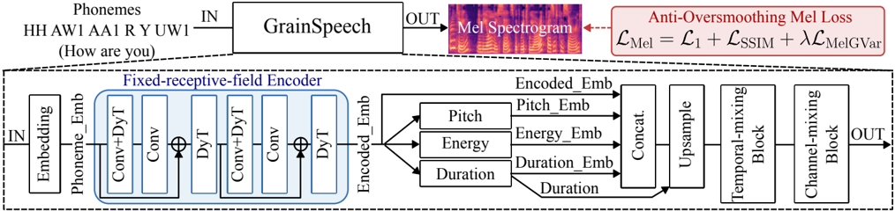

> [!abstract] arXiv · 2026 · Preprint
> **Zitao Liang et al.** (Delft University of Technology) · [→ Paper](https://arxiv.org/abs/2609.18856) · Demo: ✓ · Code: ✓
>
> A 264.8K-parameter non-autoregressive acoustic model pairs a fixed-receptive-field convolutional encoder with a Mel-specific gradient-variance loss, reaching UTMOS on par with a 75.7× larger model on LJSpeech and generating Mel spectrograms at 17.9× real time on a microcontroller.

## Problem

Acoustic models with only a few hundred thousand parameters must trade quality for capacity. The authors isolate two possible bottlenecks in this regime. First, prior comparisons of self-attention and convolutional encoders change both the architecture and the phoneme context the encoder can see, so the effect of each factor is unclear. Second, pointwise L1 supervision over-smooths Mel spectrograms. SSIM improves local structure but does not directly supervise fine-grained variation, and the gradient-variance (GVar) loss from image super-resolution was designed for two spatial axes, not for time and Mel frequency.

## Method

GrainSpeech follows the FastSpeech-style non-autoregressive pipeline (mapped here to `transformer-enc-dec`, although the model contains no self-attention). An encoder maps phonemes to hidden states. Pitch, energy and duration predictors run on the encoder output. The predicted features are embedded, concatenated with the encoder output and upsampled by duration. A dilated temporal-mixing block and a channel-mixing bottleneck MLP then produce an 80-bin Mel spectrogram. A shared HiFi-GAN v2 vocoder reconstructs the waveform for all systems. The full model has 264.8K parameters, about the same budget as EfficientSpeech's ES-Tiny.

The encoder is a phoneme embedding followed by stacked residual convolutional blocks. Dilation schedules set a fixed receptive field W on the phoneme sequence, and DynamicTanh (DyT) replaces LayerNorm. To choose W, the authors build a parameter-matched single-block self-attention encoder (based on EfficientSpeech) with symmetric attention masks. This setup lets them compare attention and convolution at the same accessible context. The final model uses W = 15 phonemes, chosen on validation acoustic-feature errors.

The training objective is L_Mel = L1 + L_SSIM + λ·L_MelGVar. Mel-GVar keeps the local gradient-variance principle of image GVar but changes three components. Axis-wise first-order differences along time and Mel frequency replace Sobel filters. Sliding 11×5 time × frequency windows replace non-overlapping patches. Log-domain L1 matching of local variances replaces raw-domain L2 matching, so the loss compares relative rather than absolute variance gaps. Mel-GVar uses λ = 0.5. Models train from scratch on LJSpeech (12,588 training utterances) with AdamW for 5,000 epochs. Durations come from forced-alignment TextGrids, and pitch and energy come from WORLD, averaged per phoneme.

## Key Results

**Encoder context study (§3.2, Fig. 2).** Widening the attention receptive field beyond 15 phonemes, including global attention, gives no consistent gain in pitch, energy or duration MSE. At every shared W, the convolutional encoder (147,428 parameters) has lower MSE than the attention encoder (147,368 parameters) on all three targets. At W = 15 it reduces pitch, energy and duration MSE by 36.0%, 17.3% and 3.4%.

**Loss ablation (§3.3, Fig. 3).** UTMOS is 3.798 with L1 only and 3.923 with L1 + SSIM. Adding the original image-domain GVar restores fine-scale spectral energy but adds horizontal discontinuities and drops UTMOS to 2.769. Mel-GVar reaches 4.086, the highest of the four objectives. Applied to ES-Tiny, Mel-GVar raises UTMOS from 3.591 to 3.945 and lowers MCD-DTW from 6.374 to 6.350 dB. WER changes from 3.08% to 3.13%. The loss therefore helps a second architecture as well.

**Overall comparison (§3.4, Table 1).** At the ES-Tiny budget, GrainSpeech raises UTMOS by 0.496 (paired-bootstrap 95% CI [0.431, 0.562]). WER is close (3.27% vs. 3.08%, overlapping CIs), and MCD-DTW is slightly lower (6.314 vs. 6.374 dB). Of this gain, the loss accounts for 0.354 and the encoder adds 0.141 (CI [0.077, 0.204]) under the same objective. GrainSpeech has the highest UTMOS of the systems below 5M parameters (ES-Small 3.885, ES-Base 3.900, SpeedySpeech 3.716). Its UTMOS is statistically tied with MixerTTS (4.086 vs. 4.087, overlapping CIs), which has 75.7× more parameters. It is above FastSpeech 2 (3.953) and below Matcha-TTS (4.264). All 18 to 35M-parameter models have lower WER (1.80% to 2.85%) and lower MCD-DTW (5.374 to 5.935 dB). The UTMOS parity with larger models therefore does not extend to intelligibility or spectral distortion.

**MCU deployment (§3.4, Table 2).** With 16-bit activations and 8-bit weights (A16W8) on an STM32H747XI (480 MHz Cortex-M7, 1 MB SRAM), GrainSpeech generates Mel spectrograms at 17.9× real time with 483.19 KiB peak SRAM. ES-Tiny runs at 17.2× with 478.59 KiB. Quantization changes UTMOS by −0.036 for GrainSpeech and −0.079 for ES-Tiny. ES-Small does not fit in SRAM. These figures cover the acoustic model only; vocoding is not deployed.

The comparisons with ES-Tiny are controlled (same split, pipeline and seed). The external checkpoints (MixerTTS, Matcha-TTS, FastSpeech 2, SpeedySpeech) use their own data splits, training settings and frontends. The authors treat those rows as reference points rather than controlled comparisons.

## Novelty Assessment

The architectural novelty is in the training objective. Mel-GVar is a targeted adaptation of an image-domain loss to time-frequency structure. Its three changes are motivated, and the direct-transfer baseline that collapses UTMOS gives a clear reason for them. It also transfers to ES-Tiny. The three changes are only evaluated jointly, so which ones matter is unknown. The convolutional encoder is a standard residual dilated-convolution stack with DyT. The useful part is the matched-context, matched-parameter comparison, which separates receptive field from architecture more cleanly than earlier encoder comparisons. The downstream decoder reuses known temporal- and channel-mixing blocks. The MCU deployment is an engineering demonstration that GrainSpeech fits the same memory footprint as ES-Tiny. All evidence comes from automatic metrics on one single-speaker English dataset.

## Field Significance

Moderate. The paper shows that a sub-300K-parameter acoustic model can gain substantial automatic quality from a better training objective and a short-context convolutional encoder, without adding capacity. Mel-GVar is a drop-in loss that can serve other compact Mel-spectrogram models. The receptive-field study suggests that a short phoneme window may be enough for variance prediction in this setting. Both findings still lack listening tests.

## Claims

- **supports:** Loss functions that explicitly supervise local time-frequency variation reduce Mel-spectrogram over-smoothing and improve predicted naturalness in compact non-autoregressive acoustic models beyond L1 and SSIM objectives.
  > *Evidence:* On LJSpeech, UTMOS rises from 3.798 (L1) and 3.923 (L1+SSIM) to 4.086 with Mel-GVar. Applied to ES-Tiny, the same loss raises UTMOS from 3.591 to 3.945 with similar WER (3.08% vs. 3.13%). *(§3.3, Figure 3; §3.4, Table 1)*
- **complicates:** Supervision objectives transferred directly from image restoration can recover fine-scale spectral detail while degrading speech quality, so Mel-spectrogram losses need time-frequency-specific formulations.
  > *Evidence:* The original Sobel-gradient, non-overlapping-patch, raw-L2 GVar restores corner-region energy in the 2D Fourier spectrum but adds horizontal discontinuities to the Mel spectrogram and lowers UTMOS to 2.769. Axis-wise differences, overlapping 11×5 windows and log-domain L1 raise it to 4.086. *(§2.3; §3.3, Figure 3)*
- **refines:** Prosodic feature prediction in non-autoregressive acoustic models needs only short local phoneme context, and at matched context and parameter count, convolutional encoders predict these features more accurately than self-attention.
  > *Evidence:* Widening a masked single-block attention encoder beyond 15 phonemes, up to global context, gives no consistent gain in pitch, energy or duration MSE. A parameter-matched convolutional encoder has lower MSE at every shared receptive field, with 36.0%, 17.3% and 3.4% reductions at W = 15. This holds only for the tested architecture and LJSpeech setting. *(§3.2, Figure 2; §4)*
- **complicates:** In sub-million-parameter acoustic models, automatic naturalness can approach much larger models while intelligibility and spectral distortion remain worse.
  > *Evidence:* GrainSpeech's UTMOS (4.086) is statistically tied with MixerTTS (4.087) at 75.7× fewer parameters. Its WER (3.27%) and MCD-DTW (6.314 dB) are worse than every 18 to 35M-parameter model (WER 1.80% to 2.85%, MCD-DTW 5.374 to 5.935 dB). *(§3.4, Table 1)*
- **supports:** Compact neural acoustic models can generate Mel spectrograms faster than real time on microcontroller-class hardware under 8-bit weight quantization, with small quality loss.
  > *Evidence:* With A16W8 on an STM32H747XI (1 MB SRAM), GrainSpeech generates Mel spectrograms at 17.9× real time in 483.19 KiB peak SRAM, and quantization changes UTMOS by only −0.036. Vocoding is not included. *(§3.4, Table 2)*

## Limitations and Open Questions

> [!warning]
> All quality evidence comes from automatic metrics (UTMOS, Whisper WER, MCD-DTW) on 128 single-speaker LJSpeech utterances, with no listening test. The external baselines use their own splits and training setups, so the parity with MixerTTS is a reference point, not a controlled comparison.

- The MCU results cover Mel generation only. End-to-end on-device synthesis, including the HiFi-GAN v2 vocoder, is out of scope, and the vocoder's cost on the same hardware is not reported.
- The receptive-field finding comes from one architecture and one training setting. The authors note that it does not establish a general receptive-field requirement, and multi-speaker or expressive data may need longer context.
- Mel-GVar's three changes (axis-wise differences, overlapping windows, log-domain L1) are evaluated only together, so their individual contributions are unknown.
- Mel-GVar matches local variance statistics, not exact detail locations, so restored detail need not match the reference point by point.
- The UTMOS gain does not carry over to intelligibility. GrainSpeech's WER (3.27%) is slightly above ES-Tiny's (3.08%), and all larger baselines have lower WER and MCD-DTW.
- Only one random seed is used for all variants. Bootstrap CIs cover utterance sampling, not training variance.

## Wiki Connections

- [[transformer-enc-dec-tts|Transformer Encoder-Decoder TTS]] — GrainSpeech is a FastSpeech-style non-autoregressive acoustic model with duration-based upsampling and variance predictors. It replaces self-attention with a fixed-context convolutional encoder and adds a Mel-specific anti-over-smoothing loss.
- [[2006.04558|FastSpeech 2]] — Provides the variance-adaptor design that GrainSpeech follows, and serves as a 35.159M-parameter external baseline with lower UTMOS (3.953) but lower WER and MCD-DTW.
- [[2010.05646|HiFi-GAN]] — The HiFi-GAN v2 vocoder is used unchanged to turn every system's Mel output into audio, so the comparisons isolate the acoustic models.
- [[2204.02152|UTMOS]] — The paper's only naturalness measure. Every quality claim, including parity with MixerTTS, rests on UTMOS rather than human ratings.
- [[2212.04356|Whisper]] — Whisper-large-v3 with greedy decoding provides the WER intelligibility metric for all systems.
- [[interspeech-2017-1386|Montreal Forced Aligner]] — Forced-alignment TextGrids supply the phoneme durations used to train the duration predictor.
