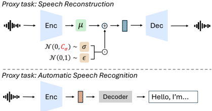

> [!abstract] ICLR · 2026 · Conference
> **Peng et al.** (Microsoft Research) · [→ Paper](https://openreview.net/forum?id=FihSkzyxdv) · Demo: ? · Code: ✓
>
> VibeVoice generates long-form, multi-speaker podcast audio end to end by letting an LLM autoregressively predict continuous 7.5 Hz acoustic latents through a per-token diffusion head, with ASR-aligned semantic features of each generated segment fed back as input to keep content stable over dialogues of up to 30 minutes and four speakers.

## Problem

Zero-shot TTS has become strong for single speakers and short utterances, but podcast-style content needs consistent voices for several speakers over tens of minutes, natural turn-taking, and non-lexical cues such as breaths. Concatenating independently synthesised utterances keeps each turn intelligible but loses conversational coherence, while end-to-end predecessors such as [[2503.14345|MoonCast]] are limited to two speakers and about 10 minutes and are slower than real time. Two practical obstacles stand in the way: codec rates of tens to hundreds of tokens per second make hour-scale contexts very long for an LLM, and existing data pipelines annotate short clips rather than long recordings with speaker turns.

## Method

VibeVoice is a next-token diffusion system in the style of [[2412.08635|LatentLM]]. A [[2412.15115|Qwen2.5]] LLM (1.5B or 7B) reads a prompt that interleaves speaker identifiers with each speaker's voice-prompt latents, then the dialogue script (text only; the prompt transcripts are not included), then a start-of-speech token. At each step the LLM hidden state conditions a 4-layer diffusion head (about 123M parameters in the 1.5B version) that denoises the next continuous acoustic latent with a DDPM noise-prediction objective; the LLM also decides when to emit an end token. Inference uses classifier-free guidance, where the unconditional branch is the hidden state of the start token, with a guidance scale of 1.3 and 10 denoising steps accelerated by DPM-Solver++.

Two separately trained 7.5 Hz tokenizers supply the representations. The acoustic tokenizer is a sigma-VAE (fixed rather than learned variance, to avoid variance collapse under autoregressive modelling) with a mirror-symmetric encoder-decoder of about 340M parameters each; the encoder stacks 7 stages of Transformer-style blocks that use causal depth-wise 1D convolutions instead of self-attention, with six downsampling layers giving 3200x compression of 24 kHz audio. It is trained with DAC-style discriminators and losses. The semantic tokenizer reuses the same encoder design without the VAE and is trained on an ASR proxy task through Transformer decoder layers that are discarded afterwards. During generation, each new segment is decoded to waveform, re-encoded by the semantic encoder, and the input for the next step is a learned sum of the acoustic latent and the semantic feature (the "hybrid" representation). The authors argue the semantic path stabilises long-form generation, and because each segment depends only on history the system is streaming by construction.

Both tokenizers are frozen while the LLM and diffusion head train on about 80B tokens of internal podcast audio, under a context-length curriculum of 4K, 16K, 32K and 64K tokens over 110k steps (the 7B model skips the 64K phase). Training the 1.5B model took about 170 hours on 64 MI300X GPUs. The training data come from an automatic long-form annotation pipeline (Appendix A): Silero VAD segmentation into clips of at most 30 s, Whisper-large-v3-turbo transcription with word timestamps and re-segmentation at sentence-final punctuation, WeSpeaker embeddings with HDBSCAN clustering for diarization, and filtering that discards files whose secondary-ASR disagreement is too high, whose speech covers less than 60% of the duration, or that contain more than four speakers. Speech enhancement is deliberately omitted because the authors observed that it degrades expressive cues such as interjections.

## Key Results

**Human evaluation (Table 1).** 24 raters scored eight LLM-scripted two-speaker podcasts (3 to 15 minutes, mean about 7.3 minutes) on 5-point Realism, Richness and Preference scales. VibeVoice-7B averages 3.76, ahead of Gemini 2.5 Pro preview TTS (3.66), ElevenLabs v3 alpha (3.40), Higgs Audio V2 (2.99) and Sesame CSM (2.89); VibeVoice-1.5B averages 3.54, below Gemini. Standard deviations are around 0.9 to 1.2 on every system, so the 0.10 margin of the 7B model over Gemini is small relative to rater spread, and no significance test is reported. On the objective columns, VibeVoice-1.5B has the lowest Whisper WER (1.11 vs. 1.73 for Gemini) and VibeVoice-7B the highest SIM-O (0.692), while the 1.5B model's SIM-O (0.548) is below [[2412.10117|CosyVoice 2]] (0.68) and Sesame CSM (0.685). A first-phase study with 20 raters (Appendix I, Table 11) had VibeVoice-1.5B ahead of CosyVoice 2 and MoonCast on all six subjective dimensions, including rated similarity to the prompt (3.66 vs. 3.15 and 3.19).

**VibeVoice-Eval (Table 2).** The new benchmark has 108 podcasts from sources outside the training set (28.9 h, 1 to 4 speakers, 1 to 30 minutes). On the short subset (0 to 12 minutes), VibeVoice-7B reaches overall WER 0.66 and SIM-O 0.75, against 4.27 / 0.73 for concatenated CosyVoice 2 and 10.4 / 0.55 for MoonCast, whose three- and four-speaker numbers cover only the generations that succeeded within three retries. On the long subset (12 to 30 minutes), the 7B model keeps WER 1.24 and SIM-O 0.75; MoonCast could only be scored on a 12 to 13 minute two-speaker subset (WER 13.64). The 1.5B model trades speaker similarity for comparable intelligibility (SIM-O 0.57 to 0.60 against 0.73 to 0.74 for concatenated CosyVoice 2).

**Ablations.** With 16K context and the 1.5B model, an acoustic-only input is best for single-speaker clips (WER 1.06) but collapses with more speakers (13.74 at three speakers, 6.22 overall), whereas the hybrid input gives 1.84 overall at SIM-O 0.64 vs. 0.68. A coupled tokenizer that forces one latent to serve both reconstruction and ASR (Appendix B, Table 5) reduces overall WER to 3.55 but drops SIM-O to 0.45 and reconstructs worse (LibriSpeech PESQ 1.92 vs. 2.98, UTMOS 3.3 vs. 4.19, Table 7). Extending the 1.5B training context from 32K to 64K lowers short-subset WER from 2.11 to 1.22 but raises long-subset WER from 1.33 to 1.55. The CFG/step sweep (Figure 3) finds the best WER (1.55) at 10 steps with guidance 1.25, with WER degrading at 5 steps, while SIM-O peaks (about 0.6) at as few as 5 steps and declines slightly with more steps; Appendix J attributes the decline to more denoising steps stripping the prompt's room noise and reverberation.

**Other results.** On SEED (Table 6), VibeVoice-1.5B gets CER 1.16 / SIM 0.744 on test-zh and WER 3.04 / SIM 0.689 on test-en, competitive in Chinese but behind [[2406.02430|Seed-TTS]] (2.25 / 0.762) and Spark-TTS (1.98 WER) in English. The acoustic tokenizer at 7.5 Hz has the best PESQ (3.068 / 2.848) and UTMOS (4.181 / 3.724) on LibriTTS test-clean/test-other in Table 3, beating DAC, EnCodec, [[2308.16692|SpeechTokenizer]] and [[2408.16532|WavTokenizer]] at 40 to 600 tokens/s, but its STOI (0.828 / 0.823) is the second-lowest in the table. On a single A6000 with batch size 1 (Table 8), RTF ranges from 0.62 (1.5B, 1 step) to 0.97 (7B, 10 steps), against 1.43 for MoonCast and 0.72 for Higgs Audio V2 (which generates 3-second chunks in parallel); the LLM dominates per-segment cost (about 48 to 72 ms).

## Novelty Assessment

The central architectural move is applying next-token diffusion over continuous VAE latents to long-form, multi-speaker speech, made tractable by an unusually low 7.5 Hz frame rate. The sigma-VAE and the diffusion head are inherited from the authors' LatentLM work and from MAR-style image generation, and the Qwen2.5 backbone is off the shelf, so much of the system is engineering integration. What is specific to speech is the hybrid input, where an ASR-trained semantic encoder re-reads each generated segment, and this ICLR version backs it with ablations that the [[2508.19205|technical report]] did not include: acoustic-only, coupled and hybrid tokenizers are compared directly on multi-speaker generation, showing why the two-encoder design is needed. The paper also adds a reusable long-form multi-speaker benchmark (VibeVoice-Eval), a context-length comparison, CFG and step sweeps, an inference-cost breakdown, and a documented data pipeline. The training data remain internal, which limits how much of the gain over open baselines can be attributed to architecture rather than data scale.

## Field Significance

> [!tip]
> High — VibeVoice provides a working recipe, with released code and checkpoints, for end-to-end multi-speaker conversational synthesis at the 30-minute scale, and shows that an LLM predicting continuous 7.5 Hz latents through a diffusion head can match or exceed commercial dialogue TTS in a small listening test. VibeVoice-Eval gives long-form, multi-speaker generation a stratified objective test set, and the tokenizer ablations offer direct evidence that semantic feedback, not acoustic latents alone, keeps content stable as speaker count grows.

## Claims

- **supports:** Continuous latent tokenizers at very low frame rates can match or exceed far higher-rate discrete codecs on perceptual reconstruction quality.
  > *Evidence:* The 7.5 Hz sigma-VAE acoustic tokenizer reaches PESQ 3.068 and UTMOS 4.181 on LibriTTS test-clean, above EnCodec and DAC at 400 to 600 tokens/s and WavTokenizer at 75 tokens/s, though its STOI (0.828) trails most baselines, which the authors attribute to unenhanced podcast training data. *(§4.3, Table 3; Appendix D, Table 7)*
- **supports:** In autoregressive generation over acoustic latents, feeding back content-aligned semantic features keeps intelligibility stable as the number of speakers in a long dialogue grows, whereas a single shared latent for content and acoustics sacrifices speaker similarity.
  > *Evidence:* Acoustic-only input reaches WER 1.06 for one speaker but 13.74 for three speakers (6.22 overall); the hybrid input gives 1.84 overall at SIM-O 0.64; a coupled single-encoder tokenizer reaches WER 3.55 but SIM-O 0.45. *(§4.2, Table 2; Appendix B, Table 5)*
- **complicates:** Embedding-based speaker similarity diverges from human similarity judgements in long-form conversational speech, partly because it rewards reproducing the prompt's recording conditions.
  > *Evidence:* Concatenated CosyVoice 2 scores higher SIM-O than VibeVoice-1.5B (0.68 vs. 0.55) while human raters score VibeVoice higher on similarity (3.66 vs. 3.15); SIM-O also falls with more denoising steps as the output loses the prompt's background noise and reverberation. *(Appendix I, Table 11; §4.2, Figure 3; Appendix J, Figure 6)*
- **supports:** Scaling the LLM backbone in an LLM-plus-diffusion-head speech generator improves both perceived quality and speaker similarity.
  > *Evidence:* Moving from 1.5B to 7B raises the average subjective score from 3.54 to 3.76 and, on VibeVoice-Eval Short, lowers overall WER from 2.11 to 0.66 and raises SIM-O from 0.59 to 0.75 at the same 32K context. *(§4.2, Tables 1 and 2)*
- **complicates:** Training on longer contexts does not uniformly improve robustness on longer generations.
  > *Evidence:* Extending the 1.5B model from 32K to 64K training context lowers overall WER on the 0 to 12 minute subset (2.11 to 1.22) but raises it on the 12 to 30 minute subset (1.33 to 1.55). *(§4.1, Table 2)*

## Limitations and Open Questions

The training corpus is an internal podcast collection described only by its token count (about 80B) and processing pipeline, so neither the data nor its language mix can be reproduced, and comparisons with open baselines confound data with architecture. The human study is small: eight LLM-generated two-speaker scripts, rated by 24 listeners, with standard deviations near 1 point and no significance testing; Gemini 2.5 Pro has no SIM-O entry, and the baseline set differs between the main and first-phase studies. Long-form claims are not evaluated past 30 minutes, although the abstract and conclusion mention generation up to 90 minutes while §4.1 states support for up to 30 minutes. MoonCast numbers on three- and four-speaker and long inputs are computed only on successful generations or a shortened subset, which flatters the baseline but also makes the comparison partial. The pipeline caps training data at four speakers and the paper does not discuss overlapping speech. The 1.5B model's speaker similarity on VibeVoice-Eval sits well below a concatenative CosyVoice 2 baseline, so the speaker-identity benefit appears only at 7B scale. The streaming claim rests on causal design and sub-1.0 RTF; first-packet latency is not reported.

## Wiki Connections

- [[autoregressive-codec-tts|Autoregressive Codec TTS]] — Replaces discrete codec tokens with continuous 7.5 Hz VAE latents predicted autoregressively by an LLM, and ablates context length up to 64K tokens.
- [[diffusion-tts|Diffusion TTS]] — Uses a per-token DDPM diffusion head conditioned on LLM hidden states, with ablations of guidance scale and denoising steps.
- [[neural-codec|Neural Audio Codec]] — Contributes a 7.5 Hz continuous acoustic tokenizer evaluated on LibriTTS and LibriSpeech reconstruction, plus a coupled-versus-separate tokenizer comparison.
- [[zero-shot-tts|Zero-Shot TTS]] — Extends voice-prompt cloning to up to four prompted speakers in one long generation, and reports SEED results for short-utterance cloning.
- [[subjective-evaluation|Subjective Evaluation]] — Runs two listening studies (24 and 20 raters) on long podcasts with Realism, Richness and Preference rubrics, and finds human similarity ratings disagreeing with SIM-O.
- [[evaluation-metrics|Evaluation Metrics]] — Introduces VibeVoice-Eval, a 108-podcast benchmark stratified by speaker count and duration, with diarization-based SIM-O assignment.
- [[2508.19205|VibeVoice Technical Report]] — This page is the peer-reviewed ICLR 2026 version of the system first described in that technical report; it adds the VibeVoice-Eval benchmark, the acoustic/hybrid/coupled tokenizer ablations, the 32K vs. 64K context comparison, CFG and step sweeps, an inference cost and RTF breakdown, the data pipeline, and a first-phase 20-rater study.
- [[2412.08635|LatentLM]] — Supplies the next-token diffusion framework and sigma-VAE formulation that VibeVoice applies to speech.
- [[2503.14345|MoonCast]] — Main end-to-end podcast baseline, which crashes on long and multi-speaker inputs and runs slower than real time.
- [[2412.10117|CosyVoice 2]] — Concatenative baseline that keeps strong SIM-O but loses conversational coherence in human ratings.
- [[2406.02430|Seed-TTS]] — Provides the SEED short-utterance test sets and a comparison system there.
- [[2408.16532|WavTokenizer]] — Low-rate single-codebook codec baseline in the reconstruction comparison.
- [[2308.16692|SpeechTokenizer]] — Semantically enriched codec baseline in the reconstruction comparison.
- [[2412.15115|Qwen2.5]] — Pretrained LLM backbone at 1.5B and 7B parameters.
