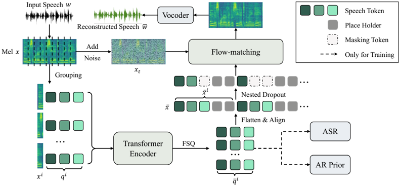

> [!abstract] ICLR · 2026 · Conference
> **Weidong Chen et al.** (The Chinese University of Hong Kong) · [→ Paper](https://openreview.net/forum?id=JbLmIoWwDC) · Demo: ✓ · Code: ?
>
> Replaces frame-wise codec quantization with group-wise tokens ordered from coarse to fine, so a speech LM can first generate a 14 Hz linguistic "backbone" and then fill in acoustic detail, with an RL-trained allocator that drops unneeded fine tokens per group.

## Problem

Speech LMs need codec tokens that carry both high-level cues (content, structure) that are easy to model autoregressively and low-level acoustic detail for perceptual quality. Existing codecs inject semantics through self-supervised or ASR distillation, but they still quantize frame by frame, which the authors argue imposes a locality bias that limits how much high-level information each token can hold. Codecs also spend the same bitrate on every region of an utterance, including silence, which wastes tokens and generation compute. Prior variable-bitrate codecs (VRVQ, TFC) do not jointly optimize bitrate against reconstruction quality and were not tested inside a generative speech LM.

## Method

**Gogo codec.** A 100-bin log-mel spectrogram (24 kHz, hop 256, about 94 Hz) is split into non-overlapping groups of g = 20 frames. Each group is concatenated with n_q = 10 learnable query vectors and passed through a 12-layer LLaMA-style Transformer encoder with asymmetric masking (mel frames cannot attend to queries; each query sees all mel frames of the group and its preceding queries). Only the query outputs are quantized with finite scalar quantization (levels [8, 8, 8, 5, 5], effective codebook 12,800), yielding 10 tokens per group and a 47 Hz token rate from a single codebook. For decoding, each group's 10 token embeddings are padded with placeholders to 20 positions, concatenated over time, and used to condition a 12-layer DiT flow-matching model (following the F5-TTS configuration) that predicts the mel spectrogram; a pretrained Vocos vocoder produces the waveform. Training combines the conditional flow-matching loss with two auxiliary losses on the quantized queries: an ASR module (8-layer Transformer, cross-entropy on transcripts) to inject linguistic content, and a 4-layer AR prior (feature-space MSE on next-token prediction within a group) to encourage sequential predictability.

**Granularity ordering.** Two mechanisms push coarse information into early tokens. Nested dropout samples a retained count n_k uniformly from 1 to 10 and masks the remaining tokens, with a gradient reweighting (w_j = 0.5 / p_j) to compensate later tokens that are rarely retained. A loss balancer linearly shifts weight from the ASR loss toward the flow-matching loss as n_k grows, so short prefixes emphasize linguistic content and longer ones emphasize acoustic detail.

**GogoSpeech.** A two-stage speech LM, with each stage initialized from Llama-3.2-1B-Instruct and its vocabulary extended with Gogo tokens. Stage I takes the text and the first b = 3 tokens of every group of the speech prompt and generates the target's backbone (3 tokens per group, about 14 Hz) group by group. Stage II takes all prompt tokens, previously generated groups, and the current group's backbone, and generates the remaining 7 fine tokens per group. Generated tokens are decoded by Gogo's flow-matching decoder.

**Token allocator.** A 2-layer Transformer with a linear classifier reads each group's 3 backbone tokens and outputs a budget of 0 to 7 fine tokens for Stage II; skipped positions are filled with masking tokens. It is trained from scratch with a modified GRPO: because the action space has only 8 options, all allocations are enumerated and reconstructed with the frozen Gogo, and the reward combines a token-count penalty (weight 0.2) and a mel-distance penalty (weight 1.0). The KL penalty is dropped because there is no reference policy. All components are trained separately on the English subset of Emilia (about 50K hours) on 8 H100 GPUs.

## Key Results

**Reconstruction (Table 1, LibriTTS test-clean).** At 47 tokens per second from one codebook, Gogo reaches UTMOS 4.19, DNSMOS 3.99, STOI 0.92, PESQ 2.59 (WB) / 3.26 (NB), SIM 0.91, and WER 6.35. Against the 50 TPS group (MagiCodec, X-codec2, TAAE, DualCodec, Mimi at 4 codebooks) it has the best DNSMOS, PESQ (WB and NB), SIM, and WER (6.35 vs. 6.40 for X-codec2 and 6.54 for DualCodec). It does not lead every metric: TAAE has higher UTMOS (4.27) and MagiCodec higher STOI (0.93). UTMOS and DNSMOS exceed the ground-truth recordings, which the authors attribute to the generative flow-matching decoder; this also means these non-intrusive scores partly reward denoising rather than fidelity. High-rate DAC and EnCodec at 600 TPS remain better on intrusive metrics.

**Autoregressive modeling difficulty (Table 2).** Training a small LM on token sequences from each position, group-wise tokens have lower perplexity than tokens from a matched 10-layer RVQ frame-wise variant at every position (0.9 vs. 2.3 at position 1; 228.3 vs. 691.4 at position 10). The paper does not state whether the frame-wise sequences in this probe are matched in length to the group-wise ones, which bears on how directly the perplexities compare; the matched-token-rate TTS comparison in Table 10 is the cleaner evidence.

**Zero-shot TTS (Table 3, Seed-TTS test-en).** GogoSpeech gets the highest SIM (0.667) among baselines, with WER 2.394, behind F5-TTS (1.83), FireRedTTS-1S (2.17), and CosyVoice 2 (2.38). On concatenated long-form samples (>10 s) it has the best SIM (0.725) and WER (1.788), while Llasa-8B degrades sharply (WER 5.947). Human ratings (20 listeners, 20 samples) give GogoSpeech the best SMOS (4.381) and CMOS (+1.832 vs. ground truth, Wilcoxon p = 2.7e-3, Table 6). Confidence intervals overlap with CosyVoice 2 and F5-TTS, so the subjective lead over the strongest baselines is not clearly significant.

**Token allocator.** The allocator lowers the average rate from 47 to 36 tokens per second with small losses (SIM 0.667 to 0.662, WER 2.394 to 2.469, SMOS 4.381 to 4.253) and reduces RTF from 0.535 to 0.455 on an H100. F5-TTS (non-autoregressive) remains faster at RTF 0.184.

**Ablations (Tables 7 to 10).** Removing the ASR module barely changes reconstruction but raises GogoSpeech WER from 2.394 to 4.372; removing the loss balancer degrades both reconstruction and TTS (WER 4.608). Backbone size b = 3 to 5 is best; b = 10 (single-stage) gives WER 3.121. Under matched training (Emilia, same token rate, same Llama initialization), a single-stage LM on a frame-wise codec reaches SIM 0.592 / WER 4.117 versus 0.642 / 3.121 for a single-stage LM on Gogo and 0.667 / 2.394 with the two-stage design. GRPO beats DPO for the allocator (WER 2.469 vs. 3.691).

## Novelty Assessment

The core novelty is the codec's tokenization unit: learnable queries summarize a fixed group of mel frames into an ordered set of tokens, with nested dropout and a scheduled ASR/reconstruction loss making the order coarse-to-fine. Query-based 1D tokenization and nested dropout are borrowed from image tokenizers (TiTok, FlexTok) and ALMTokenizer, so the contribution is their combination and adaptation to speech-LM generation rather than a new primitive. The two-stage coarse-then-fine generation is conceptually close to semantic-then-acoustic hierarchies (AudioLM-style), but here both stages read from one codebook whose ordering is learned, and the backbone runs at about 14 Hz. The GRPO allocator is a useful application of RL to adaptive bitrate in a generative pipeline, though it optimizes reconstruction distance under the frozen codec rather than downstream TTS quality. The controlled comparison in Table 10 is the strongest evidence that the gains come from the design and not from data or backbone differences; the cross-system comparisons in Tables 1 and 3 use official checkpoints trained on different data.

## Field Significance

Moderate — The paper shows that changing the quantization unit from frames to ordered groups lets one single-codebook codec serve both as a low-rate (about 14 Hz) planning representation and as a high-fidelity reconstruction target, and that this improves autoregressive TTS stability on long-form speech under controlled conditions. It also demonstrates content-adaptive token budgets inside a generative speech LM rather than only in a compression setting. The design is a new combination of known ingredients evaluated at 1B scale on English only, so it is a solid sub-area advance rather than a shift in direction.

## Claims

- **supports:** Grouping several frames into one quantization unit produces codec tokens that are easier for autoregressive models to predict than frame-wise residual tokens at the same token rate.
  > *Evidence:* An LM trained on per-position token sequences reaches lower perplexity for group-wise Gogo tokens than for a 10-layer RVQ frame-wise variant at every position (Table 2), and under matched Emilia training and Llama-3.2-1B initialization a single-stage TTS LM on group-wise tokens reaches SIM 0.642 / WER 3.121 versus 0.592 / 4.117 on frame-wise tokens. *(§5.2, Table 2; §Appendix K, Table 10)*
- **supports:** Generating a low-rate coarse speech representation first and then conditioning fine acoustic token prediction on it improves stability of codec-LM text-to-speech compared with predicting all tokens in one stage.
  > *Evidence:* With 3 of 10 tokens per group generated in Stage I (about 14 Hz), WER on Seed-TTS test-en is 2.394 versus 3.121 when all 10 tokens are generated in one stage; on concatenated long-form samples GogoSpeech reaches the best WER (1.788) among compared systems. *(§5.4, Table 3; §Appendix K, Table 8)*
- **supports:** Allocating codec token budgets according to local signal complexity can reduce generation cost in speech LMs with only small quality loss.
  > *Evidence:* A GRPO-trained allocator reading each group's backbone lowers the average token rate from 47 Hz to 36 Hz and RTF from 0.535 to 0.455, while SIM drops 0.667 to 0.662 and WER rises 2.394 to 2.469; visualizations show fewer tokens assigned to silent regions. *(§5.5, Table 3; §Appendix L, Figures 9-10)*
- **refines:** Auxiliary linguistic supervision on codec tokens matters more for downstream generation than for reconstruction quality.
  > *Evidence:* Removing the ASR module slightly improves PESQ and SIM for Gogo reconstruction but raises GogoSpeech WER from 2.394 to 4.372; removing the AR prior similarly leaves reconstruction nearly unchanged while degrading TTS. *(§Appendix K, Table 7)*
- **complicates:** Non-intrusive quality predictors can rate codec reconstructions from generative decoders above the original recordings, so they do not measure fidelity to the input.
  > *Evidence:* Gogo's flow-matching decoder yields UTMOS 4.19 and DNSMOS 3.99 against 4.13 and 3.83 for ground truth on LibriTTS test-clean, while its intrusive PESQ (2.59 WB) remains far below high-rate codecs such as DAC at 600 TPS (3.52). *(§5.1, Table 1)*

## Limitations and Open Questions

- The authors note that placeholder tokens in the flow-matching decoder occasionally introduce artifacts *(§6)*.
- The 47 Hz token rate is higher than recent 25 Hz low-rate codecs, and the 14 Hz backbone only covers Stage I; Stage II still generates most tokens *(§6)*.
- GogoSpeech uses a 1B Llama backbone; scaling to larger LMs is untested, and only the English Emilia subset is used for training and evaluation.
- Code availability is not stated in the paper; parameter counts of the codec and allocator are not reported.
- The allocator is trained on reconstruction of ground-truth speech through the frozen codec, yet applied to generated backbones at inference; the mismatch is not analyzed.
- The subjective test is small (20 samples, 20 listeners), and confidence intervals overlap with the strongest baselines (Table 6).
- Reconstruction and TTS baselines are official checkpoints trained on different data, so only the Table 10 comparison is fully controlled.

## Wiki Connections

- [[neural-codec|Neural Audio Codec]] — Introduces a group-wise, granularity-ordered single-codebook speech codec with query-based FSQ tokenization and a flow-matching decoder.
- [[autoregressive-codec-tts|Autoregressive Codec TTS]] — GogoSpeech is a two-stage Llama-based codec LM that generates a 14 Hz backbone before fine acoustic tokens.
- [[zero-shot-tts|Zero-Shot TTS]] — Evaluated on prompt-based zero-shot synthesis on Seed-TTS test-en, including a long-form stability setting.
- [[flow-matching|Flow Matching]] — The codec decoder is a DiT conditional flow-matching model that maps token embeddings to mel spectrograms.
- [[rlhf-speech|RLHF Speech]] — A GRPO-trained policy with automatic fidelity and token-count rewards sets per-group token budgets, and outperforms a DPO-trained alternative.
- [[subjective-evaluation|Subjective Evaluation]] — Reports SMOS and CMOS from 20 human listeners with confidence intervals and Wilcoxon tests.
- [[2505.13000|DualCodec]] — A semantically enhanced low-frame-rate codec used as a 50 TPS reconstruction baseline.
- [[2502.04128|Llasa]] — Single-codebook Llama-based TTS baseline whose long-form WER degrades sharply compared with GogoSpeech.
- [[2412.10117|CosyVoice 2]] — Strong zero-shot TTS baseline with close WER and SMOS.
- [[2025.acl-long.313|F5-TTS]] — Non-autoregressive TTS baseline with the best short-form WER and RTF; its DiT configuration and sway sampling are reused in Gogo's decoder.
- [[2406.02430|Seed-TTS]] — Source of the Seed-TTS test-en zero-shot evaluation set and scripts.
- [[2407.05361|Emilia]] — English subset used to train the codec, both GogoSpeech stages, and the allocator.
- [[2308.16692|SpeechTokenizer]] — Semantic-distillation RVQ codec baseline representing the frame-wise paradigm Gogo departs from.
- [[2410.00037|Moshi]] — Its Mimi codec is a reconstruction baseline at several codebook counts.
