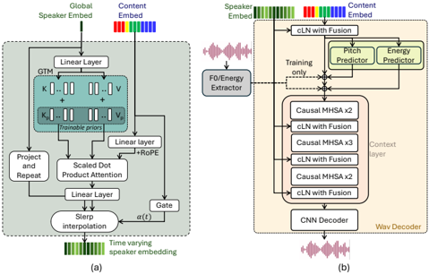

> [!abstract] ICLR · 2026 · Conference
> **Waris Quamer et al.** (Texas A&M University) · [→ Paper](https://openreview.net/forum?id=Tf4Lfw85lS) · Demo: ? · Code: ?
>
> Replaces the static speaker embedding of a streaming voice conversion and speaker anonymization system with a content-synchronous, time-varying timbre stream retrieved frame by frame from a learned timbre memory, improving naturalness at under 80 ms GPU latency.

## Problem

Streaming VC and speaker anonymization systems reach sub-second latency by pairing lightweight causal content encoders with direct waveform decoders, but they inject speaker identity as a single global vector repeated at every frame. The authors argue that this static-dynamic mismatch forces the decoder to reconcile incompatible time scales and produces over-smoothed timbre, especially when articulation, emphasis, or emotion change within an utterance. Prior attempts at attention-based speaker conditioning either use static embeddings (FreeVC), require non-causal inference (GenVC), or are offline-only without learnable speaker prototypes ([[interspeech-2025-0305|DAFMSVC]]). Separately, aggressive content bottlenecks that improve anonymization tend to suppress accent and emotional color or introduce artifacts, as in the authors' earlier [[2509.04667|DarkStream]].

## Method

TVTSyn has four modules operating at a 50 Hz frame clock on 16 kHz audio: a causal content encoder, a speaker processing block that produces time-varying timbre (TVT), causal F0/energy predictors, and a causal waveform decoder.

**Content encoder.** A causal SEANet-style 1-D CNN (strides [8, 5, 4, 2], 320-sample hop) feeds an 8-layer causal multi-head self-attention context stack with a 2 s look-back window and a 4-frame (about 80 ms) masked future context during training; at inference the right context is limited to within-chunk. Instead of a separate look-ahead module (as in DarkStream), the look-ahead is folded into the attention mask, and a ring KV cache maintains the rolling window. The 512-dim output passes through a factorized VQ bottleneck (borrowed from [[2403.03100|NaturalSpeech 3]]): projection to 8 dimensions, a 4096-entry codebook, and projection back to 512. The encoder and bottleneck are trained with cross-entropy against k-means (200 clusters) pseudo-labels from HuBERT-base layer 9, so no transcripts are needed. The content encoder has 37.5M parameters.

**Time-varying timbre.** The global speaker embedding concatenates an X-vector and an [[2005.07143|ECAPA-TDNN]] embedding (pretrained [[2106.04624|SpeechBrain]] models trained on VoxCeleb). This vector is expanded into a Global Timbre Memory (GTM) of K key-value slots (48 in the final model), where each slot is the sum of a speaker-specific MLP output and a learnable prior shared across all speakers. At each frame, the content embedding attends over the GTM keys to retrieve a timbre facet; a gating network predicts a scalar in [0, 1] that sets how far the frame may deviate from the global timbre; and spherical linear interpolation (Slerp) between the global vector and the retrieved facet yields the final per-frame timbre embedding.

**Decoder.** The TVT stream conditions the decoder through conditional layer normalization with fusion: per-frame scale and shift are computed from the timbre embedding, and a gated, normalized copy of the timbre is concatenated before projection. Causal 2-layer CNN predictors for F0 and energy are trained on ground-truth contours and injected at inference. An 8-layer causal MHSA context stack (2 s look-back, no future context) precedes a causal SEANet decoder with transposed-convolution strides [2, 4, 5, 8]. The decoder (48.7M parameters) is trained to reconstruct the input with multi-resolution log-mel L1, multi-period waveform and multi-band spectrogram adversarial losses, feature matching, and F0/energy L2 losses. Both stages train separately for 500k steps on about 600 hours of [[1904.02882|LibriTTS]]. At inference, identity is changed by swapping the global speaker embedding; anonymization uses 28 fixed pseudo-speakers drawn from EMIME.

## Key Results

**Voice conversion (objective).** On ARCTIC, L2-ARCTIC, and VCTK sources converted to EMIME targets, the full model reaches a Tgt-SIM of 0.77 and a Src-SIM of 0.47 (Table 1). The paper notes that 0.77 matches within-speaker similarity of real source utterances, and its source similarity matches between-speaker similarity of real speech (§5.3, Figure 5). NISQA-MOS is 3.91, second to SLT24 (4.01) among streaming systems. Both GenVC configurations show much lower target similarity even though their content encoder is non-causal.

**Ablations.** Removing the TVT block or the VQ step lowers NISQA-MOS to 3.42 or 3.44, and removing both lowers it to 3.179 (§5.3). Neither component materially changes speaker similarity. Within the TVT block, removing the GTM causes the largest drop (3.91 to 3.45), followed by removing the learnable priors (3.62), replacing Slerp with linear interpolation (3.75), and fixing the gate at 0.5 (3.80). Shrinking the memory to 24 or 12 slots also degrades quality slightly. Src-SIM stays at 0.48 in every TVT ablation, so the TVT design affects quality but not privacy (Table 1).

**Listening tests.** With 20 Mechanical Turk listeners per test, TVTSyn obtains a MOS of 3.82, against 3.84 for unmodified source speech, 3.77 for SLT24, 3.63 for GenVC-small, and 3.49 for DarkStream. In an ABX test, listeners chose the target speaker 74.33% of the time, the highest rate among the systems compared, versus 68.00 to 70.67% for the baselines (Table 2).

**Anonymization (VPC 2024).** TVTSyn achieves WER 5.35%, the lowest of the streaming systems (SLT24 5.70%, DarkStream 10.80%, GenVC-small 8.2%). Its lazy-informed EER is 47.55% and its semi-informed EER is 14.57% (Table 3). On privacy, the stronger semi-informed attacker reveals a real trade-off: DarkStream (20.83%) and GenVC-small (15.94%) both have higher semi-informed EER than TVTSyn, so the gain is in utility at comparable or slightly lower privacy, not in privacy itself. Offline VPC 2024 entries reach semi-informed EERs of 33 to 48% with WERs of 2.35 to 8.31%. The authors list these for context only, because those systems are offline and use pseudo-speaker generation. Emotion UAR is 37.32%, which the authors treat as intentional suppression of paralinguistic cues.

**Latency.** With 60 ms chunks, latency is 78.51 ms on GPU (RTF 0.308) and 131.76 ms on CPU (RTF 1.196) (Table 4). DarkStream is slightly faster on raw numbers (76.12 ms GPU), but it also needs a 140 ms encoder look-ahead that this metric does not include. The CPU RTF above 1 at 60 ms chunks means CPU real-time operation requires the larger 100 ms chunk (RTF 0.862).

## Novelty Assessment

The architectural contribution is the speaker processing block: a memory of shared timbre prototypes modulated by the speaker embedding, queried per frame by content, with gated Slerp back toward the global identity. Attention over learned speaker tokens and per-frame conditional normalization have precedents (GenVC's learned queries, DAFMSVC's content-aware modulation, AdaIN/FiLM), but combining them with shared priors and geodesic interpolation in a fully causal pipeline is new, and the component ablations isolate each piece. The rest of the system is incremental over the authors' own SLT24 and DarkStream line: SEANet encoder and decoder, HuBERT-unit distillation, a factorized VQ bottleneck from NaturalSpeech 3, and a look-ahead folded into the attention mask. The evidence that the timbre actually varies meaningfully over time is qualitative (attention maps and PCA trajectories for a single utterance, Figure 4). The quantitative evidence shows a quality gain rather than measured gains in expressivity or accent and emotion retention.

## Field Significance

Moderate — TVTSyn demonstrates that frame-level, content-driven speaker conditioning can raise naturalness in a fully causal VC and anonymization system without changing its privacy profile. This makes speaker-conditioning granularity a concrete design axis for streaming VC. The evidence is a single-lab comparison against largely the same authors' prior systems, with a small listening test and a privacy result that trails DarkStream under the stronger attacker.

## Claims

- **supports:** Replacing a static, utterance-level speaker embedding with frame-synchronous, content-driven timbre conditioning improves the naturalness of streaming voice conversion.
  > *Evidence:* Removing the TVT block drops NISQA-MOS from 3.91 to 3.42; within the block, removing the Global Timbre Memory drops it to 3.45 and removing the shared learnable priors to 3.62. In the human test, TVTSyn's MOS (3.82) is close to unmodified source speech (3.84). *(§5.3, Table 1, Table 2)*
- **refines:** In bottleneck-based voice conversion, the privacy level (residual source-speaker similarity) is set mainly by the content pathway, while the speaker-conditioning design mainly affects synthesis quality.
  > *Evidence:* Src-SIM stays at 0.48 across all TVT ablations and changes little when TVT or VQ is removed, while NISQA-MOS varies from 3.45 to 3.91. *(§5.3, Table 1, Figure 5)*
- **complicates:** Gains in intelligibility and naturalness for streaming speaker anonymization do not necessarily come with stronger privacy against attackers who retrain verification on anonymized data.
  > *Evidence:* TVTSyn has the best WER among streaming systems (5.35% vs. 10.80% for DarkStream) but a lower semi-informed EER (14.57%) than DarkStream (20.83%) and GenVC-small (15.94%), despite a lazy-informed EER near chance (47.55%). *(§5.4, Table 3)*
- **supports:** A discrete low-dimensional VQ bottleneck on self-supervised-unit content features reduces speaker information in the content stream.
  > *Evidence:* t-SNE of content embeddings shows tight per-speaker clusters for continuous encoder outputs that loosen markedly after the bottleneck and VQ bottleneck. Native and non-native accent clusters remain separable, which the authors attribute to accent being partly linguistic. *(§5.1, Figure 3)*
- **supports:** Causal attention with a small future-token mask and a rolling KV cache can replace a separate look-ahead module in streaming voice conversion while keeping latency under 100 ms on GPU.
  > *Evidence:* With 60 ms chunks, TVTSyn's GPU latency is 78.51 ms (RTF 0.308), comparable to DarkStream's 76.12 ms, which additionally needs a 140 ms encoder look-ahead. *(§3.1, §5.5, Table 4)*

## Limitations and Open Questions

- Anonymization uses 28 fixed pseudo-speakers rather than generated pseudo-identities. The authors call this a simplification, and it limits how far the VPC results can be compared with challenge systems (§5.4).
- Under the semi-informed attacker, privacy is weaker than DarkStream and GenVC-small, so the overall privacy-utility improvement depends on how utility and privacy are weighted.
- Listening tests use 20 crowdsourced listeners per test, each rating 15 utterances per system, and the authors acknowledge that larger tests may be needed (§5.3, footnote 7). Objective quality relies on NISQA, a predicted MOS.
- The claim that time-varying timbre preserves expressivity and accent is supported qualitatively (Figure 4) but not with a measured prosody or accent metric. The low emotion UAR (37.32%) shows that, in the anonymization setting, emotional cues are suppressed rather than preserved.
- Training data are English read speech only (LibriTTS). Cross-lingual, noisy, and reverberant conditions are left to future work (§6).
- GenVC is excluded from the latency comparison because its encoder is non-causal, so the latency comparison covers only the authors' own prior systems (§5.5).
- Code and demo availability are not stated in the parsed paper.

## Wiki Connections

- [[voice-conversion|Voice Conversion]] — Proposes a streaming any-to-any VC and speaker anonymization system whose main contribution is per-frame, content-synchronous speaker conditioning.
- [[streaming-tts|Streaming TTS]] — Fully causal chunk-wise synthesis with ring KV caches, measured at 78.51 ms GPU latency with 60 ms chunks.
- [[gan-vocoder|GAN Vocoder]] — The causal SEANet waveform decoder is trained with multi-period and multi-band adversarial discriminators plus feature matching.
- [[self-supervised-speech|Self-Supervised Speech]] — The content encoder is trained to predict k-means units from HuBERT-base layer 9, which makes HuBERT the source of content supervision.
- [[subjective-evaluation|Subjective Evaluation]] — Reports a crowdsourced MOS test and an ABX speaker-verifiability test with 20 listeners each.
- [[2509.04667|DarkStream]] — The authors' prior streaming anonymization system, used as a main baseline. TVTSyn folds DarkStream's separate look-ahead into the attention mask and replaces its static speaker embedding.
- [[2507.14534|Conan]] — Cited as a concurrent chunkwise streaming VC approach that still conditions on a static speaker embedding.
- [[interspeech-2025-0305|DAFMSVC]] — Cited as content-aware speaker modulation that is offline-only and lacks learnable speaker prototypes, which motivates the GTM design.
- [[2403.03100|NaturalSpeech 3]] — Source of the factorized VQ bottleneck design that TVTSyn adopts to reduce speaker leakage in content.
- [[1904.02882|LibriTTS]] — The only training corpus for both the content encoder and the waveform decoder.
- [[2005.07143|ECAPA-TDNN]] — One of two concatenated speaker embeddings that form the global timbre input to the GTM.
- [[2106.04624|SpeechBrain]] — Provides the pretrained X-vector and ECAPA-TDNN speaker encoders, trained on VoxCeleb.
