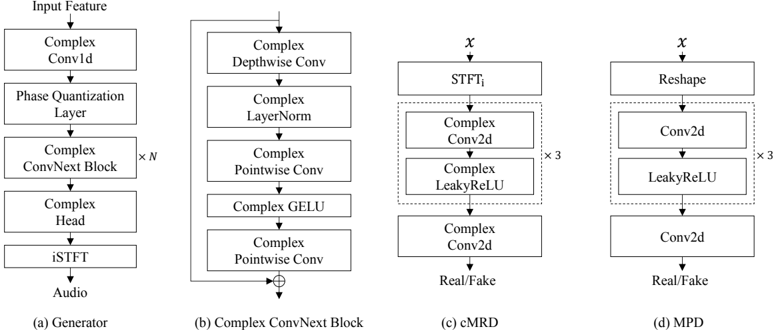

> [!abstract] ICLR · 2026 · Conference
> **Hyung-Seok Oh et al.** (Korea University) · [→ Paper](https://openreview.net/forum?id=U4GXPqm3Va) · Demo: ✓ · Code: ✓
>
> ComVo builds an iSTFT-based GAN vocoder in which both the generator and the spectrogram discriminator use native complex-valued layers, so real and imaginary spectral components are modeled jointly rather than as independent channels.

## Problem

iSTFT-based vocoders such as iSTFTNet and [[2306.00814|Vocos]] predict complex spectrogram coefficients and synthesize the waveform in one inverse STFT, avoiding learned upsampling. Their networks, however, are real-valued: the real and imaginary parts of each coefficient are treated as two unrelated channels, and spectrogram discriminators either see only magnitude or concatenate the two parts as independent inputs. The authors argue this split parameterization cannot directly capture the coupling between the components (equivalently, between magnitude and phase) that defines a complex spectrogram.

## Method

A preliminary experiment motivates the design: on a synthetic 2-D complex distribution, a small complex-valued MLP GAN matches the target magnitude and phase distributions more closely (lower Jensen-Shannon divergence) than a real-valued GAN given twice the hidden width to equalize memory (§3, Table 1).

The generator is adapted from Vocos. A 100-bin mel-spectrogram (24 kHz audio, FFT 1024, hop 256) is cast to a complex tensor with zero imaginary part, passed through a complex Conv1d, then a phase quantization layer, then a stack of 8 complex ConvNeXt blocks (complex depthwise and pointwise convolutions, complex LayerNorm, split GELU), and a complex head whose output feeds the iSTFT directly. The base model has 13.28M parameters.

Phase quantization rewrites each complex feature $re^{i\theta}$ with its phase rounded to one of $N_q$ uniformly spaced levels, keeping the magnitude. A straight-through estimator passes gradients as identity. It is applied once, after the first complex convolution, as a regularizer on the point where the network must invent the imaginary component; $N_q = 128$ is the default.

Adversarial training pairs a real-valued multi-period discriminator (MPD, from HiFi-GAN) on waveforms with a new complex multi-resolution discriminator (cMRD) whose complex Conv2d and complex LeakyReLU layers operate on complex STFTs at three resolutions. Hinge adversarial and feature-matching losses on cMRD outputs are applied separately to the real and imaginary parts and averaged; the total generator loss adds an L1 log-mel reconstruction term (weights 45, 1.0, 0.1 for mel, MPD, cMRD).

For efficiency, every parameterized complex layer is implemented as a single real block-matrix multiplication $\begin{bmatrix} W_r & -W_i \\ W_i & W_r \end{bmatrix}$ applied to the stacked real and imaginary inputs, with a custom autograd function using the transposed block for the backward pass. This replaces four separate real multiplications and shrinks the backward graph. Numerical deviations from native PyTorch complex ops stay below $10^{-5}$ at the model level (Appendix F). Models train for 1M steps on a single NVIDIA A6000.

## Key Results

Copy-synthesis on LibriTTS (Table 2): ComVo has the best objective scores among the vocoders compared, with UTMOS 3.69 against 3.60 for Vocos and 3.52 for BigVGAN, and PESQ 3.82 against 3.63 for Vocos and 3.61 for BigVGAN. MR-STFT, periodicity RMSE, and V/UV F1 also improve. Subjective gains are small: MOS is 4.07 against 4.05 for Vocos and BigVGAN, with ±0.05 confidence intervals that overlap, and CMOS gives Vocos −0.02 relative to ComVo, while ground truth is preferred to ComVo by 0.14. All baselines were retrained on the same LibriTTS splits from official code (an open-source reimplementation for iSTFTNet).

On out-of-distribution MUSDB18-HQ (music stems and mixtures), ComVo again leads on all objective metrics (PESQ 3.52 against 3.28 for Vocos, Table 3). The subjective average is 3.89, essentially tied with BigVGAN at 3.88 (Table 4). When the vocoder is run on Matcha-TTS mel outputs without fine-tuning (Table 8), ComVo reaches the highest UTMOS by a negligible margin (3.4403 against 3.4357 for Vocos) and ties BigVGAN on MOS (3.92).

The ablations carry most of the evidence. Swapping in a complex generator alone (G_C D_R) improves every objective metric over the all-real Vocos configuration, a complex discriminator alone helps MR-STFT and PESQ, and the fully complex setup is best (Table 5). A real-valued generator widened to about 2× parameters (27.05M) to match the complex model's memory footprint still scores below the complex generator on every metric (Table 10). Phase quantization at $N_q = 128$ raises UTMOS and PESQ with a negligible MR-STFT cost (Table 6). Large-scale variants at about 113-115M parameters keep the ordering over BigVGAN and Vocos (Table 19). In Appendix J, ComVo also beats the amplitude-phase vocoders APNet, APNet2, and FreeV retrained under the same setting by large margins (Table 16).

Costs: the block-matrix scheme cuts training time from 183 to 138 hours (25%) and backward-graph nodes by 55% (generator) and 67% (cMRD) with no fidelity loss (Table 7). At inference ComVo runs at 819× real time on GPU, about twice as fast as iSTFTNet but more than 5× slower than Vocos (4658×), and needs 101 MB of weight memory against 52 MB for Vocos (Table 9).

## Novelty Assessment

The architectural contribution is real but narrow. Complex-valued networks are established in speech enhancement and were tried in statistical parametric synthesis, and the generator is Vocos with every layer swapped for its complex counterpart. What is new for neural vocoders is the end-to-end complex adversarial setup (complex generator plus complex discriminator), the phase quantization layer as a complex-domain nonlinearity, and a training-efficiency trick for complex layers. The block-matrix scheme is an implementation-level contribution: it is mathematically identical to standard complex multiplication, and its gain comes from a smaller autograd graph.

The evidence is strongest in the controlled ablations, particularly the memory-matched widened real generator, which addresses the obvious objection that complex layers simply add capacity. The headline subjective comparisons, by contrast, show differences inside the confidence intervals. Evaluation uses a single training corpus (LibriTTS) and 20 crowd raters, and several design choices (split GELU, component-wise hinge losses) are, by the authors' own description, simplifications rather than fully complex designs.

## Field Significance

Moderate — The paper shows that native complex-valued modeling is a viable alternative parameterization for iSTFT-based GAN vocoders, with consistent objective gains that persist under memory-matched and large-scale controls. Because subjective improvements are within noise and inference memory and latency costs rise relative to real-valued iSTFT vocoders, it is best read as evidence that the complex parameterization matters, not as a step change in perceptual quality.

## Claims

- **supports:** Processing complex spectrogram coefficients with complex-valued layers, rather than as independent real and imaginary channels, improves iSTFT-based vocoder quality beyond what equivalent extra capacity in a real-valued network provides.
  > *Evidence:* A complex generator with a real discriminator (13.28M params, 101 MB) beats both the real Vocos-style generator and a real generator widened to 27.05M params at matched memory on UTMOS, MR-STFT, PESQ, periodicity, and V/UV F1 on LibriTTS. *(§5.7, Table 10; §5.3, Table 5)*
- **supports:** Spectrogram discriminators that operate natively on complex STFT coefficients give the generator more structured adversarial feedback than real-valued multi-resolution discriminators.
  > *Evidence:* A cMRD-only model beats an MRD-only model on all objective metrics, swapping the discriminator alone to complex lowers MR-STFT and raises PESQ, and Grad-CAM maps of the complex discriminator follow spectral structure where real-valued ones are diffuse. *(§5.3, Table 5, Figure 3)*
- **refines:** Constraining phase at the point where a vocoder first forms complex features acts as a regularizer that trades a small amount of spectral reconstruction accuracy for perceptual quality.
  > *Evidence:* Phase quantization with 128 levels after the first complex convolution raises UTMOS from 3.66 to 3.69 and PESQ from 3.78 to 3.82, while MR-STFT moves from 0.8435 to 0.8439. Finer quantization gives diminishing returns, and the benefit disappears when the first layer is a real convolution producing two channels. *(§5.4, Table 6; Appendix I, Table 15)*
- **complicates:** Objective-metric gains among modern neural vocoders often do not translate into distinguishable subjective naturalness differences.
  > *Evidence:* ComVo leads every objective metric on LibriTTS and MUSDB18-HQ, but its MOS (4.07 against 4.05 for Vocos and BigVGAN) and MUSDB18-HQ subjective scores fall within ±0.05 to ±0.17 confidence intervals of the strongest baselines, and its TTS-pipeline MOS ties BigVGAN. *(§5.2, Tables 2 and 4; §5.6, Table 8)*
- **complicates:** Complex-valued vocoders carry an inference efficiency penalty relative to real-valued iSTFT vocoders of the same parameter count.
  > *Evidence:* At 13.28M parameters ComVo uses 101 MB of weight memory against 52 MB for Vocos and runs at 819× real time against 4658× for Vocos. Multi-GPU training was under-optimized for complex parameters, with occasional numerical issues, so results are single-GPU only. *(§5.7, Table 9; §6)*

## Limitations and Open Questions

- Perceptual gains are not established: MOS, CMOS, and stem-level subjective scores sit within confidence intervals of Vocos or BigVGAN, so the improvement claim rests mainly on objective metrics and ablations.
- Memory roughly doubles at fixed parameter count, and inference is several times slower than Vocos, the real-valued architecture it is derived from.
- The design is only partially complex: split GELU, component-wise hinge losses on real and imaginary outputs, and a real-valued MPD. The authors leave fully complex activations and losses to future work.
- Training data is LibriTTS only (English read speech); there is no evaluation on other speech corpora beyond the music set, no multilingual evaluation, and the TTS pipeline test uses a single acoustic model (Matcha-TTS) trained on the same corpus.
- Distributed multi-GPU training showed under-optimized performance and occasional numerical issues, which may limit scaling studies.
- Extending complex-domain modeling to diffusion or flow-matching vocoders is proposed but untested.

## Wiki Connections

- [[gan-vocoder|GAN Vocoder]] — Introduces a complex-valued GAN vocoder with a complex multi-resolution discriminator and shows that complex modeling improves an iSTFT GAN vocoder under capacity-matched controls.
- [[subjective-evaluation|Subjective Evaluation]] — Reports MOS, SMOS, and CMOS from 20 crowdsourced native English listeners with attention checks; the small subjective margins contrast with larger objective gains.
- [[evaluation-metrics|Evaluation Metrics]] — Relies on UTMOS, PESQ, MR-STFT, periodicity RMSE, and V/UV F1, where its gains are much clearer than in listening tests.
- [[2306.00814|Vocos]] — Supplies the generator backbone that ComVo converts to complex layers, and serves as the main real-valued baseline and the G_R D_R ablation configuration.
- [[2010.05646|HiFi-GAN]] — Provides the multi-period discriminator ComVo keeps in real-valued form, and is an upsampling-based baseline.
- [[2206.04658|BigVGAN]] — Strongest upsampling-based baseline at both base and large scale; ties ComVo on TTS-pipeline MOS.
- [[1904.02882|LibriTTS]] — Sole training corpus and main speech test set for all vocoders and for the Matcha-TTS pipeline evaluation.
- [[2204.02152|UTMOS]] — Automatic MOS predictor used as the primary objective naturalness metric throughout.
