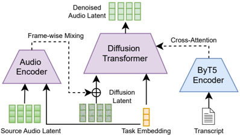

> [!abstract] ICLR · 2026 · Conference
> **Justin Lovelace et al.** (Cornell University / Adobe Research) · [→ Paper](https://openreview.net/forum?id=eLsEjjFODE) · Demo: ✓ · Code: ?
>
> Fine-tunes a pre-trained latent-diffusion TTS model into a multi-task speech processor and composes its tasks at inference time by using the TTS branch as a classifier-free "discriminative guide" rather than averaging generative priors, which lets ASR transcripts steer speech enhancement toward much better content preservation.

## Problem

Generative TTS models benefit from tens of thousands of hours of in-the-wild speech, but speech-to-speech processing tasks (enhancement, speaker separation, foreground/background isolation) need paired degraded and clean recordings that are expensive to collect, so they are usually trained on small simulated corpora. Generative models trained this way tend to hallucinate or distort content and speaker identity, which is exactly what enhancement must preserve. Earlier multi-task speech models (autoregressive codec-LM systems, or broad audio foundation models trained from scratch such as [[2310.00704|UniAudio]]) cover many tasks but do not support principled composition of tasks at inference time, and the score-averaging composition used in prior diffusion work mixes the TTS prior into the enhancement prior and degrades acoustic fidelity.

## Method

SpeechOp is a latent diffusion model operating on 64-channel, 40 Hz continuous latents from a DAC-style autoencoder with a variational bottleneck instead of residual vector quantization (48 kHz audio). The backbone is a 20-layer Diffusion Transformer (419M parameters) trained with a velocity-parameterized denoising objective, a shifted cosine noise schedule, and sigmoid loss weighting. For TTS, the DiT cross-attends to frozen ByT5-base character embeddings of the transcript; 75% of training samples use inpainting (clean prompt prefix or clean start and end around a noised middle), which supports both speaker-prompted zero-shot TTS and speech editing. Output duration at inference is set from the prompt's phones-per-second rate multiplied by the target phoneme count.

For speech-to-speech tasks, a separate 8-layer audio encoder (71M parameters, randomly initialized) encodes the source audio latent, and its outputs are added frame by frame to the noisy diffusion latent rather than injected through cross-attention. A learnable task embedding conditions both the audio encoder and the DiT through adaptive layer norm. Tasks needing a reference (target-speaker separation, acoustic matching) prepend the prompt to both source and noisy latents to keep frame alignment. Training is two-stage: 400K steps of TTS pre-training on MLS English plus LibriTTS, then 200K steps of joint multi-task fine-tuning that samples TTS and speech-to-speech batches equally, with enhancement and speaker separation upweighted 3x. The speech-to-speech data uses LibriTTS-R clean speech with simulated noise, reverberation, EQ, compression, and bandlimiting.

The central inference contribution is Task-Composition Classifier-Free Guidance (TC-CFG). Assuming the transcript is conditionally independent of the noisy source given the latent, the composed score decomposes into the enhancement score conditioned on noisy audio plus a term $\nabla \log p(w \mid z_t)$, which is approximated by the difference between the transcript-conditioned and unconditional TTS scores scaled by a guidance weight. The TTS model therefore contributes only content-discriminating guidance, not its broad acoustic prior. TTS guidance is applied only for logSNR above -1.0, with scale 1.5. Implicit Task Composition (ITC) feeds WhisperX transcripts of the noisy input into this TC-CFG pipeline, so enhancement gains text guidance without any transcript-paired training data. The same mechanism composes enhancement with speaker-prompted TTS for personalized enhancement. Sampling uses SDE-DPM-Solver++(2M) with 256 steps.

![Figure 1: Overview of SpeechOp's multi-task training (top), inference-time task composition capabilities (middle), and implicit task composition pipeline (bottom). The model is trained on six core speech tasks including text-to-speech, enhancement, and separation. At inference time, novel tasks can be composed by combining learned capabilities - for example, using transcripts to guide enhancement or personalizing enhancement with voice samples. In the implicit task composition pipeline, we use a state-of-the-art discriminative model (Whisper) to automatically transcribe noisy speech, then use the resulting transcript to guide SpeechOp's enhancement process.](assets/iclr-2026-eLsEjjFODE/figure-1.png)

## Key Results

**TTS pre-training as initialization.** In single-task pilot models, initializing from the TTS DiT reaches the random-init validation loss in 4x fewer steps for enhancement and 8x fewer for separation; separation WER falls from 17.8% to 8.5% and MCD from 22.95 to 4.46, while enhancement gains are small (PESQ 2.07 to 2.10, identical WER 8.1%) (Figure 2).

**Zero-shot TTS (LibriSpeech test-clean, 3 s prompts, Table 1).** Multi-task fine-tuning improves the same-size TTS baseline on every MOS dimension (MOS-Q +0.22, MOS-N +0.13, voice similarity +0.36, style similarity +0.32) and speaker similarity (0.48 to 0.53), at a small intelligibility cost (WER 3.32% to 3.57%). Against similar-scale systems, SpeechOp has lower WER than [[2406.04904|XTTS]] (4.93%) and CLaM-TTS (5.11%) and beats the larger [[2403.16973|VoiceCraft]] on WER and all MOS scores, but [[iclr-2025-hQvX9MBowC|DiTTo-TTS]] (740M, about 56k hours) remains clearly better (WER 2.56%, SIM 0.62, MOS-N 4.14). Speaker similarity (0.53) trails VoiceCraft (0.61) and DiTTo-TTS. Training data differs across systems (about 45k hours for SpeechOp), so the comparison is not data-controlled.

**Speech editing (RealEdit, Table 2).** SpeechOp outperforms VoiceCraft on all four MOS dimensions (for example MOS-Q 4.15 vs 3.62) with fewer parameters, but it is essentially tied with its own TTS baseline (MOS-Q 4.15 vs 4.18, MOS-VS 4.48 vs 4.45), so multi-task training neither helps nor hurts editing.

**Speech enhancement (Table 3).** Without a transcript, SpeechOp's WER (8.1%) is worse than the noisy input (3.3%) and than the discriminative-leaning HiFi-GAN-2 baseline (5.4%), illustrating the content-hallucination problem. ITC with WhisperX transcripts brings WER to 2.9% (below the noisy input), and adding a clean voice sample of the target speaker lowers it further to 2.4% with PESQ 2.12. HiFi-GAN-2 keeps the best PESQ (2.23) and MCD (4.40). Subjective MOS is effectively tied: ITC 3.89, no-transcript SpeechOp 3.93, HiFi-GAN-2 3.90.

**Speaker separation (Tables 4 and 5).** On human MOS pooled over LibriMix clean, LibriMix noisy, WHAMR!, and WSJ0-2Mix, SpeechOp scores 3.57 without transcripts and 3.92 with gold transcripts versus 3.10 to 3.28 for SepFormer variants. Objective metrics invert this: on WSJ0-2Mix SpeechOp reaches SI-SDRi 0.23 dB versus 11.86 dB for SepFormer, with WER 11.1% (5.5% with gold transcripts) versus 4.4%.

**Composition ablation (Table 6, gold transcripts).** TC-CFG reaches WER 2.1% with PESQ 2.06 and MCD 4.83, while score averaging (TC-Avg) reaches WER 3.4% but degrades PESQ to 1.88 and MCD to 5.24, worse than no guidance. An appendix ablation shows frame-wise mixing beats cross-attention for source-audio conditioning, which fails catastrophically (WER above 100%) on lengths other than its 5 s training clips (Table 10).

## Novelty Assessment

The architectural base is assembled from known parts: a latent DiT TTS model in the lineage of DiTTo-TTS and the authors' earlier Simple-TTS and sample-efficient diffusion TTS work, ByT5 text conditioning, Voicebox-style inpainting, and DiT class-embedding conditioning repurposed as a task embedding. Using a pre-trained TTS model as initialization for speech-to-speech tasks and the frame-wise additive source encoder are sensible engineering choices rather than new ideas in isolation. The genuinely new piece is TC-CFG: deriving, from a conditional-independence assumption, that a TTS model should enter a composed diffusion score as a CFG difference term rather than as a weighted generative prior, and showing (in a 1D toy and on real enhancement) that this avoids the fidelity loss of score averaging. ITC, which plugs off-the-shelf ASR into this guidance, is a clean and practical consequence. The TTS evidence that multi-task fine-tuning improves synthesis is real but modest and comes from one model size and one data mix; the headline enhancement gain is in WER, while signal metrics and MOS stay at parity with a strong GAN baseline.

## Field Significance

Moderate — The paper provides a principled recipe for composing a diffusion TTS model with conditional speech-to-speech generators at inference time, and evidence that TTS knowledge is most useful to restoration tasks as a content guide rather than as an acoustic prior. It also offers a data point that multi-task speech-to-speech fine-tuning can improve, rather than erode, zero-shot TTS naturalness and similarity in a latent diffusion model. Its scope remains English, simulated degradations, and fully overlapped mixtures.

## Claims

- **supports:** Initializing speech-to-speech generative models from a pre-trained TTS model accelerates convergence and improves output quality, with the largest gains on tasks that require separating overlapping content.
  > *Evidence:* TTS initialization reaches random-init validation loss 4x faster for enhancement and 8x faster for target-speaker separation; separation WER drops from 17.8% to 8.5% and MCD from 22.95 to 4.46, while enhancement gains are marginal (PESQ 2.07 to 2.10, unchanged WER). *(§4, Figure 2)*
- **supports:** Multi-task fine-tuning of a TTS model on speech-to-speech processing tasks can improve zero-shot TTS naturalness and speaker similarity rather than diluting it, at a small intelligibility cost.
  > *Evidence:* Relative to its own 419M TTS initialization, the multi-task model gains +0.22 MOS-Q, +0.13 MOS-N, +0.36 MOS-VS, +0.32 MOS-SS, and +0.05 speaker similarity on LibriSpeech test-clean, while WER rises from 3.32% to 3.57%; speech-editing MOS stays at parity with the baseline. *(§8, Table 1, Table 2)*
- **refines:** When composing a text-to-speech diffusion model with another conditional diffusion model, using the TTS model's classifier-free guidance difference as a content guide preserves the other model's acoustic fidelity better than averaging the two scores.
  > *Evidence:* With gold transcripts on enhancement, score averaging lowers WER to 3.4% but worsens PESQ (2.00 to 1.88) and MCD (4.83 to 5.24), while TC-CFG reaches WER 2.1% with PESQ 2.06 and unchanged MCD; a 1D Gaussian mixture simulation shows averaging smears samples toward the TTS prior. *(§6, §8, Table 6, Figure 4)*
- **complicates:** Generative speech restoration models trained on limited paired data can lose linguistic content relative to their own degraded input, so perceptual quality gains do not imply content preservation.
  > *Evidence:* Without transcript guidance, SpeechOp's enhancement output has 8.1% WER against 3.3% for the unprocessed noisy input, despite a MOS of 3.93 versus 1.78; ASR-transcript guidance (ITC) is needed to bring WER to 2.9%. *(§8, Table 3)*
- **complicates:** Signal-level metrics can strongly disagree with human ratings for generative speech separation, ranking generative systems far below mask-based separators that listeners rate lower.
  > *Evidence:* SpeechOp beats SepFormer variants on pooled MOS (3.57 vs at most 3.28) but scores SI-SDRi 0.23 dB versus 11.86 dB and WER 11.1% versus 4.4% on WSJ0-2Mix. *(§8, Table 4, Table 5)*

## Limitations and Open Questions

- Separation is evaluated only on fully overlapping synthetic mixtures (LibriMix, WSJ0-2Mix, WHAMR!); the authors list partial-overlap conversational audio with diarization-assisted, speaker-attributed transcripts as future work.
- Without transcripts, separation WER (11.1%) is far worse than SepFormer (4.4%), and objective separation fidelity is very low, so content and mixture consistency rely heavily on transcript guidance.
- Enhancement training and testing use simulated degradations from LibriTTS-R; robustness to real recordings is not reported.
- ITC inherits ASR errors; the paper argues TC-CFG tolerates them but does not report results stratified by ASR error rate, and guidance only activates above a logSNR threshold chosen empirically.
- The conditional-independence assumption behind TC-CFG is justified only for moderate-to-high SNR regimes.
- TTS comparisons are not data-controlled, and the strongest baseline (DiTTo-TTS) still outperforms SpeechOp on WER, speaker similarity, and every MOS dimension.
- The system is English-only; cross-lingual extension and voice conversion via TC-CFG are proposed but untested. Code availability is not stated.

## Wiki Connections

- [[diffusion-tts|Diffusion TTS]] — Builds a multi-task latent diffusion DiT on top of a diffusion TTS backbone and introduces a CFG-based rule for composing its TTS score with speech-to-speech scores.
- [[zero-shot-tts|Zero-Shot TTS]] — Evaluates 3 s-prompted zero-shot TTS and speech editing and shows multi-task fine-tuning raises MOS and speaker similarity over the TTS-only initialization.
- [[subjective-evaluation|Subjective Evaluation]] — Runs Prolific listening tests with validation-based rater filtering across TTS, editing, enhancement, and separation, and documents large MOS versus SI-SDRi disagreement for generative separation.
- [[iclr-2025-hQvX9MBowC|DiTTo-TTS]] — Supplies DiT design elements (dense connections) and serves as the strongest TTS baseline, which SpeechOp does not match.
- [[2403.16973|VoiceCraft]] — Used as a zero-shot TTS baseline and the main speech-editing baseline; SpeechOp beats it on MOS in both settings with fewer parameters.
- [[2406.04904|XTTS]] — Zero-shot TTS baseline of comparable scale that SpeechOp matches or exceeds on most metrics.
- [[2310.00704|UniAudio]] — Contrasted as a broad-coverage audio foundation model trained from scratch, whereas SpeechOp adapts an existing TTS model and focuses on composition.
- [[2212.04356|Whisper]] — Provides (via WhisperX) the ASR transcripts that drive Implicit Task Composition and the WER evaluation for non-TTS tasks.
- [[2012.03411|MLS]] — Its English portion (about 44k hours) forms most of the TTS pre-training data.
- [[1904.02882|LibriTTS]] — Supplies shorter TTS training utterances alongside MLS.
- [[2304.09116|NaturalSpeech 2]] — Cited as prior evidence that latent diffusion yields high-quality zero-shot synthesis, motivating the diffusion backbone.
