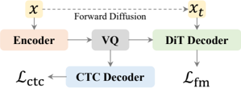

> [!abstract] ICLR · 2026 · Conference
> **Yuancheng Wang et al.** (Meta Superintelligence Labs / The Chinese University of Hong Kong, Shenzhen) · [→ Paper](https://openreview.net/forum?id=llMfmDtWka) · Demo: ✓ · Code: ?
>
> SiTok trains a single-codebook speech tokenizer end to end as a diffusion (flow-matching) autoencoder with a CTC text-prediction regularizer on the quantized latents, reaching 12.5 tokens per second and 0.2 kbps while remaining usable for reconstruction, speech understanding, and autoregressive zero-shot TTS.

## Problem

Speech tokenizers for speech LMs must compress aggressively (few tokens per second), reconstruct speech faithfully, and carry linguistic content that downstream understanding can use. Existing designs trade these off: residual vector quantization or higher frame rates inflate the token budget; acoustically trained codecs carry weak linguistic structure; and diffusion-based tokenizers are typically two-stage, quantizing self-supervised features first and training a separate diffusion decoder afterwards, so the quantizer is never optimized for reconstruction. The authors also report that with deterministic reconstruction losses, scaling data or model size gives diminishing returns at low token rates, which they attribute to the quantized latent being forced to collapse uncertainty.

## Method

SiTok operates on 50 Hz, 128-bin mel-spectrograms, stacking four frames to reach a 12.5 Hz frame rate. A causal Llama-style Transformer encoder (16 layers, hidden size 1536) maps the stacked frames to latents, which an EMA-updated vector quantizer maps to a single 65,536-entry codebook of 32-dimensional codes. A non-causal 16-layer Transformer decoder (a DiT-style decoder with Adaptive RMSNorm for the time-step embedding) reconstructs the mel-spectrogram from the quantized embeddings under a flow-matching velocity objective (the authors call it diffusion). A Vocos-based vocoder converts mel-spectrograms to 24 kHz audio. Encoder, quantizer, and decoder are trained jointly, which distinguishes the design from two-stage diffusion detokenizers.

The key regularizer is a lightweight 4-layer causal CTC decoder attached to the quantized latents and trained to predict the transcript, with weight 0.1 alongside the reconstruction and VQ losses. Unlike semantic distillation toward self-supervised features, or ASR-encoder-based tokenizers, this supervises the discrete space directly with text while the encoder still learns from raw mel input. Training uses 2 million hours of in-house, mostly English multilingual speech at full utterance length for one epoch (about 450K steps). The default L configuration has 1.12B parameters; the scaling study spans 0.63B to 1.61B.

For efficient decoding, the decoder can be fine-tuned with the shortcut-model objective (a flow-matching term plus a self-consistency term over step size), with the encoder and VQ frozen, to support 2 to 4 sampling steps. A light-weight diffusion head (Appendix C.1) runs the first 12 decoder layers once and iterates only the last 4. Two optional refinements improve reconstruction: decoder-only fine-tuning, and token classifier-free guidance enabled by dropping all tokens with 10% probability during training. For generation, a 0.5B autoregressive TTS model initialized from Qwen2.5-0.5B is trained on 100K hours of Emilia to predict SiTok tokens from text, which the diffusion decoder then renders with 16 steps.

## Key Results

On SeedTTS test-en reconstruction (Table 1), single-codebook SiTok at 12.5 Hz and 0.2 kbps reaches WER 4.06, SIM 0.641, and UTMOS 3.44, at a lower bitrate than every listed baseline. Its speaker similarity exceeds all baselines, but its WER trails several higher-rate tokenizers (DualCodec 2.63, X-codec 2 2.63, BigCodec 3.25) and its UTMOS is mid-pack. Decoder fine-tuning raises SIM to 0.682, and token CFG lowers WER to 3.34 and raises UTMOS to 3.60, with a slight SIM drop (0.635). Adding codebooks via RVQ gives WER 3.17 (2 codebooks, 0.35 kbps) and 2.80 (4 codebooks, 0.7 kbps).

The understanding results are the strongest (Table 2). Feeding single-codebook SiTok tokens to a 1B LLM-based ASR gives 4.95 WER on LibriSpeech test-clean, against 16.3 for the GLM-4-Voice tokenizer at the same 0.2 kbps and 23.1 for Mimi at 1.1 kbps. SiTok also scores higher than the listed baselines on DASB emotion recognition, speaker verification, and keyword spotting. Baseline LLM-ASR numbers are taken from prior work, so they were not produced by the authors' own pipeline.

Removing the CTC regularizer is catastrophic at 12.5 Hz, with reconstruction WER rising from 4.06 to 33.0 and LLM-ASR WER from 4.95 to 29.4 (Table 3). The gap narrows as codebooks are added (5.17 vs. 2.80 at 4 codebooks). A CTC weight that is too high (0.5 or 1.0) also hurts reconstruction (WER 8.81 and 10.1, Table 5). Diffusion training beats L1 regression on the same architecture (WER 4.06 vs. 4.66, LLM-ASR 4.95 vs. 6.06), and fine-tuning only a diffusion decoder on top of regression-trained codes does not recover this (WER 5.73). Scaling from 0.63B to 1.61B parameters gives modest reconstruction gains (WER 4.18 to 3.84), while understanding peaks at 1.12B and speaker verification worsens at 1.61B (Table 4). At 6.25 Hz, WER degrades to 23.0. At 25 Hz it improves to 3.05, with SIM 0.688.

Shortcut fine-tuning keeps quality at few sampling steps (Figure 2), with RTFs of 0.041, 0.024, and 0.013 at 16, 8, and 4 steps. In zero-shot TTS (Table 7), SiTok-AR-TTS reaches WER 2.46 and SIM 0.64 on SeedTTS test-en at RTF 0.234 on an A100, compared with CosyVoice 2 (2.89, 0.66, RTF 0.455), Spark-TTS (2.50, 0.57), and Llasa (3.94, 0.58). These baselines differ in training data and model size, so the comparison shows competitiveness, not a controlled tokenizer ablation. VQ outperforms FSQ at the same codebook size (WER 4.06 vs. 5.23, Table 8). The paper reports no human listening tests.

## Novelty Assessment

The main architectural contribution is training a diffusion (flow-matching) decoder jointly with the quantizer and encoder from raw mel input, together with direct CTC supervision of the discrete latents. Each ingredient exists separately: diffusion autoencoders for speech tokenization appear in TaDiCodec (which also reaches very low frame rates but conditions its decoder on text), and ASR supervision of tokenizers appears in Baichuan-Audio and XY-Tokenizer, which however rely on a separate ASR encoder. The combination, and the ablations showing that both joint diffusion training and CTC regularization are needed at 12.5 Hz, are the substantive contribution. Shortcut fine-tuning, token CFG, and the light diffusion head adapt known techniques. The scaling study to 1.6B parameters and 2M hours is useful evidence but uses proprietary data. The headline reconstruction numbers are competitive rather than dominant. The clearest gains are in token-level understanding at an extremely low bitrate.

## Field Significance

Moderate — Demonstrates that a single 12.5 Hz codebook at 0.2 kbps can support reconstruction, LLM-based ASR well beyond prior same-rate tokenizers, and competitive autoregressive zero-shot TTS, provided the tokenizer is trained end to end with a generative decoder and text supervision on the codes. Its ablations isolate why deterministic reconstruction objectives without semantic supervision break down at this compression level. Each ingredient has a precedent (diffusion-autoencoder tokenization in TaDiCodec, ASR supervision of tokens in Baichuan-Audio and XY-Tokenizer), and reconstruction is competitive rather than leading, so the contribution is the combination and its ablations.

## Claims

- **supports:** Explicit text supervision applied directly to the quantized latent space is necessary for speech tokenizers to remain intelligible and linguistically informative at very low token rates.
  > *Evidence:* Removing the CTC regularizer at 12.5 Hz raises reconstruction WER from 4.06 to 33.0 and LLM-based ASR WER from 4.95 to 29.4. The effect shrinks as RVQ codebooks are added (5.17 vs. 2.80 WER at 4 codebooks). *(§3.3.3, Table 3; §3.4, Table 5)*
- **refines:** Semantic regularization of speech tokenizers trades acoustic fidelity against linguistic content, so its weight must be tuned rather than maximized.
  > *Evidence:* Raising the CTC weight from 0.1 to 0.5 or 1.0 increases reconstruction WER to 8.81 and 10.1 and degrades LLM-based ASR (7.87, 8.90), while a weight of 0.02 is also worse than 0.1. *(§3.4, Table 5)*
- **supports:** Training a speech tokenizer end to end with a generative (diffusion or flow-matching) decoder yields better discrete representations than deterministic regression reconstruction, and the benefit cannot be recovered by swapping in a generative decoder afterwards.
  > *Evidence:* The diffusion objective beats L1 regression on reconstruction (WER 4.06 vs. 4.66, SIM 0.641 vs. 0.587) and downstream ASR (4.95 vs. 6.06). Fine-tuning a diffusion decoder on regression-trained codes worsens WER to 5.73. *(§3.4, Table 5)*
- **complicates:** Scaling speech tokenizer capacity improves reconstruction, but not necessarily the usefulness of its tokens for understanding.
  > *Evidence:* Going from 0.63B to 1.61B parameters lowers reconstruction WER from 4.18 to 3.84, but LLM-based ASR is best at 1.12B (4.95 vs. 5.07 at 1.61B) and speaker-verification error rises from 13.8 to 14.7. *(§3.3.4, Table 4)*
- **supports:** Lower speech-token rates directly reduce the inference cost of autoregressive TTS without sacrificing intelligibility.
  > *Evidence:* A 0.5B AR TTS model over 12.5 Hz SiTok tokens reaches WER 2.46 and SIM 0.64 on SeedTTS test-en at RTF 0.234, compared with CosyVoice 2 at 25 Hz (2.89, 0.66, RTF 0.455) and Llasa at 50 Hz (3.94, 0.58, RTF 0.422). *(§Appendix C.2, Table 7)*

## Limitations and Open Questions

- The tokenizer is trained on 2 million hours of in-house data. The paper only promises a future release of inference code and of checkpoints trained on public research-only data, so the reported 2M-hour models are not reproducible from released artifacts.
- The authors acknowledge that the discrete tokens still fall short of continuous feature representations on understanding (§Appendix E).
- The non-causal diffusion decoder makes streaming generation difficult. Chunk-wise autoregressive diffusion is named as future work (§Appendix E).
- Quality is measured only with automatic metrics (Whisper WER, WavLM-based SIM, UTMOS). No human listening test is reported.
- Reconstruction WER at 0.2 kbps remains above several higher-bitrate baselines, and baseline LLM-ASR numbers are copied from prior work, not re-run in the same pipeline.
- The zero-shot TTS comparison is against systems with different training data and model sizes. The paper does not ablate the tokenizer within a fixed TTS setup.
- The training data is multilingual but mostly English, and all evaluation is English. Multilingual behavior is untested.

## Wiki Connections

- [[neural-codec|Neural Audio Codec]] — Proposes a single-codebook 12.5 Hz, 0.2 kbps speech tokenizer evaluated on reconstruction, token-level understanding, and generation.
- [[flow-matching|Flow Matching]] — The tokenizer's decoder is trained with a flow-matching velocity objective and accelerated with shortcut-model fine-tuning to 2 to 4 sampling steps.
- [[autoregressive-codec-tts|Autoregressive Codec TTS]] — Trains a 0.5B autoregressive TTS model over SiTok tokens and shows that the low token rate roughly halves the real-time factor relative to 25 to 50 Hz baselines.
- [[zero-shot-tts|Zero-Shot TTS]] — Evaluates SiTok as the token interface for zero-shot TTS on SeedTTS test-en against CosyVoice 2, Spark-TTS, and Llasa.
- [[2508.16790|TaDiCodec]] — The closest prior diffusion-autoencoder tokenizer. SiTok drops TaDiCodec's text-conditioned decoder so the tokens stay usable for understanding.
- [[2506.23325|XY-Tokenizer]] — A prior ASR-supervised tokenizer. SiTok instead supervises the quantized latents with a CTC head and no separate ASR encoder.
- [[2410.00037|Moshi]] — Its Mimi tokenizer is a 12.5 Hz reconstruction and LLM-ASR baseline that uses semantic distillation, which SiTok replaces with CTC supervision.
- [[2412.02612|GLM-4-Voice]] — Its 12.5 Hz, 0.2 kbps tokenizer is the matched-bitrate LLM-ASR baseline (16.3 vs. 4.95 WER).
- [[2505.13000|DualCodec]] — A strong low-frame-rate reconstruction baseline that beats SiTok on WER at a higher bitrate.
- [[2412.10117|CosyVoice 2]] — A zero-shot TTS baseline at 25 Hz that SiTok-AR-TTS matches on intelligibility at about half the RTF.
- [[2406.14294|DASB]] — Supplies the emotion recognition, speaker verification, and keyword spotting protocol used to probe token quality.
- [[2406.02430|Seed-TTS]] — Supplies the SeedTTS test-en set used for both reconstruction and zero-shot TTS evaluation.
